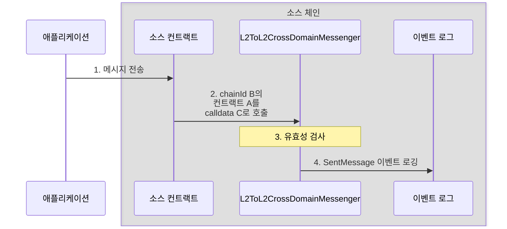
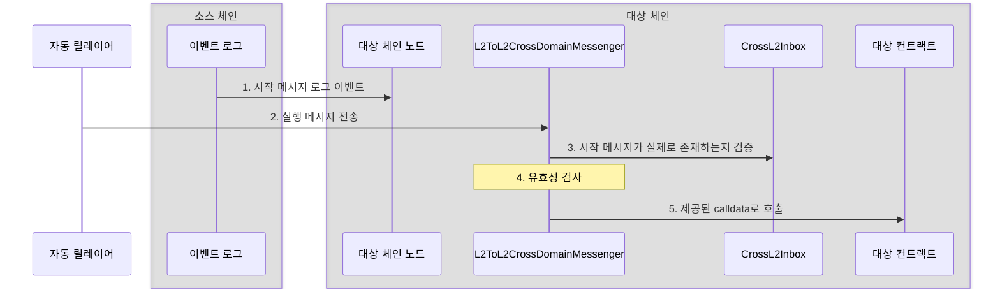

<Info>OP Stack interop은 Lagoon 하드포크와 함께 활성화됩니다.</Info>
<Info>
  이 문서는 interop이 작동하는 방식에 대한 설명입니다.
  단계별 튜토리얼은 [여기](/ko/app-developers/tutorials/interoperability/message-passing)에서 확인할 수 있습니다.
</Info>

저수준 [`CrossL2Inbox`](https://github.com/ethereum-optimism/optimism/blob/develop/packages/contracts-bedrock/src/L2/CrossL2Inbox.sol) 컨트랙트는 기본적인 메시지 실행을 처리합니다. 이 컨트랙트는 시작 메시지(initiating message)가 존재하는지 검증하지만, 메시지의 대상, 처리 상태 또는 기타 속성은 확인하지 않습니다.

[`L2ToL2CrossDomainMessenger`](https://github.com/ethereum-optimism/optimism/blob/develop/packages/contracts-bedrock/src/L2/L2ToL2CrossDomainMessenger.sol) 컨트랙트는 완전한 크로스 도메인 메시징 기능을 제공하여 `CrossL2Inbox`를 확장합니다.

고수준 상호운용성(interoperability)을 위해 두 메시지 모두 각 체인의 `L2ToL2CrossDomainMessenger` 컨트랙트를 사용합니다.

## 시작 메시지

1.  애플리케이션이 소스 체인의 컨트랙트로 트랜잭션을 보냅니다.

2.  컨트랙트가 `L2ToL2CrossDomainMessenger.sendMessage`를 호출합니다.
    이 호출에는 다음 매개변수가 필요합니다.

    *   `_destination`: 대상 블록체인의 chain ID입니다.
    *   `_target`: 해당 블록체인에 있는 컨트랙트의 주소입니다.
    *   `_message`: 실제 메시지입니다.

    이 메시지는 calldata로 `_target`에 제공됩니다. 즉, 함수 selector와 해당 함수 호출의 매개변수를 포함합니다.

3.  소스 체인의 `L2ToL2CrossDomainMessenger`가 메시지가 정당한지 검증합니다.
    *   대상 체인은 이 체인이 메시지를 보낼 수 있는 체인이어야 합니다.
    *   대상 체인은 소스 체인이 *아니어야* 합니다.
    *   대상은 `L2ToL2CrossDomainMessenger`, `L2CrossDomainMessenger` 또는 `L2ToL1MessagePasser`가 아니어야 합니다.

4.  `L2ToL2CrossDomainMessenger`가 로그 항목을 발생시킵니다.
    로그 항목에는 매개변수 외에도 다음이 포함됩니다.

    *   `_nonce`: 메시지가 한 번만 실행되도록 보장하는 [nonce](https://en.wikipedia.org/wiki/Cryptographic_nonce) 값입니다.

    *   `_sender`: 크로스 도메인 메시지를 보낸 컨트랙트입니다.

## 실행 메시지

1.  실행 메시지가 처리되기 전에, 시작 메시지의 로그 이벤트가 7일의 [만료 기간](/ko/app-developers/guides/interoperability/message-expiration)이 지나기 전에 대상 체인의 노드에 도달해야 합니다.

2.  자동 릴레이어(autorelayer), 애플리케이션 또는 애플리케이션을 대신해 호출하는 컨트랙트가 `L2ToL2CrossDomainMessenger.relayMessage`를 호출합니다.
    이 호출에는 전송된 메시지(`_sentMessage`)와 [해당 메시지를 찾는 데 필요한 필드(`_id`)](https://github.com/ethereum-optimism/optimism/blob/develop/packages/contracts-bedrock/interfaces/L2/ICrossL2Inbox.sol#L4-L10)가 포함됩니다.

3.  `L2ToL2CrossDomainMessenger`는 `CrossL2Inbox`를 사용하여 메시지가 소스에서 전송되었는지 검증합니다.

4.  대상 체인의 `L2ToL2CrossDomainMessenger`가 메시지가 정당한지 검증합니다.

    *   `_destination`: 대상 체인의 chain ID입니다.
    *   `_nonce`: 전송된 메시지의 nonce입니다.
    *   `_sender`: 메시지를 보낸 주소입니다.
    *   `_target`: 대상 컨트랙트 또는 지갑 주소입니다.
    *   `message`: 대상을 호출할 때 사용할 메시지 페이로드입니다.

5.  모든 검증을 통과하면 `L2ToL2CrossDomainMessenger`가 메시지에 제공된 calldata로 대상 컨트랙트를 호출합니다.

## 다음 단계

*   [블록체인 간에 메시지를 전달](/ko/app-developers/tutorials/interoperability/message-passing)하는 방법을 알아보십시오.
