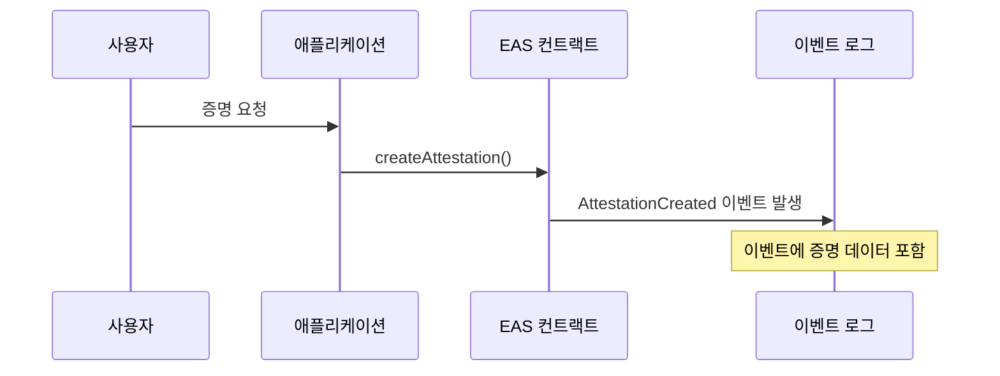
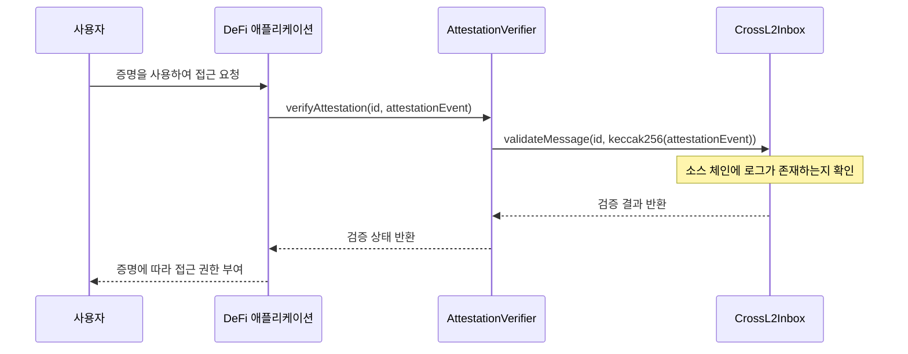
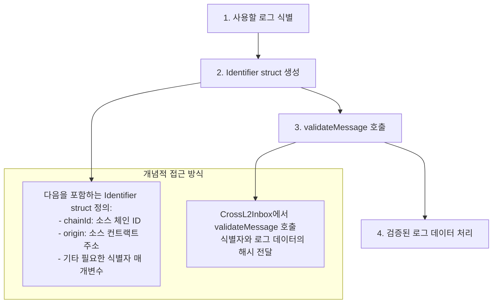
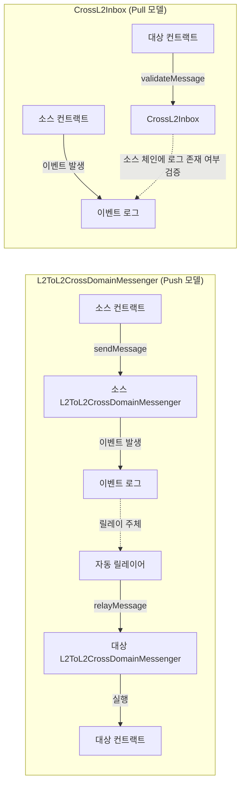

<Info>OP Stack interop은 Lagoon 하드포크와 함께 활성화됩니다.</Info>
OP Stack interop을 사용하면 개발자는 [OP Stack interop cluster](/ko/interop/explainer#superchain-interop-cluster) 내 다른 블록체인의 현재 및 과거 로그를 로컬 체인에서 직접 활용할 수 있습니다.
이를 통해 스마트 컨트랙트는 신뢰를 최소화한(trust-minimized) 방식으로 낮은 지연 시간에 로컬 및 크로스체인 로그를 사용할 수 있습니다.

## 개요

개발자는 [`L2ToL2CrossDomainMessenger`](https://github.com/ethereum-optimism/optimism/blob/develop/packages/contracts-bedrock/src/L2/L2ToL2CrossDomainMessenger.sol)에만 의존하는 대신, [`CrossL2Inbox#validateMessage`](https://github.com/ethereum-optimism/optimism/blob/develop/packages/contracts-bedrock/src/L2/CrossL2Inbox.sol#L76)를 사용하여 `CrossL2Inbox`를 다른 체인 또는 로컬 체인에서 발생한 로그에 대한 oracle로 활용할 수 있습니다.

이를 통해 개발자는 다음을 할 수 있습니다.

*   OP Stack 체인 전반에서 발생하는 이벤트에 반응하는 크로스체인 애플리케이션을 구축합니다.
*   여러 체인의 데이터를 활용하는 새로운 애플리케이션을 만듭니다.

<Info>
로그를 읽을 때는 [7일의 만료 기간](/ko/app-developers/guides/interoperability/message-expiration) 내에 생성된 로그를 참조해야 합니다.
</Info>

## `CrossL2Inbox`를 사용하는 이유

*   **기존 로그 참조**: 컨트랙트가 이미 발생한 로그를 검증하고 사용할 수 있으며, 해당 로그가 크로스체인 메시지로 전송되었을 필요가 없습니다.
*   **신뢰 최소화 보안**: 추가적인 신뢰 가정 없이 기존 OP Stack 보안 모델을 활용합니다.
*   **유연성**: 다른 체인 또는 로컬 체인의 이벤트를 검증하는 데 사용할 수 있습니다.

## 작동 방식

### 아키텍처

이 과정은 OP Stack interop cluster 내 다른 체인의 로그에 대한 oracle 역할을 하는 [`CrossL2Inbox`](https://github.com/ethereum-optimism/optimism/blob/develop/packages/contracts-bedrock/src/L2/CrossL2Inbox.sol#L31) 컨트랙트를 통해 이루어집니다.

1.  `Chain A`의 스마트 컨트랙트가 로그(이벤트)를 발생시킵니다
2.  `Chain B`의 컨트랙트가 로그의 식별자를 사용하여 `CrossL2Inbox#validateMessage`를 호출합니다
3.  `CrossL2Inbox` 컨트랙트가 로그의 진위를 검증합니다
4.  이후 컨트랙트는 검증된 로그 데이터를 사용할 수 있습니다

### 주요 구성 요소

*   **Identifier**: `chainId`, `origin`(컨트랙트 주소) 및 기타 로그 메타데이터를 포함하여 로그에 대한 정보를 담은 struct입니다
*   **[validateMessage](https://github.com/ethereum-optimism/optimism/blob/develop/packages/contracts-bedrock/src/L2/CrossL2Inbox.sol#L79)**: 로그를 사용하기 전에 진위를 검증하는 함수입니다

## 예시: 크로스체인 증명(attestation) 검증

여러 체인에 걸쳐 Ethereum Attestation Service(EAS) 증명을 검증하는 개념적인 예시를 살펴보겠습니다.
EAS는 무엇에 대해서든 온체인 또는 오프체인 증명을 생성하기 위한 OP Stack의 [predeploy](/ko/app-developers/reference/contracts/interop/predeploy)입니다.

### 소스 체인: 증명 생성

소스 체인(예: OP Mainnet)에서 사용자가 EAS를 사용하여 증명을 생성합니다.

1.  사용자가 애플리케이션을 통해 증명 요청을 시작합니다.

2.  애플리케이션이 소스 체인의 EAS(Ethereum Attestation Service) 컨트랙트에서 `createAttestation()` 함수를 호출합니다.

3.  EAS 컨트랙트가 증명 요청을 처리하고 `AttestationCreated` 이벤트를 발생시킵니다.

4.  필요한 모든 증명 데이터를 포함한 이벤트가 체인의 로그에 기록됩니다.

### 대상 체인: 증명 검증

대상 체인(예: Unichain)에서 DeFi 애플리케이션이 이 증명을 검증하려고 합니다.

1.  사용자가 소스 체인에서 생성된 증명을 참조하여 대상 체인의 DeFi 애플리케이션에 접근을 요청합니다.

2.  DeFi 애플리케이션이 증명의 식별자와 이벤트 데이터를 전달하여 증명 검증 컨트랙트의 검증 함수를 호출합니다.

3.  증명 검증 컨트랙트가 증명 식별자와 이벤트 데이터의 해시를 전달하여 `CrossL2Inbox` 컨트랙트의 `validateMessage()`를 호출합니다.

4.  [`CrossL2Inbox`](https://github.com/ethereum-optimism/optimism/blob/develop/packages/contracts-bedrock/src/L2/CrossL2Inbox.sol) 컨트랙트가 지정된 로그가 소스 체인에 존재하는지 확인합니다.

5.  `CrossL2Inbox`가 증명 검증 컨트랙트에 검증 결과를 반환합니다.

6.  증명 검증 컨트랙트가 DeFi 애플리케이션에 검증 상태를 반환합니다.

7.  검증에 성공하면 DeFi 애플리케이션은 검증된 증명을 바탕으로 사용자에게 접근 권한을 부여합니다.

이 접근 방식의 주요 이점은, 다른 체인에 이미 존재하는 증명이 크로스체인 메시지로 명시적으로 전송되지 않았더라도 컨트랙트가 이를 검증할 수 있다는 점입니다.

## 과정 개요

크로스체인 로그 읽기를 구현하는 과정은 다음과 같습니다.

1.  먼저 애플리케이션에서 사용하려는 다른 체인의 로그를 식별합니다.

2.  로그를 발생시킨 chain ID와 컨트랙트 주소를 포함하여 로그에 대한 필요한 모든 정보를 담은 Identifier struct를 생성합니다.

3.  식별자와 로그 데이터의 해시를 전달하여 `CrossL2Inbox` 컨트랙트의 `validateMessage()` 함수를 호출합니다.

4.  검증 후 애플리케이션의 요구 사항에 따라 로그 데이터를 처리합니다.

## 중요 고려 사항

*   이 기능은 [OP Stack interop cluster](/ko/interop/explainer#superchain-interop-cluster) 내의 체인 간에 작동합니다.
*   동일한 기능을 단일 체인에서도 사용할 수 있습니다(예: 일관된 아키텍처를 유지하기 위해).

### 검증 실패 처리

*   검증에 실패하면 `validateMessage` 호출은 전체 트랜잭션을 revert합니다.
*   이러한 실패를 처리하기 위해 애플리케이션 프런트엔드에 try-catch 패턴을 구현하는 것을 고려하십시오.
*   필요한 경우 재시도 메커니즘을 허용하도록 컨트랙트를 설계하십시오.

## `L2ToL2CrossDomainMessenger`와의 비교

| 기능    | L2ToL2CrossDomainMessenger                     | CrossL2Inbox#validateMessage                      |
| ---------- | ---------------------------------------------- | ------------------------------------------------- |
| 목적    | 체인 간 메시지 전송                   | 다른 체인 또는 로컬 체인의 로그 검증      |
| 시작 방식 | 소스가 대상에 명시적으로 메시지를 전송 | 대상이 소스의 기존 로그를 조회 |
| 사용 사례   | 토큰 전송, 작업 트리거               | 증명 검증, 이벤트 참조             |
| 흐름       | Push 모델                                     | Pull 모델                                        |

## 엔드투엔드 흐름 비교

이 다이어그램은 크로스체인 통신을 위한 두 가지 접근 방식을 비교합니다.

### L2ToL2CrossDomainMessenger (Push 모델):

1.  소스 컨트랙트가 `L2ToL2CrossDomainMessenger`의 `sendMessage()`를 호출합니다.

2.  messenger가 이벤트 로그에 이벤트를 발생시킵니다.

3.  자동 릴레이어(autorelayer)가 이벤트를 감지하고 대상 체인으로 릴레이합니다.

4.  대상 `L2ToL2CrossDomainMessenger`가 릴레이된 메시지를 수신합니다.

5.  대상 messenger가 대상 컨트랙트에서 메시지를 실행합니다.

### CrossL2Inbox (Pull 모델):

1.  소스 컨트랙트가 이벤트 로그에 이벤트를 발생시킵니다.

2.  대상 컨트랙트가 `CrossL2Inbox`의 `validateMessage()`를 호출합니다.

3.  `CrossL2Inbox`가 소스 체인에 로그가 존재하는지 검증합니다.

4.  대상 컨트랙트가 검증 결과를 받고 자체 로직을 진행합니다.

## 다음 단계

*   [블록체인 간에 메시지를 전달](/ko/app-developers/tutorials/interoperability/message-passing)하는 방법을 알아보십시오
