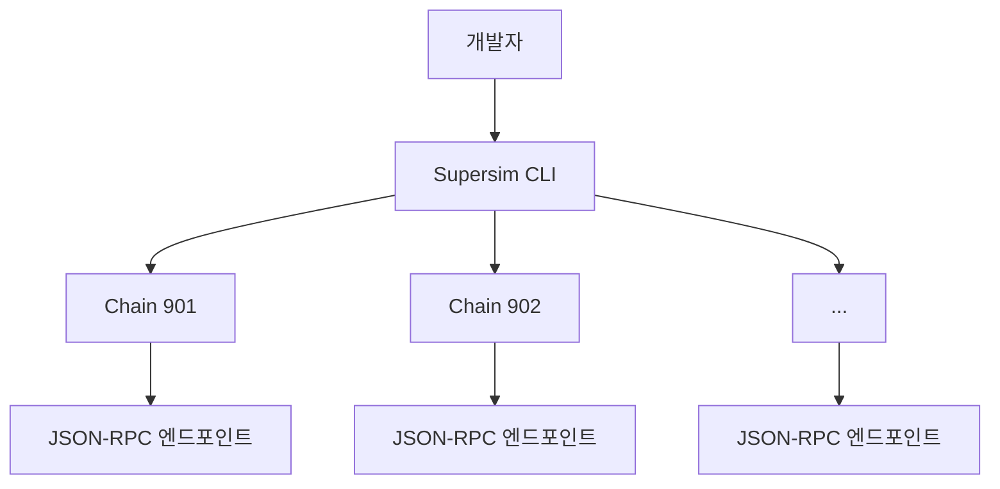

<Info>
  상호운용성(interop)은 현재 활발하게 개발 중이며 아직 프로덕션에서 사용할 준비가 되지 않았습니다. 여기에 제공된 정보는 변경될 수 있습니다. 최신 정보를 확인하려면 정기적으로 다시 방문하십시오.
</Info>

[Supersim](https://github.com/ethereum-optimism/Supersim)은 멀티체인 애플리케이션을 구축하는 개발자를 위해 OP Stack을 시뮬레이션하도록 설계된 로컬 개발 환경 도구입니다. OP Stack 생태계 내 여러 체인과 상호작용하는 애플리케이션을 간편하게 테스트하고 개발할 수 있는 방법을 제공합니다.

## Supersim 워크플로

이 다이어그램은 스마트 컨트랙트 작성부터 크로스체인 상호작용 테스트 및 개선까지, Supersim을 사용하는 개발자의 일반적인 워크플로를 보여줍니다.

## 기능 및 이점

*   여러 OP Stack 체인(예: chain 901, 902)을 로컬에서 시뮬레이션
*   크로스체인 메시징 및 상호작용 테스트 지원
*   사전 배포된 상호운용성 컨트랙트 포함
*   Supersim 인스턴스를 시작하고 관리하기 위한 CLI 인터페이스 제공
*   시뮬레이션된 각 체인에 대한 로컬 JSON-RPC 엔드포인트 제공
*   체인 파라미터의 맞춤 구성 지원
*   크로스체인 토큰 전송과 같은 Superchain 전용 기능의 테스트 지원
*   일반적인 Ethereum 개발 도구와 함께 쉽게 사용 가능 
*   체인 포크 지원

## Supersim CLI 상호작용

이 다이어그램은 개발자가 CLI를 통해 Supersim과 상호작용하는 방식을 보여줍니다. CLI는 로컬에서 실행되는 체인에서 OP Stack 전용 기능(특히 interop)을 시뮬레이션하며, 각 체인은 자체 JSON-RPC 엔드포인트와 사전 배포된 상호운용성 컨트랙트를 갖습니다.

## 다음 단계

*   더 많은 [Supersim 튜토리얼](/ko/app-developers/tutorials/development/supersim/first-steps)을 확인하십시오.
