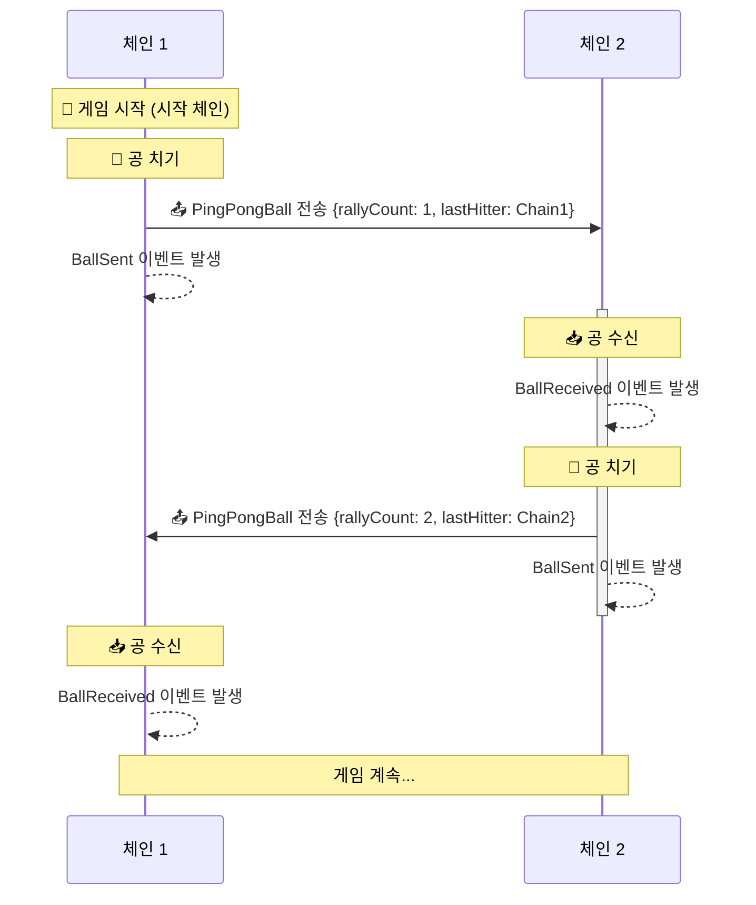

<Info>OP Stack 상호운용성(interop)은 Lagoon 하드포크와 함께 활성화됩니다.</Info>
이 페이지에서는 `CrossChainPingPong.sol` 예제 컨트랙트의 설계와, 이 컨트랙트가 `L2ToL2CrossDomainMessenger`를 통합하여 크로스체인 컨트랙트 호출을 수행하는 방식을 설명합니다. 자세한 내용은 [소스 코드](https://github.com/ethereum-optimism/supersim/blob/main/contracts/src/pingpong/CrossChainPingPong.sol)를 참조하십시오.

## 개요

`CrossChainPingPong.sol`은 `L2ToL2CrossDomainMessenger`를 사용하여 크로스체인 핑퐁 게임을 구현합니다.

*   플레이어는 허용된 L2 체인 사이에서 **가상의 공**을 주고받습니다. 게임은 서브로 시작되며,
*   지정된 시작 체인에서 서브가 이루어지고, 공을 칠 때마다 랠리 횟수가 증가합니다. 컨트랙트는 마지막으로 공을 친 사람의 주소, 체인 ID, 현재 랠리 횟수를 추적합니다.

### 다이어그램



### 흐름

<Steps>
  <Step title="컨트랙트 배포">
  *   참여하는 모든 체인에 배포됩니다.
    *   동일한 파라미터 `_serverChainId`로 CREATE2를 사용하므로, 동일한 주소와 초기 상태를 갖게 됩니다.
  </Step>

  <Step title="공 치기 (시작 동작)">
  *   공을 가진 체인에서 대상 체인을 지정하여 `hitBallTo`를 호출합니다.
    *   컨트랙트는 `L2ToL2CrossDomainMessenger`를 사용하여 지정된 체인으로 공 데이터를 보냅니다.
    *   서브한 체인에서는 공에 대한 참조가 삭제됩니다.
  </Step>

  <Step title="대상 체인에서 수신">
  *   대상 체인의 `L2ToL2CrossDomainMessenger`가 `receiveBall`을 호출합니다.
    *   컨트랙트는 메시지 발신자와 출처를 검증합니다.
    *   공 데이터가 저장되어 공이 이 체인에 있음을 나타냅니다.
  </Step>

  <Step title="게임 계속 (치기)">
  *   현재 공을 보유한 체인의 사용자는 누구나 `hitBallTo`를 호출하여 공을 다른 체인으로 보낼 수 있습니다.
    *   컨트랙트는 `PingPongBall` 데이터를 업데이트합니다(랠리 횟수 증가, 마지막으로 친 사람 업데이트).
    *   2단계부터 과정이 반복됩니다.
  </Step>
</Steps>

## 단계별 설명

다음은 컨트랙트의 함수에 대한 설명이며, 특히 `L2ToL2CrossChainMessenger`와 상호작용하는 방식에 초점을 맞춥니다.

### 컨트랙트 상태 초기화

#### 생성자 설정

```solidity
constructor(uint256 _serverChainId) {
    if (block.chainid == _serverChainId) {
        ball = PingPongBall(1, block.chainid, msg.sender);
    }
}
```

시작 체인인 경우 공을 초기화하여 칠 수 있는 상태로 만듭니다.

#### 크로스체인 일관성을 위한 CREATE2 의존

코드에 명시적으로 언급되어 있지는 않지만, 이 컨트랙트의 설계는 배포 시 CREATE2를 사용한다는 것을 암묵적으로 전제합니다. 이 구성에서 CREATE2가 중요한 이유는 다음과 같습니다.

*   **예측 가능한 주소**:
    CREATE2를 사용하면 모든 체인에서 동일한 주소에 배포할 수 있으며, 이는 크로스체인 메시지 검증에 매우 중요합니다.
    ```solidity
    if (messenger.crossDomainMessageSender() != address(this)) revert InvalidCrossDomainSender();
    ```

*   **자기 참조 메시징**:
    컨트랙트는 다른 체인에 있는 자기 자신에게 메시지를 보냅니다.
    ```solidity
    messenger.sendMessage(_toChainId, address(this), _message);
    ```
    이를 위해서는 `address(this)`가 모든 체인에서 일관되어야 합니다.

*   **초기화 상태 고려 사항**:

    시작 체인 ID는 initcode의 일부이므로, 다른 값으로 배포하면 CREATE2를 통해 다른 주소가 생성됩니다. 이는 주소로부터 시작 체인에 대한 암묵적인 합의가 이루어진다는 점에서 유용한 특성입니다.

    CREATE2가 없다면 다음 작업이 필요합니다.

    *   각 체인의 컨트랙트 주소를 수동으로 추적해야 합니다.
    *   체인 간 컨트랙트 주소를 등록하기 위해 더 복잡한 초기화 프로세스를 구현해야 합니다.
    *   주소 일치에 의존하는 보안 모델을 재설계해야 할 수도 있습니다.

### 공 치기

`hitBallTo`: 이 함수는 공이 있을 때 다른 체인으로 공을 치는 데 사용됩니다.

#### 공 치기 제약 조건

```solidity
function hitBallTo(uint256 _toChainId) public {
    if (ball.lastHitterAddress == address(0)) revert BallNotPresent();
    if (_toChainId == block.chainid) revert InvalidDestination();
    ...
}
```

*   `ball` 컨트랙트 변수가 해당 체인에 채워져 있어 공이 있음을 나타내야 합니다.
*   대상은 다른 체인이어야 합니다.

### 수신 핸들러 정의

```solidity
modifier onlyCrossDomainCallback() {
    if (msg.sender != address(messenger)) revert CallerNotL2ToL2CrossDomainMessenger();
    if (messenger.crossDomainMessageSender() != address(this)) revert InvalidCrossDomainSender();

    _;
}

function receiveBall(PingPongBall memory _ball) onlyCrossDomainCallback() external {
    // Hold reference to the ball
    ball = _ball;

    emit BallReceived(messenger.crossDomainMessageSource(), block.chainid, _ball);
}
```

*   핸들러는 수신한 공에 대한 참조를 저장하기만 합니다.
*   핸들러는 크로스체인 messenger만 호출할 수 있습니다.
*   컨트랙트가 자기 참조 방식이므로, 크로스체인 발신자는 동일한 컨트랙트 주소여야 합니다.

### 크로스체인으로 공 치기

```solidity
function hitBallTo(uint256 _toChainId) public {
    ...

    // Construct a new ball
    PingPongBall memory newBall = PingPongBall(ball.rallyCount + 1, block.chainid, msg.sender);

    // Delete current reference
    delete ball;

    // Send to the destination
    messenger.sendMessage(_toChainId, address(this), abi.encodeCall(this.receiveBall, (newBall)));

    emit BallSent(block.chainid, _toChainId, newBall);
}
```

*   업데이트된 속성으로 새 공을 채웁니다.
*   현재 공에 대한 참조를 삭제하여 더 이상 칠 수 없도록 합니다.
*   (2)에서 정의한 `receiveBall` 핸들러와 일치하도록 대상 체인의 컨트랙트를 호출합니다.

## 핵심 정리

이는 컨트랙트에서 `L2ToL2CrossDomainMessenger`를 사용하여 크로스체인 호출을 구현하는 여러 패턴 중 하나일 뿐입니다. 기억해야 할 핵심 사항은 다음과 같습니다.

*   **단순한 메시지 전달**: 이 설계는 서로 다른 체인에 있는 동일한 컨트랙트 간에 단순한 메시지를 보냅니다. 각 메시지에는 필수 게임 상태(랠리 횟수, 마지막으로 친 사람)만 포함됩니다. 더 복잡한 시스템에는 여러 컨트랙트나 중간 relayer가 포함될 수 있습니다.

*   **크로스체인 발신자 검증**: 크로스체인 메시지의 발신자를 항상 검증하십시오. 여기에는 직접 호출자(messenger)와 소스 체인의 원래 발신자를 모두 확인하는 것이 포함됩니다.

*   **크로스체인 컨트랙트 조정**: 이 설계는 체인 간에 일관된 컨트랙트 주소를 위해 CREATE2를 사용하여 크로스체인 검증을 단순화합니다. 대안적인 접근 방식은 다음과 같습니다.
    *   업그레이드 가능한 컨트랙트를 위한 Beacon proxy 패턴
    *   배포 후 컨트랙트 주소를 지정하는 배포 후 설정 방식
