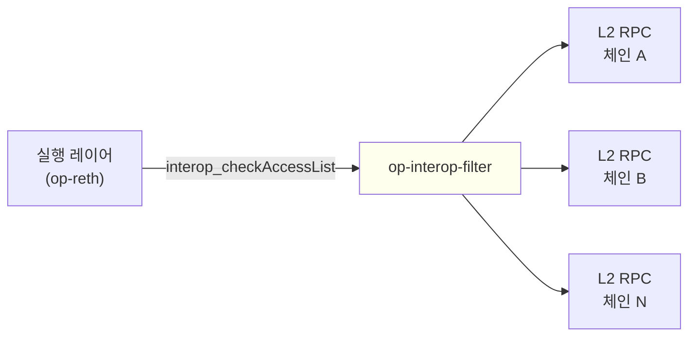

<Info>
  OP Stack interop은 Lagoon 하드포크와 함께 활성화됩니다.
  op-interop-filter는 체인 운영자가 실행 레이어를 위해 interop 트랜잭션을 검증하는 데 실행하는 서비스이며, 여기에서 설명하는 인터페이스는 롤아웃이 진행됨에 따라 계속 변경될 수 있습니다.
</Info>

*op-interop-filter*는 interop 실행 메시지(executing message)를 검증하는 경량 서비스입니다. 이를 통해 실행 레이어(EL) 클라이언트인 op-reth가 유효하지 않은 크로스체인 트랜잭션을 sequencer의 트랜잭션 풀에 도달하기 전에 거부할 수 있습니다.

이 서비스는 EL이 모든 interop 트랜잭션마다 호출하는 `interop_checkAccessList` RPC에 응답하기 위해 체인 운영자가 실행하는 서비스입니다.

## op-interop-filter가 하는 일

interop 트랜잭션은 의존성 집합(dependency set)에 속한 다른 체인의 시작 메시지(initiating message)에 대한 참조로 구성된 *액세스 리스트(access list)*를 포함합니다.
트랜잭션이 유효하려면 참조된 모든 시작 메시지가 실행 체인이 요구하는 안전성 수준(safety level)으로 소스 체인에 존재해야 합니다.

EL은 이 질문에 스스로 답할 수 없습니다.
EL은 설정된 interop 검증 엔드포인트를 JSON-RPC(`interop_checkAccessList`)로 호출하고, 해당 서비스가 트랜잭션의 허용 여부를 결정하도록 합니다.

op-interop-filter는 이러한 서비스 중 하나입니다.
이 서비스는 의존성 집합에 속한 모든 체인의 L2 RPC에 연결하고, 해당 체인의 로그를 로컬 데이터베이스에 수집한 뒤, 그 데이터베이스를 기준으로 `interop_checkAccessList`에 응답합니다.
응답이 부정적이거나 필터가 자체 상태에 대한 신뢰를 잃은 경우 EL은 트랜잭션을 거부합니다.

## interop 배포에서의 위치

op-interop-filter는 interop 체인의 EL과 해당 체인의 의존성 집합에 속한 다른 체인들 사이에 위치합니다.

EL은 op-reth의 `--rollup.interop-http` 플래그를 통해 필터를 가리키며, 각 interop 트랜잭션을 검증하기 위해 필터의 `interop_checkAccessList` 메서드를 호출합니다.

이는 [op-supernode](/ko/op-stack/interop/supernode)가 하는 일과는 다른 역할입니다.
supernode는 합의 레이어(CL)에서 동작합니다. 블록의 크로스체인 의존성이 L1으로부터 재현되었는지 검증한 다음, 체인 자체의 CL을 통해 해당 블록을 *safe*로 승격합니다.
반면 op-interop-filter는 트랜잭션 수용 시점에 동작합니다. 즉, interop 트랜잭션이 애초에 풀에 들어갈 수 있는지 결정하기 위해 실행 레이어가 참조하는 별도의 서비스입니다.
interop 체인을 운영하는 체인 운영자는 두 가지를 모두 실행합니다.

## 페일세이프 동작

op-interop-filter에는 *페일세이프(failsafe)*가 있으며, 이 기능이 활성화되어 있는 동안에는 모든 `interop_checkAccessList` 요청을 `ErrFailsafeEnabled`로 거부합니다.
EL은 이 검사를 기준으로 interop 트랜잭션을 통제하므로, 페일세이프가 활성화되어 있는 동안에는 어떠한 interop 트랜잭션도 수용되지 않습니다.
interop 액세스 리스트 항목이 없는 일반 트랜잭션은 영향을 받지 않으며 정상적으로 계속 처리됩니다.

페일세이프는 다음 두 가지 방식 중 하나로 활성화됩니다.

*   **자동**: 체인 수집기(ingester)가 reorg, 데이터베이스 충돌, 데이터 손상 또는 유효하지 않은 실행 메시지 등의 오류를 보고하거나, 교차 검증기(cross-validator)가 오류를 보고하는 경우입니다.
*   **수동**: 운영자가 admin RPC에서 `admin_setFailsafeEnabled`를 사용하여 활성화하는 경우입니다.

페일세이프가 해제되는 방식은 트리거된 원인에 따라 다릅니다.

*   **수동** 페일세이프는 운영자가 `admin_setFailsafeEnabled`를 `false`로 호출하면 해제됩니다.
    필터는 수동 페일세이프 상태를 `--data-dir`의 `failsafe.json`에 저장하므로, 재시작 후에도 페일세이프가 유지됩니다.
    `--data-dir`이 없으면 재시작 시 수동 페일세이프가 해제됩니다.
    `--failsafe-enabled`는 시작할 때마다 수동 페일세이프를 활성화합니다.
    `failsafe.json`을 읽을 수 없으면 필터가 시작되지 않습니다. `--failsafe-enabled`를 설정하면 이 파일을 무시하고 수동 페일세이프가 활성화된 상태로 시작합니다.
*   **reorg로 트리거된** 페일세이프는 `--reorg-recovery-enabled`가 설정된 경우에만 자동으로 해제됩니다. 이 경우 필터는 영향을 받은 각 체인의 로그 데이터베이스를 최종 확정된(finalized) 블록으로 되돌리고 오류를 해제합니다.
*   수동도 아니고 자동으로 해결되지도 않는 페일세이프(`--reorg-recovery-enabled`가 꺼진 상태의 reorg, 데이터베이스 충돌, 데이터 손상, 유효하지 않은 실행 메시지 또는 교차 검증 실패)는 이를 해제할 admin RPC가 없습니다. `--data-dir`에 있는 `chain-*` 로그 데이터베이스 디렉터리를 삭제하고 서비스를 재시작하여 복구해야 합니다.
    `failsafe.json`은 삭제하지 마십시오. 이 파일을 삭제하면 재시작 후 수동 페일세이프가 해제됩니다.

`admin_setFailsafeEnabled`로 수동 오버라이드를 비활성화해도 오류로 트리거된 페일세이프는 해제되지 않습니다. 근본적인 오류를 먼저 해결해야 합니다.

## 구성

op-interop-filter는 CLI 플래그 또는 이에 대응하는 `OP_INTEROP_FILTER_*` 환경 변수로 구성합니다.
전체 플래그 목록은 [`op-interop-filter/flags/flags.go`](https://github.com/ethereum-optimism/optimism/blob/develop/op-interop-filter/flags/flags.go)에 정의되어 있습니다.

### 필수 플래그

| 플래그 | 설명 |
| --- | --- |
| `--l2-rpcs` | 연결할 L2 RPC 엔드포인트입니다. 필터는 각 엔드포인트에서 체인 ID를 조회하고 로드된 rollup 구성과 대조합니다. |
| `--networks` *또는* `--rollup-configs` | 둘 중 최소 하나가 필요합니다. `--networks`는 superchain registry에서 이름으로 rollup 구성을 로드하고, `--rollup-configs`는 개발 또는 테스트 체인용 사용자 지정 JSON 파일을 로드합니다. |

### 주요 선택 플래그

| 플래그 | 기본값 | 설명 |
| --- | --- | --- |
| `--data-dir` | (임시 디렉터리) | LogsDB와 저장된 수동 페일세이프 상태용 디렉터리입니다. 백필 상태와 수동 페일세이프가 재시작 후에도 유지되도록 프로덕션에서는 영구 경로를 사용하십시오. |
| `--backfill-duration` | `168h` | 시작 시 백필할 기간입니다. `--message-expiry-window` 이상이어야 합니다. |
| `--message-expiry-window` | `168h` (7일) | 이 기간보다 오래된 메시지는 만료된 것으로 처리됩니다. |
| `--poll-interval` | `2s` | 새 블록을 확인하기 위해 L2 RPC를 폴링하는 주기입니다. |
| `--failsafe-enabled` | off | 설정하면 필터가 시작 시 수동 페일세이프를 활성화합니다. admin RPC로 해제할 수 있지만, 다음 시작 시 다시 활성화됩니다. |
| `--reorg-recovery-enabled` | off | 설정하면 필터가 finalized로 되돌려 reorg로 트리거된 페일세이프를 자동으로 해제합니다. |
| `--admin.rpc.addr` | (비활성화) | JWT로 보호되는 admin RPC의 바인드 주소입니다. 설정하면 `--admin.jwt-secret`도 필요합니다. |

### 주의해서 사용해야 하는 플래그

다음 두 플래그는 소스에서 DANGEROUS로 표시되어 있으며, 명확한 운영상의 이유가 있을 때만 사용해야 합니다.

| 플래그 | 동작 |
| --- | --- |
| `--dangerously-enable-passthrough` | interop 필터링 없이 모든 트랜잭션을 통과시킵니다. 모든 실행 메시지 검증을 비활성화합니다. |
| `--support-legacy-check-access-list-format` | 실행 체인 ID가 생략된 `interop_checkAccessList` 요청을 수락합니다. 레거시 클라이언트와의 호환성만을 위한 것이며, 액세스 리스트의 소스 체인 검증은 계속 실행됩니다. |

## RPC 인터페이스

op-interop-filter는 각각 별도로 구성되는 두 개의 HTTP RPC 엔드포인트를 제공합니다.

### Public RPC

`--rpc.addr`(기본값 `0.0.0.0`)와 `--rpc.port`(기본값 `8545`)로 바인딩됩니다.
EL 또는 기타 소비자가 필요로 하는 메서드를 제공합니다.

*   `interop_checkAccessList` — 최소 안전성 수준에서 실행 메시지 액세스 리스트를 검증합니다. EL이 모든 interop 트랜잭션마다 호출하는 메서드입니다.
*   `interop_getBlockHashByNumber` — 체인에서 가장 최근에 수집된 블록 해시 또는 특정 높이의 해시를 반환합니다.
*   `admin_getFailsafeEnabled` — 현재 페일세이프가 활성화되어 있는지 확인하는 읽기 전용 검사입니다.

### Admin RPC

기본적으로 비활성화되어 있습니다.
`--admin.rpc.addr`와 `--admin.rpc.port`(기본값 `8546`)로 바인딩되며, `--admin.jwt-secret`에서 로드한 JWT 시크릿으로 보호됩니다.

admin RPC는 운영자 전용 제어 기능을 제공합니다.

*   `admin_setFailsafeEnabled` — 페일세이프를 수동으로 활성화하거나 비활성화합니다.
*   `admin_getFailsafeEnabled` — public RPC에서도 조회할 수 있는 동일한 상태를 인증된 방식으로 읽습니다.

admin RPC는 운영자 도구용이며 공개적으로 노출해서는 안 됩니다.

## 다음 단계

*   크로스체인 메시징과 실행 메시지 액세스 리스트가 프로토콜 수준에서 어떻게 동작하는지 알아보려면 [interop 설명](/ko/op-stack/interop/explainer)을 읽어보십시오.
*   interop 배포의 합의 레이어 측면(블록 안전성 승격 및 supernode 토폴로지)에 대해서는 [op-supernode 페이지](/ko/op-stack/interop/supernode)를 읽어보십시오.
*   reorg가 크로스체인 메시지 안전성과 어떻게 상호작용하는지에 대해서는 [interop reorg 인식](/ko/op-stack/interop/reorg)을 읽어보십시오.
*   구현 세부 사항은 모노레포의 [op-interop-filter 소스](https://github.com/ethereum-optimism/optimism/tree/develop/op-interop-filter)를 참조하십시오.
