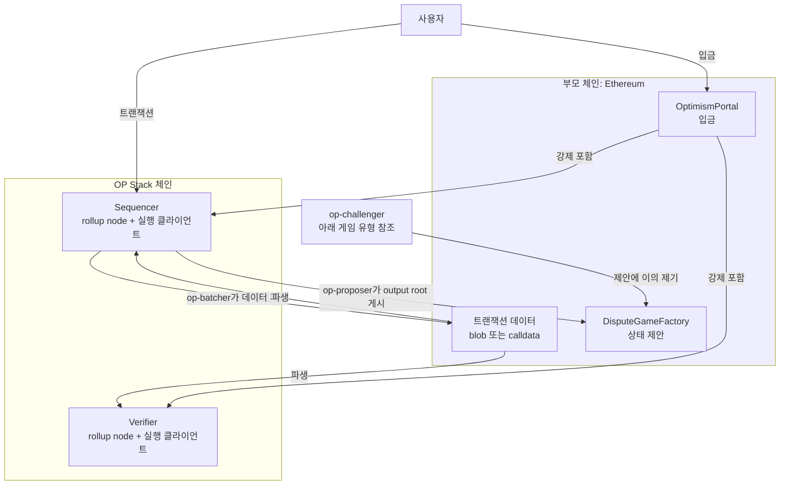
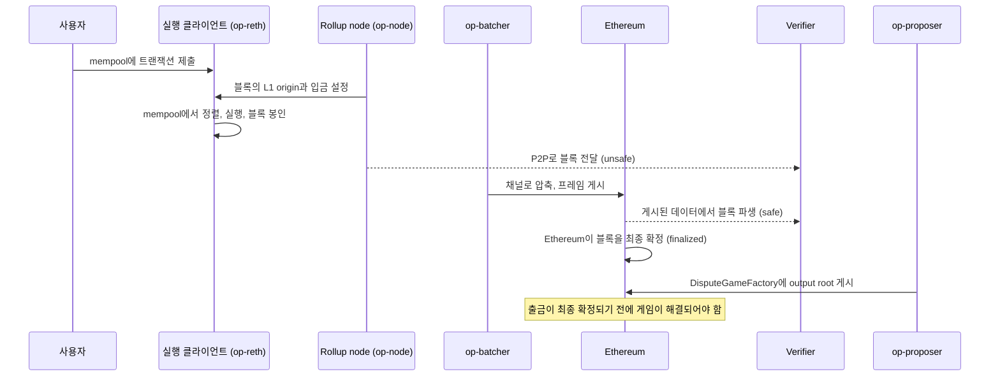

import { NormativeSpec } from "/ko/snippets/normative-spec.mdx"

<NormativeSpec
  what="OP Stack 프로토콜 동작"
  title="Optimism 개요 사양"
  href="https://specs.optimism.io/protocol/overview.html"
  note="이 페이지는 시스템이 어떻게 맞물려 동작하는지 설명하며, 사양을 다시 서술하지 않습니다."
/>

<Info>
  **OP Stack 배우기 — 14단계 중 2단계.**
  OP Stack이 무엇이며 무엇을 구동하는지 이미 알고 있습니다. 이 페이지에서는
  시스템 관점을 더합니다. 구성 요소, 각 구성 요소의 운영 주체, 그리고 트랜잭션이
  이들을 거쳐 이동하는 방식을 다룹니다. 다 읽은 후에는
  [설계 철학 및 원칙](/ko/op-stack/protocol/design-principles)으로 이어서 진행하십시오.
</Info>

OP Stack 체인은 *옵티미스틱 rollup*입니다. 자체 네트워크에서 트랜잭션을 실행하고,
그 데이터를 부모 체인(parent chain)에 게시하며, 각 상태를 미리 증명하는 대신
결과 상태에 대한 주장에 누구나 이의를 제기할 수 있도록 합니다.
따라서 OP Stack 체인은 *파생된(derived)* 체인입니다. 정식(canonical) 이력은 부모 체인에
게시된 데이터로 정의되며, 시스템의 나머지 모든 부분은 그 데이터를 생성하거나,
데이터를 다시 블록으로 변환하거나, 부모 체인에 그 결과를 납득시키기 위해 존재합니다.
이 단 하나의 속성이 아키텍처 대부분을 설명합니다.

이 페이지는 시스템 관점의 설명입니다. 구성 요소의 이름을 밝히고, 각 구성 요소를 누가
운영하는지 설명하며, 하나의 트랜잭션이 모든 구성 요소를 거치는 과정을 따라가고,
신뢰가 실제로 어디에 놓이는지 표시합니다. 각 섹션은 세부 내용을 반복하지 않고 해당
내용을 담당하는 페이지로 연결되며, 여기서 소개하는 용어는
[용어집](/ko/op-stack/reference/glossary)에 정의되어 있습니다.

이 페이지의 예시는 표준 구성의 체인을 기준으로 합니다. 즉, 데이터 가용성(data availability)에
Ethereum을 사용하고 무허가(permissionless) 결함 증명(fault proof)을 사용합니다. 두 가지 모두
구성 가능하며, 아래 섹션에서 다른 선택을 하면 답이 달라지는 부분을 표시합니다.

## 전체 구조

두 개의 체인이 관여합니다. *부모 체인*은 보통 Ethereum이며, L2의 트랜잭션 데이터를
저장하고 그 상태를 정산하는 컨트랙트를 보유합니다. *rollup*은 블록을 빠르고 저렴하게
생성하며, 자신이 수행한 모든 것을 다시 부모 체인에 게시합니다.

보안 논증의 대부분은 두 개의 연결선이 담당합니다. **파생(derivation)**은 sequencer와
모든 verifier에서 동일하게 실행되므로, Ethereum만 읽는 verifier도 sequencer가 구축한 것과
같은 체인에 도달합니다. **강제 포함(forced inclusion)**은 sequencer도 다른 모든 참여자와
동일한 입금(디파짓) 규칙을 따르도록 강제합니다. 그래서 sequencer가 무시하고 싶어 하더라도
입금은 반영됩니다. [파생 파이프라인](/ko/op-stack/protocol/derivation-pipeline)을 참조하십시오.

## 참여자와 각 구성 요소의 운영 주체

OP Stack은 하나의 프로그램이 아니라 별도의 서비스들의 집합입니다.

| 구성 요소 | 역할 | 운영 주체 | 없으면 어떻게 되는가 |
| --- | --- | --- | --- |
| [op-node](/ko/op-stack/components/op-node) 또는 [kona-node](/ko/op-stack/components/kona-node) | 합의 계층. 각 블록의 L1 origin과 입금을 설정하고, L1에서 체인을 파생합니다 | 운영자(sequencer), 누구나(verifier) | 블록이 생성되거나 파생되지 않습니다 |
| [op-reth](/ko/op-stack/components/op-reth) | 실행 계층. mempool을 보유하고, 트랜잭션을 정렬 및 실행하며, 상태를 보유합니다 | rollup node를 운영하는 주체, node당 하나 | 상태 전이가 일어나지 않습니다 |
| [op-batcher](/ko/op-stack/components/op-batcher) | L2 트랜잭션 데이터를 DA 계층에 게시합니다 | 운영자 | safe head가 더 이상 진행되지 않으며, 체인을 파생할 수 없습니다 |
| [op-proposer](/ko/op-stack/components/op-proposer) | output root(L2 상태에 대한 커밋먼트)를 L1에 게시합니다 | 운영자, 또는 무허가 체인에서는 누구나 | 새로운 출금을 증명할 수 없습니다 |
| [op-challenger](/ko/op-stack/components/op-challenger) | 유효하지 않은 제안에 이의를 제기하고, 유효한 제안을 방어합니다 | 운영자, 또는 무허가 체인에서는 누구나 | 유효하지 않은 제안이 이의 제기 없이 통과됩니다 |
| [op-conductor](/ko/op-stack/components/op-conductor) | sequencer 클러스터 전체의 리더 선출 | 운영자(선택 사항) | sequencer 장애 시 수동 장애 조치(failover) 전까지 블록 생성이 멈춥니다 |
| [op-deployer](/ko/op-stack/components/op-deployer) | 체인의 L1 컨트랙트를 배포합니다 | 운영자 | L1에 컨트랙트가 없으므로 체인도 없습니다 |

합의 클라이언트와 실행 클라이언트는 일대일로 쌍을 이루어 실행되며, Engine API로
연결됩니다. 합의 역할에는 Go로 작성된 op-node와 Rust로 작성된 kona-node라는 두 가지 구현이
있으며, 이것이 이 계층에서의 클라이언트 다양성입니다.
배포된 컨트랙트의 업그레이드는 op-deployer를 거치지 않습니다.
[컨트랙트 업그레이드](/ko/op-stack/protocol/smart-contracts#upgrading-the-contracts)를 참조하십시오.

보안 논증은 **verifier**에게 특권이 없다는 점에 기반합니다. 누구나 rollup node와
실행 클라이언트를 함께 실행하여 Ethereum에서 체인을 파생하고, 데이터가 뒷받침하지 않는
내용을 게시한 sequencer를 탐지할 수 있습니다. *제안과 이의 제기*도 똑같이 개방되어 있는지는
체인에 구성된 게임 유형에 따라 다르며, 이는 [무허가와 특권](#permissionless-and-privileged)에서
다룹니다.

## 트랜잭션의 생애

아래 순서는 Ethereum DA를 사용하는 체인에서 하나의 트랜잭션이 모든 구성 요소를 거치는
과정을 따라갑니다. 이는 구성 요소 관점의 설명입니다. 최종성 라벨의 의미와 각 단계에
걸리는 시간은 [트랜잭션 최종성](/ko/op-stack/transactions/transaction-finality)을
참조하십시오.

| 단계 | 구성 요소 | 수행 작업 | 결과 |
| --- | --- | --- | --- |
| 1 | 실행 클라이언트 | 트랜잭션을 mempool에 받아들입니다 | 대기 중(Pending) |
| 2 | Rollup node | 블록의 L1 origin을 확정하고 이번 epoch에 처리할 입금을 앞에 추가합니다 | 입금 접두부 설정 |
| 3 | 실행 클라이언트 | mempool에서 나머지 트랜잭션을 선택하고 실행한 뒤 블록을 봉인합니다 | 순서 결정, 새로운 state root |
| 4 | Rollup node | 블록을 피어에 전달합니다 | Verifier가 **unsafe**로 인식 |
| 5 | op-batcher | 블록을 채널로 압축하고, 프레임으로 분할하여 DA 계층에 게시합니다 | DA 계층에서 데이터 사용 가능 |
| 6 | Verifier rollup node | sequencer와 독립적으로, 게시된 데이터에서 블록을 파생합니다 | 블록이 **safe** 상태 |
| 7 | Ethereum | 데이터를 담은 블록을 최종 확정합니다 | 블록이 **finalized** 상태 |
| 8 | op-proposer | 일정 간격으로 `DisputeGameFactory`에 output root를 제출하여 분쟁 게임(dispute game)을 생성합니다 | 출금 증명의 기준이 되는 주장 |
| 9 | op-challenger | 자체적으로 동기화된 node와 제안을 비교하고, 잘못된 경우 반박합니다 | 게임이 제안에 유리하거나 불리하게 해결됨 |

sequencer의 mempool은 L1 Ethereum의 공개 mempool과 달리 비공개이므로, 공개된 대기 트랜잭션
풀이 만들어내는 MEV 기회가 제한됩니다.

순서는 rollup node가 아니라 실행 클라이언트가 결정합니다. 블록 생성 시점에 rollup node가
하는 일은 프로토콜이 요구하는 것, 즉 L1 origin과 해당 epoch의 입금을 확정하는 것이며,
나머지는 실행 클라이언트의 mempool에 맡깁니다.

1~5단계는 체인 운영자가 실행하므로 sequencer가 올바르게 동작하는지에 의존합니다.
6단계에서 그 의존이 끝납니다. 데이터가 DA 계층에 게시되면 블록의 순서는 sequencer의
선의가 아니라 해당 계층에 의해 고정됩니다.
[Subblocks](/ko/op-stack/features/subblocks)를 스트리밍하는 체인에서는 애플리케이션이 제출 후
약 200밀리초 이내, 즉 4단계보다 훨씬 이전에 사전 확인(preconfirmation)에 따라 동작할 수 있습니다.
이 간격은 보장이 아니라 목표치입니다.

8단계와 9단계는 자체 일정에 따라 진행되는 별도의 트랙입니다. proposer는 트랜잭션마다 한 번씩이
아니라 여러 블록을 포괄하는 구성된 간격마다 게시하며, 기본적으로 최종 확정된 L2 상태만
제안합니다. 이 단계들은 출금을 위한 것이며, 체인을 진행시키지 않습니다.

제안은 자동으로 실행되지 않습니다. 제안을 기준으로 증명된 출금이 최종 확정되려면 먼저
해당 분쟁 게임이 제안에 유리하게 해결되어야 하며, 그 이후의 기간 동안에도 Guardian이 여전히
조치를 취할 수 있습니다. 출금의 증명과 최종 확정은 별개의 단계이며,
[출금 흐름](/ko/op-stack/bridging/withdrawal-flow)에서 설명합니다.

트랜잭션은 L1에서 진입할 수도 있습니다. 사용자가 `OptimismPortal`에 입금을 제출하면
파생 규칙 자체에 의해 L2에 포함되며, 이것이 입금이 검열 저항성을 갖는 이유입니다.
[입금 흐름](/ko/op-stack/bridging/deposit-flow)과
[강제 트랜잭션](/ko/op-stack/transactions/forced-transaction)을 참조하십시오.

## 데이터가 저장되는 위치와 신뢰 대상

부모 체인에는 세 가지 서로 다른 것이 게시되며, 이들을 혼동하는 것이 rollup 보안에 대한
가장 흔한 오해의 원인입니다.

| 게시되는 것 | 컨트랙트 또는 위치 | 얻는 것 |
| --- | --- | --- |
| 트랜잭션 데이터 | DA 주소의 blob 또는 calldata | 누구나 sequencer 없이 체인을 재구성할 수 있습니다 |
| 입금 | `OptimismPortal` | L1이 L2에 트랜잭션을 강제로 넣을 수 있습니다 |
| Output root | `DisputeGameFactory` | L1이 출금을 위해 L2 상태를 인증할 수 있습니다 |

*output root*는 특정 블록 시점의 L2 체인 전체 상태에 대한 커밋먼트이며, 블록의 state root만을
의미하지 않습니다. 출금 증명은 이 output root를 기준으로 검증됩니다. 관련 컨트랙트는
[OP Stack 스마트 컨트랙트](/ko/op-stack/protocol/smart-contracts)에서 설명합니다.

트랜잭션 데이터는 체인을 *파생 가능*하게 만듭니다. Output root는 체인을 *정산 가능*하게
만듭니다. 데이터는 게시하지만 output root를 게시하지 않는 체인은 여전히 누구나 검증할 수 있는
체인이지만, 아무도 출금할 수 없습니다. output root는 게시하지만 데이터를 게시하지 않는 체인은
검증이 불가능하며, 그 제안도 확인할 수 없습니다.

트랜잭션이 오래될수록 신뢰 경계가 이동합니다. 데이터가 게시되기 전에는 사용자가 sequencer가
트랜잭션의 순서를 바꾸거나 누락시키지 않을 것이라고 신뢰합니다. 게시된 후에는 DA 계층을
신뢰합니다. 결함 증명 시스템은 세 번째 행만 관장합니다. 즉, L2 상태에 대한 주장이 L1에서
받아들여지는지를 결정하며, L2 체인의 순서를 바꾸지는 않습니다. 패배한 제안은 체인에 대한
주장을 제거할 뿐, 체인을 롤백하지 않습니다.
[결함 증명 설명](/ko/op-stack/fault-proofs/explainer)을 참조하십시오.

## 토폴로지 옵션

계층화된 설계 덕분에 여러 선택을 체인이 직접 할 수 있습니다. 일부는 나중에 변경할 수 있고,
일부는 genesis 시점에 고정됩니다.

*   **표준 체인.** 데이터 가용성에 Ethereum, gas에 ETH를 사용하고, 거버넌스를 통해
    업그레이드합니다. 이는
    [blockspace charter](/ko/op-stack/protocol/blockspace-charter)가 정의하는 것이며,
    상호운용성(interoperability)과 공유 도구가 전제로 하는 구성입니다.
*   **사용자 지정 데이터 가용성.** Ethereum blob 대신 [Alt-DA](/ko/op-stack/features/experimental/alt-da-mode)
    계층을 사용합니다. 비용이 더 저렴하며, 체인의 보안은 Ethereum이 아니라 해당 계층의
    가용성 보장에 좌우됩니다. 이 기능은 실험적이며, 이를 사용하면 누구나 Ethereum에서 체인을
    재구성할 수 있다는 주장이 더 이상 성립하지 않습니다. L1에는 커밋먼트만 도달합니다.
*   **사용자 지정 gas 토큰.** ETH 대신 [사용자 지정 gas 토큰](/ko/op-stack/features/custom-gas-token)을
    네이티브 수수료 자산으로 사용합니다. genesis 시점에 구성되며 마이그레이션 경로가 없습니다.
    기존 체인은 하드포크를 조율해야 합니다.
*   **상호운용 클러스터.** 공유 종속성 집합(dependency set)에 속한 체인들이 낮은 지연 시간으로
    메시지를 교환합니다. 현재 활발히 개발 중입니다.
    [상호운용성 설명](/ko/op-stack/interop/explainer)을 참조하십시오.

데이터 가용성 선택은 구성 변경이기 이전에 보안 결정입니다. 해당 계층이 체인을 애초에 파생할 수
있는지를 결정하기 때문입니다. 교체 가능한 요소를 계층별로 살펴보려면
[OP Stack 구성 요소](/ko/op-stack/protocol/components)를 참조하십시오.

## 무허가와 특권

**모든 OP Stack 체인에서 누구나** 검증 node를 실행하여 DA 계층과 대조해 체인을 확인할 수 있고,
`OptimismPortal`을 통해 입금을 제출할 수 있으며, 출금을 뒷받침하는 제안이 해결되면 출금을
증명하고 최종 확정할 수 있습니다.

**누구나 제안하거나 이의를 제기할 수 있는지는 체인이 인정하는(respected) 게임 유형에 따라
다릅니다.** 무허가 `FaultDisputeGame`에서는 output root 제안과 분쟁 게임 내 수(move) 진행이
동기화된 node와 각 수에 필요한 본드(bond) 자본을 갖춘 누구에게나 개방됩니다.
대체(fallback) 구성이자 많은 신규 체인의 시작 구성인 `PermissionedDisputeGame`에서는 두 가지
모두 지정된 Proposer 및 Challenger 주소로 제한됩니다. Guardian은 체인이 인정할 게임 유형을
선택하며, 무허가 시스템이 실패하면 허가형으로 다시 전환할 수 있습니다. 두 방식 간 마이그레이션은
신중하게 수행해야 하는 작업입니다.
[무허가 결함 증명으로 마이그레이션](/ko/chain-operators/tutorials/migrating-permissionless)을
참조하십시오.

이의 제기가 개방된 경우에도 비용이 없는 것은 아닙니다. 게임에 참여하려면 동기화된 정직한 node,
게임을 생성하거나 수를 진행하기 위한 본드, 모든 수에 대한 gas, 그리고 지연된 지급을 기다릴
인내심이 필요합니다.

**지정된 역할**에는 L1 및 L2 Proxy Admin(시스템 컨트랙트 업그레이드),
System Config Owner(gas 한도 등의 체인 파라미터와 unsafe 블록 서명자 키), Batcher,
허가형 게임에서의 Proposer와 Challenger, 그리고 Guardian(출금 일시 중지, 게임 블랙리스트 등록,
인정되는 게임 유형 설정)이 포함됩니다. 각 역할의 위험, 완화 방안, 실제 주소는
[특권 역할](/ko/op-stack/protocol/privileged-roles)에 정리되어 있습니다.

## 다음 단계

*   [트랜잭션 흐름](/ko/op-stack/transactions/transaction-flow)에서 하나의 트랜잭션을 기계적 세부 수준까지 따라가 보십시오.
*   [OP Stack 구성 요소](/ko/op-stack/protocol/components)에서 교체 가능한 계층과 그 모듈을 확인하십시오.
*   [Stack 구성 요소](/ko/op-stack/components/index)에서 각 구성 요소의 허브 페이지를 찾아보십시오.
*   [OP Stack 사양](https://specs.optimism.io/)에서 규범적 정의를 읽어 보십시오.
