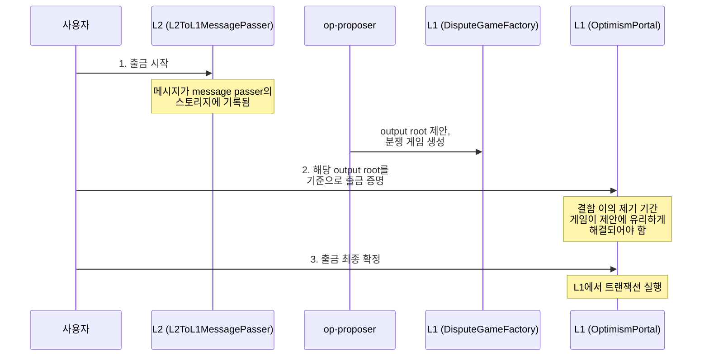

<Info>
  **OP Stack 배우기 — 14단계 중 10단계.**
  트랜잭션이 L1에서 L2로 진입하는 방식을 알게 되었습니다. 이 페이지에서는
  반대 방향, 즉 출금이 L1으로 돌아가기 위해 거치는 시작, 증명, 최종 확정
  단계를 다룹니다. 다 읽은 후에는
  [L1에서 트랜잭션 제출하기](/ko/app-developers/tutorials/bridging/cross-dom-bridge-eth)로 이어서 진행하십시오.
</Info>

Optimism 용어에서 *출금(withdrawal)*은 L2(OP Mainnet, OP Sepolia 등)에서 L1(Ethereum mainnet, Sepolia 등)으로 전송되는 트랜잭션을 의미합니다.

출금을 위해 사용자는 세 개의 트랜잭션을 제출해야 합니다.

1.  **출금 시작 트랜잭션**: 사용자가 L2에서 제출합니다.
2.  **출금 증명 트랜잭션**: 출금이 정당함을 증명하기 위해 사용자가 L1에서 제출합니다(L2에 있는 `L2ToL1MessagePasser` 스토리지의 상태를 커밋하는 Merkle-Patricia trie root를 기반으로 합니다).
3.  **출금 최종 확정 트랜잭션**: 결함 이의 제기 기간(fault challenge period)이 지난 후, L1에서 트랜잭션을 실제로 실행하기 위해 사용자가 L1에서 제출합니다.

세 트랜잭션 사이를 가르는 것은 작업이 아니라 대기입니다. 2단계는 출금 블록을 포함하는
제안이 L1에 도달하기 전까지 수행할 수 없습니다. 그 후 3단계는 하나가 아니라 세 가지 독립적인
조건을 기다립니다. 증명은 게임 생성 이후에 이루어져야 하고, 증명 자체가 사용자의 증명
트랜잭션 시점부터 측정한 증명 성숙 지연(proof maturity delay)을 지나야 하며, 게임이 제안에
유리하게 해결되고 분쟁 게임 최종성 지연(dispute game finality delay)을 통과해야 합니다.
이미 해결된 게임을 기준으로 늦게 증명하더라도 즉시 최종 확정할 수는 없습니다. 증명 성숙 지연은
여전히 증명 트랜잭션 시점부터 계산됩니다.

전체 [출금 사양은 여기](https://specs.optimism.io/protocol/withdrawals.html?utm_source=op-docs&utm_medium=docs)에서 읽을 수 있습니다.

<Info>
  이 과정을 구현하는 방법의 예시는 [브리징 튜토리얼](/ko/app-developers/tutorials/bridging/cross-dom-bridge-erc20)에서 확인할 수 있습니다.
</Info>

## 출금 시작 트랜잭션

1.  L2에서 사용자(외부 소유 계정(EOA)이 직접 호출하거나 EOA를 대신하는 컨트랙트)가 [`L2CrossDomainMessenger`](https://github.com/ethereum-optimism/optimism/blob/develop/packages/contracts-bedrock/src/L2/L2CrossDomainMessenger.sol#L22) 컨트랙트의 [`sendMessage`](https://github.com/ethereum-optimism/optimism/blob/develop/packages/contracts-bedrock/src/universal/CrossDomainMessenger.sol#L191) 함수를 호출합니다.

    이 함수는 세 개의 파라미터를 받습니다.

    *   `_target`: L1의 대상 주소입니다.
    *   `_message`: 대상 주소의 [ABI](https://docs.soliditylang.org/en/v0.8.19/abi-spec.html)에 따라 형식화된 L1 트랜잭션의 calldata입니다.
    *   `_minGasLimit`: 출금 최종 확정 트랜잭션이 출금 트랜잭션에 제공할 수 있는 최소 gas 양입니다. 이는 `SafeCall` 라이브러리에 의해 강제되며, `OptimismPortal` -> `L1CrossDomainMessenger`로의 외부 호출 시점에 최소 gas 양을 충족할 수 없으면 최종 확정 트랜잭션이 revert되어 더 높은 gas 한도로 재시도할 수 있게 됩니다. `L1CrossDomainMessenger.relayMessage` 함수 실행에 소비되는 gas를 고려하기 위해, L2에서 `sendMessage`가 호출될 때 `CrossDomainMessenger.baseGas` 함수가 `_minGasLimit` 값에 추가 gas를 더합니다.

2.  `sendMessage`는 두 크로스 도메인 메신저 모두에서 사용되는 범용 함수입니다. 이 함수는 [`L2CrossDomainMessenger`](https://github.com/ethereum-optimism/optimism/blob/develop/packages/contracts-bedrock/src/L2/L2CrossDomainMessenger.sol#L22)에 특화된 [`_sendMessage`](https://github.com/ethereum-optimism/optimism/blob/develop/packages/contracts-bedrock/src/L2/L2CrossDomainMessenger.sol#L47)를 호출합니다.

3.  `_sendMessage`는 [`L2ToL1MessagePasser`](https://github.com/ethereum-optimism/optimism/blob/develop/packages/contracts-bedrock/src/L2/L2ToL1MessagePasser.sol#L19)의 [`initiateWithdrawal`](https://github.com/ethereum-optimism/optimism/blob/develop/packages/contracts-bedrock/src/L2/L2ToL1MessagePasser.sol#L78)을 호출합니다. 이 함수는 원시 출금 필드의 해시를 계산합니다. 그런 다음 해당 해시를 [`sentMessages`](https://github.com/ethereum-optimism/optimism/blob/develop/packages/contracts-bedrock/src/L2/L2ToL1MessagePasser.sol#L27)에 전송된 메시지로 표시하고, [`MessagePassed`](https://github.com/ethereum-optimism/optimism/blob/develop/packages/contracts-bedrock/src/L2/L2ToL1MessagePasser.sol#L40) 이벤트에 해시와 함께 필드를 내보냅니다.

    원시 출금 필드는 다음과 같습니다.

    *   `nonce` - 그 외에는 동일한 두 출금이 같은 값으로 해시되지 않도록 하는 일회용 값
    *   `sender` - 전송을 시작한 L2 주소. 일반적으로 [`L2CrossDomainMessenger`](https://github.com/ethereum-optimism/optimism/blob/develop/packages/contracts-bedrock/src/L2/L2CrossDomainMessenger.sol#L22)
    *   `target` - L1 대상 주소
    *   `value` - 이 트랜잭션으로 전송되는 WEI 양
    *   `gasLimit` - 트랜잭션의 gas 한도. 시스템은 L1에서 트랜잭션이 최소한 이 양의 gas를 사용할 수 있도록 보장합니다. gas 한도가 충분하지 않거나 L1 최종 확정 트랜잭션에 해당 gas 한도를 제공할 만큼의 gas가 없으면, 최종 확정 트랜잭션은 revert되지 않고 실패를 반환합니다.
    *   `data` - 출금 트랜잭션의 calldata

4.  `op-proposer`가 새로운 `output`을 제안하면, output 제안에는 `op-node`가 블록의 일부로 제공하는 [output root](https://specs.optimism.io/glossary.html?utm_source=op-docs\&utm_medium=docs#l2-output-root)가 포함됩니다.
    이 새로운 output root는 L2에 있는 `L2ToL1MessagePasser` 컨트랙트 스토리지의 `sentMessages` 매핑 상태를 커밋하며, 그 안에 대기 중인 출금이 존재함을 증명하는 데 사용할 수 있습니다.

## 출금 증명 트랜잭션

`MessagePassed` 이벤트를 포함하는 output root가 L1에 게시되면, 다음 단계는 메시지 해시가 실제로 L2에 존재함을 증명하는 것입니다. 일반적으로 이 작업은 viem으로 수행합니다.

### 오프체인 처리

1.  사용자가 출금 트랜잭션 영수증을 인자로 viem의 `proveWithdrawal()` 함수를 호출합니다. 이 함수는 증명 트랜잭션 파라미터의 준비를 내부적으로 처리합니다.

2.  L2 트랜잭션에서 출금 세부 정보를 가져오기 위해 viem은 `getWithdrawals()` 함수를 사용하며, 이 함수는 트랜잭션 영수증의 `MessagePassed` 이벤트에서 원시 출금 필드를 추출합니다.

3.  증명을 얻기 위해 viem은 출금 증명 기능을 사용하여 필요한 Merkle 증명을 생성합니다.

4.  마지막으로 viem은 L1에서 [`OptimismPortal.proveWithdrawalTransaction()`](https://github.com/ethereum-optimism/optimism/blob/develop/packages/contracts-bedrock/src/L1/OptimismPortal2.sol#L375)을 호출합니다.

### 온체인 처리

[`OptimismPortal.proveWithdrawalTransaction()`](https://github.com/ethereum-optimism/optimism/blob/develop/packages/contracts-bedrock/src/L1/OptimismPortal2.sol#L375)은 몇 가지 기본 검사를 수행합니다. 그런 다음 결함 분쟁 게임(fault dispute game)이 주장하는 output root에 대한 Merkle 증명을 사용하여, L2의 `L2ToL1MessagePasser.sentMessages`에서 해당 출금의 해시가 활성화되어 있는지 검증합니다. 모든 검사를 통과하면 분쟁 게임과 증명 타임스탬프를 `provenWithdrawals`에 기록하고 이벤트를 발생시킵니다. 출금은 두 번 이상 증명할 수 있으며(예: 원래 게임이 유효하지 않은 것으로 밝혀지면 다른 분쟁 게임을 기준으로 증명), 다시 증명하면 증명 타이머가 초기화됩니다.

다음 단계는 증명에 사용된 L2 output root가 정당하고, 증명 자체도 해킹이 아닌 정당한 것임을 보장하기 위해 결함 이의 제기 기간(mainnet에서는 7일, 테스트 네트워크에서는 더 짧음)을 기다리는 것입니다.

### 유효하지 않은 게임에 대한 증명 삭제

<Info>
  `deleteProvenWithdrawal`은 Optimism Governance 승인을 기다리고 있는 L1 컨트랙트 업그레이드인 Upgrade 21에 포함되어 제공됩니다.
  해당 업그레이드가 체인에서 실행된 후에만 그 체인에서 사용할 수 있습니다.
</Info>

분쟁 게임이 challenger에게 유리하게 해결되었거나 게임이 `AnchorStateRegistry`에서 블랙리스트에 등록된 경우, 해당 증명은 절대 최종 확정될 수 없습니다.
누구나 [`OptimismPortal.deleteProvenWithdrawal(bytes32 withdrawalHash, address proofSubmitter)`](https://github.com/ethereum-optimism/optimism/blob/develop/packages/contracts-bedrock/src/L1/OptimismPortal2.sol#L765)를 호출하여 이러한 증명을 제거할 수 있으며, 이 함수는 `provenWithdrawals`의 항목을 삭제하고 `WithdrawalProofDeleted(withdrawalHash, proofSubmitter)` 이벤트를 발생시킵니다.
해당 증명이 존재하지 않거나, 분쟁 게임이 challenger에게 유리하게 해결되지 않았고 블랙리스트에도 등록되지 않은 경우 호출은 revert됩니다.

증명을 삭제해도 출금 자체에는 영향을 주지 않습니다.
출금은 여전히 유효한 분쟁 게임을 기준으로 다시 증명한 후 최종 확정할 수 있습니다.
`WithdrawalProven` 및 `WithdrawalProvenExtension1` 이벤트에서 증명을 인덱싱하는 경우, 삭제된 증명을 대기 중으로 보고하지 않도록 `WithdrawalProofDeleted`도 처리하십시오.

## 출금 최종 확정 트랜잭션

마지막으로 결함 이의 제기 기간이 지나면 출금을 최종 확정하고 L1에서 실행할 수 있습니다.

이를 위해 사용자(외부 소유 계정(EOA)이 직접 호출하거나 EOA를 대신하는 컨트랙트)가 [`OptimismPortal`](https://github.com/ethereum-optimism/optimism/blob/develop/packages/contracts-bedrock/src/L1/OptimismPortal2.sol#L37) 컨트랙트의 [`finalizeWithdrawalTransaction`](https://github.com/ethereum-optimism/optimism/blob/develop/packages/contracts-bedrock/src/L1/OptimismPortal2.sol#L481) 함수를 호출합니다.

## 출금 트랜잭션에서 예상되는 내부 revert

출금 과정에서 사용자는 **Etherscan**에서 트랜잭션을 볼 때 내부 revert를 발견할 수 있습니다. 이는 흔히 혼란을 일으키는 부분이지만 예상된 동작입니다.

이러한 내부 revert는 Etherscan UI에서 노란색으로 표시되는 경우가 많아 트랜잭션에 문제가 생긴 것처럼 우려를 일으킬 수 있습니다. 그러나 이러한 revert는 Optimism에서 사용하는 비표준 프록시, 특히 **Chugsplash Proxy** 때문에 발생합니다. Chugsplash Proxy는 출금 과정의 설계된 흐름의 일부로 revert되는 내부 호출을 트리거하는 경우가 있습니다.

### 이러한 revert가 발생하는 이유는 무엇입니까?

Chugsplash Proxy는 표준 프록시와 다르게 동작합니다. 출금 트랜잭션 중에 revert로 끝나는 내부 컨트랙트 호출을 트리거할 수 있지만, 이러한 revert가 출금 실패를 의미하지는 않습니다. 오히려 시스템 내부 로직의 일부이며 특정 시나리오에서 예상되는 동작입니다.

### 핵심 요점:

*   **내부 revert는 예상된 동작입니다**: 이러한 revert는 출금 트랜잭션 중 Chugsplash Proxy의 정상적인 동작의 일부이며 오류를 나타내지 않습니다.
*   **우려할 필요가 없습니다**: Etherscan이 이러한 revert를 강조 표시하더라도 트랜잭션의 최종 성공에는 영향을 주지 않습니다.
*   **사용자 안내**: 출금 트랜잭션 중 이러한 revert를 발견하더라도 출금은 예상대로 최종 확정되므로 안심하셔도 됩니다.

### 오프체인 처리

1.  사용자가 출금 트랜잭션 영수증을 인자로 viem의 `finalizeWithdrawal()` 함수를 호출합니다.
    이 함수는 최종 확정 트랜잭션 파라미터의 준비를 내부적으로 처리합니다.

2.  L2 트랜잭션에서 출금 세부 정보를 가져오기 위해 viem은 `getWithdrawals()` 함수를 사용하며, 이 함수는 트랜잭션 영수증의 `MessagePassed` 이벤트에서 원시 출금 필드를 추출합니다.

3.  마지막으로 viem은 L1에서 [`OptimismPortal.finalizeWithdrawalTransaction()`](https://github.com/ethereum-optimism/optimism/blob/develop/packages/contracts-bedrock/src/L1/OptimismPortal2.sol#L481-L483)을 호출합니다.

### 온체인 처리

1.  [`OptimismPortal.finalizeWithdrawalTransaction()`](https://github.com/ethereum-optimism/optimism/blob/develop/packages/contracts-bedrock/src/L1/OptimismPortal2.sol#L481-L483)은 여러 검사를 수행합니다. 주목할 만한 검사는 다음과 같습니다.

    *   [출금이 이미 증명되었는지 검증합니다](https://github.com/ethereum-optimism/optimism/blob/develop/packages/contracts-bedrock/src/L1/OptimismPortal2.sol#L647-L652).
    *   [증명 성숙 지연이 이미 지났을 만큼 충분히 오래전에 증명이 제출되었는지 검증합니다](https://github.com/ethereum-optimism/optimism/blob/develop/packages/contracts-bedrock/src/L1/OptimismPortal2.sol#L662-L665).
    *   [출금 증명의 기준이 된 분쟁 게임이 제안된 output root에 유리하게 해결되었고, 그 이후 해당 주장이 무효화되지 않았는지 검증합니다](https://github.com/ethereum-optimism/optimism/blob/develop/packages/contracts-bedrock/src/L1/OptimismPortal2.sol#L667-L670).
    *   [재실행 공격을 방지하기 위해 출금이 이전에 최종 확정되지 않았는지 검증합니다](https://github.com/ethereum-optimism/optimism/blob/develop/packages/contracts-bedrock/src/L1/OptimismPortal2.sol#L642-L645).

    이 중 하나라도 실패하면 트랜잭션은 revert됩니다.

2.  `finalizedWithdrawals`에서 출금을 최종 확정된 것으로 표시합니다.

3.  실제 출금 트랜잭션을 실행합니다(`data`의 calldata로 `target` 컨트랙트를 호출).

4.  [`WithdrawalFinalized`](https://github.com/ethereum-optimism/optimism/blob/develop/packages/contracts-bedrock/src/L1/OptimismPortal2.sol#L173) 이벤트를 발생시킵니다.
