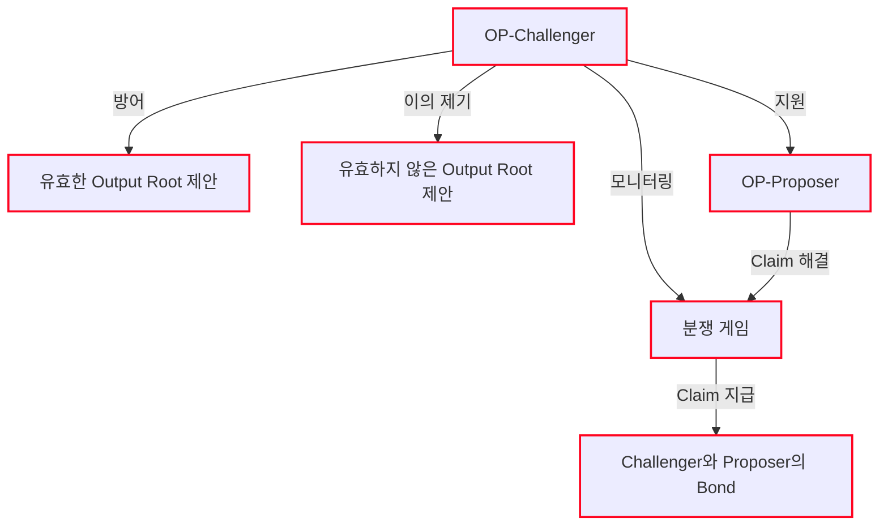

import { NormativeSpec } from "/ko/snippets/normative-spec.mdx"

<NormativeSpec
  what="정직한 challenger의 동작"
  title="정직한 challenger 명세"
  href="https://specs.optimism.io/fault-proof/stage-one/honest-challenger-fdg.html"
  note="이 페이지는 op-challenger가 해당 역할을 구현하는 방식을 설명하며, 명세 내용을 다시 서술하지 않습니다."
/>

`op-challenger`는 결함 분쟁 시스템에서 *정직한 행위자(honest actor)*로 동작하며, `OptimismPortal`을 보호하고 게임이 항상 체인의 올바른 상태로 해결되도록 보장하여 체인을 방어합니다. claim의 정당성을 검증하기 위해 `op-challenger`는 동기화된 신뢰할 수 있는 rollup node와 trace provider(예: [Cannon](/ko/op-stack/fault-proofs/cannon))에 의존합니다.

구체적으로 `op-challenger`는 다음 작업을 수행합니다.

*   분쟁 게임(dispute game)을 모니터링하고 상호작용합니다
*   유효한 output root 제안을 방어합니다
*   유효하지 않은 output root 제안에 이의를 제기합니다
*   체스 시계(chess clock)가 만료되면 claim과 게임을 해결하여 `op-proposer`를 지원합니다
*   challenger와 proposer 모두에 대해 지급된 bond를 청구합니다

## 아키텍처
이 다이어그램은 `op-challenger`가 분쟁 게임을 모니터링하고, 유효한 제안을 방어하며, 유효하지 않은 제안에 이의를 제기하는 방식을 보여 줍니다. 또한 claim을 해결할 때 `op-proposer`와 상호작용하는 방식도 보여 줍니다.

<Info>
  `op-challenger` docker 컨테이너는 게임 트레이스 데이터를 생성하기 위해 결함 증명 프로그램과 함께 `cannon` VM을 하위 프로세스로 실행합니다. Karst 업그레이드 이후 respected game type은 `kona-host`를 사용하는 `cannon-kona`입니다. 레거시 `cannon` game type은 `op-program host`를 사용하며, 이는 Karst 업그레이드 시점에 지원 종료되었습니다. [op-geth 및 op-program 지원 종료](/ko/notices/archive/op-geth-deprecation)를 참고하십시오.
</Info>

## 결함 감지 대응

`op-challenger`는 다음 로직에 따라 각 claim의 유효성을 평가하고, 유효하지 않다고 판단되는 claim에만 대응합니다.

1.  신뢰할 수 있는 node가 output에 동의하면 `op-challenger`는 아무 조치도 취하지 않습니다. 정직한 challenger는 동의하지 않는 claim이 없으므로 아무것도 하지 않습니다. 누군가 유효한 root claim에 대한 counter-claim을 게시할 경우에 대비해 게임을 계속 모니터링하며, 그런 경우 challenger는 게임에 참여하여 제안을 방어합니다.
2.  신뢰할 수 있는 node가 동의하지 않으면 `op-challenger`는 제안된 output에 이의를 제기하기 위해 counter-claim을 게시합니다. 위 시나리오와 달리, 정직한 challenger는 신뢰할 수 있는 node가 동의하지 않는 output root를 모두 삭제하여 거기에 첨부된 bond를 청구하는 것을 목표로 합니다. 정직한 challenger는 자신의 rollup node가 canonical 상태로 동기화되어 있고 결함 증명 프로그램이 올바르다고 가정하므로, 모든 결함에 대응하기 위해 기꺼이 자금을 겁니다.

## 결함 분쟁 게임 대응

`op-challenger`는 컨트랙트에 저장된 순서대로 claim을 순회하며, 조상 claim이 자손 claim보다 먼저 처리되도록 합니다. 각 claim에 대해 정직한 challenger는 해당 응답이 전체 게임 상태에 이미 존재하는지 여부와 관계없이 모든 claim에 대한 정직한 응답 집합을 결정하고 추적합니다.

### Root claim

root claim은 root claim에 대한 정직한 challenger의 state witness hash와 일치하는 [state witness Hash](https://specs.optimism.io/fault-proof/stage-one/fault-dispute-game.html?utm_source=op-docs&utm_medium=docs#claims)를 가지는 경우에만 정직한 claim으로 간주됩니다.

### Counter claim

분쟁 게임에서 새 claim이 생성되면 정직한 challenger는 이를 처리하고 응답을 수행합니다. 정직한 challenger는 다음 조건을 모두 충족하는 경우에만 claim에 대응해야 합니다.

1.  해당 claim이 정직한 응답 집합에 있는 claim의 자식입니다
2.  정직한 응답 집합에 해당 claim의 trace index보다 크거나 같은 trace index를 가진 형제 claim이 포함되어 있습니다

<Info>
  이는 정직한 challenger가 절대 자신의 claim에 대응하지 않는다는 것을 의미합니다. 각 claim에 대한 정직한 대응은 최대 하나뿐이므로, 정직한 claim에는 정직한 형제 claim이 존재하지 않습니다.
</Info>

### 가능한 move

challenger는 새 claim이 추가될 때마다 각 게임을 모니터링하고 [honest actor 알고리즘](https://specs.optimism.io/fault-proof/stage-one/honest-challenger-fdg.html?utm_source=op-docs&utm_medium=docs)에 따라 대응하여 유효한 제안을 방어하고 유효하지 않은 제안을 무효화합니다. **move**는 기존 claim에 대한 이의 제기이며, 다른 트레이스를 주장하는 대체 claim(예: attack, defend 또는 step)을 반드시 포함해야 합니다.

 

<Image src="/public/img/op-stack/protocol/challenger-moves.png" alt="Challenger move 흐름" width={700} height={600} />

<Info>
  honest actor 알고리즘의 전체 범위는 [명세](https://specs.optimism.io/fault-proof/stage-one/honest-challenger-fdg.html)를 참고하십시오.
</Info>

## 해결

`FaultDisputeGame`의 체스 시계 중 한쪽이 만료되면, 정직한 challenger의 책임은 `FaultDisputeGame` 컨트랙트의 `resolveClaim` 함수를 호출하여 게임의 각 claim을 해결하는 것입니다. root claim의 하위 게임이 해결되면 challenger는 마지막으로 `resolve` 함수를 호출하여 전체 게임을 해결합니다.

`FaultDisputeGame`은 해결에 시간 제한을 두지 않습니다. 정직한 challenger에 대한 활성성(liveness) 가정과 이들이 대응한 claim에 첨부된 bond 때문에, challenger는 게임을 빠르게 해결하여 자금을 회수하고 보상을 확보할 경제적 동기를 가집니다.

## 다음 단계

*   시작할 준비가 되었습니까? [OP Stack 체인에서 `op-challenger` 구성하기](/ko/chain-operators/guides/configuration/op-challenger-config-guide) 가이드를 읽어 보십시오.
*   `op-challenger`의 내부 작동 방식에 대한 자세한 내용은 [명세를 확인하십시오](https://specs.optimism.io/fault-proof/stage-one/honest-challenger-fdg.html?utm_source=op-docs&utm_medium=docs).
*   릴리스, 구성 레퍼런스 및 소스 링크는 [op-challenger 허브](/ko/op-stack/components/op-challenger)를 참고하십시오.

## FAQ

### 과거 데이터에 접근할 수 있는 blob archiver가 없으면 게임에서 질 수 있습니까?

아무도 과거 데이터에 접근할 수 없다면 그럴 가능성이 높습니다. 모든 정직한 행위자는 같은 move를 두려고 하므로 공격을 조율할 필요 없이 함께 협력합니다. 따라서 blob archiver가 없는 정직한 행위자가 하나뿐이고, 그 행위자가 게임의 하위 절반(게임 내 약 32개 claim 깊이)까지 밀려 내려가면, challenger는 오류를 기록하며 blob archiver 없이는 응답할 수 없게 됩니다. 행위자에게는 게임에서 자신의 몫으로 3.5일이 주어지므로, 그동안 blob을 보유한 beacon node로 전환하여 문제를 해결한 뒤 평소처럼 진행할 수 있습니다.

참고: 행위자가 게임의 하위 절반까지 밀려 내려가는 경우는 분쟁 대상 블록이 blob 보존 기간(약 18일)보다 오래된 경우뿐입니다. 유효한 제안이 정기적으로 해결되고 있다면, 각 유효한 제안이 새로 생성되는 분쟁 게임의 시작점이 되므로 이런 일은 발생할 수 없습니다. 따라서 정기적으로 유효한 제안이 있다면 일반적으로 약 3.5일 분량의 블록만 분쟁 대상이 되며, 이는 보존 기간 내에 충분히 들어갑니다.

### challenger가 효율적으로 작동하려면 CPU를 몇 개 사용해야 합니까?

기본 `--max-concurrency` 설정은 대부분의 운영자에게 적합합니다. challenger가 지연되면 값을 늘리고, 요청으로 인해 과부하가 걸리면 값을 줄이십시오.

### 게임에서 이의를 제기하려면 ETH가 얼마나 필요합니까?

정직한 challenger들은 공격자보다 더 많은 ETH를 합산하여 보유해야 합니다. 그렇지 않으면 자금이 바닥나 게임에 응답할 수 없게 될 수 있습니다(이 경우 자금을 보호하기 위해 보안 오버라이드를 사용해야 합니다). 따라서 challenger가 보유해야 하는 엄격한 금액은 없지만, 체인 운영자가 추정에 사용할 수 있는 일반적인 가이드라인은 다음과 같습니다.

*   일반적으로 게임 1개를 진행하기 위한 최소 금액 = bond 금액 \* 게임 최대 깊이 + 각 move의 gas 비용
*   단일 "체인"으로 마지막 step 호출까지 게임 하나를 끝까지 진행하는 데 총 631.2 ETH가 조금 넘게 들며, "측"마다 약 315.6 ETH입니다.

### bond란 무엇입니까? FP 시스템에서 bond의 역할은 무엇입니까?

각 *claim*은 bond를 지불하며, 게임이 생성될 때 만들어지는 root claim도 마찬가지입니다(따라서 bond는 게임이 생성될 때 지불됩니다). 게임에 새 claim이 게시될 때마다 게시되는 claim의 깊이에 따라 추가 bond를 지불해야 합니다. bond를 미리 지불할 필요는 없습니다(즉, staking과 다릅니다). 대신 bond 금액은 `FaultDisputeGame`에서 `attack` 또는 `defend`를 호출하거나 `DisputeGameFactory`에서 `create`를 호출할 때 트랜잭션의 value로 전송됩니다.

올바른 것으로 판명된 claim은 bond를 환불받습니다. 잘못된 것으로 판명된 claim의 bond는 해당 잘못된 claim의 자식 claim 중 대응되지 않은 가장 왼쪽 claim을 게시한 계정에 지급됩니다. 더 중요한 점은 유효하지 않은 claim의 bond가 해당 claim에 성공적으로 대응한 사람에게 지급되지만, bond는 항상 한 사람에게만 지급되고 절대 공유되지 않도록 설계되어 있다는 것입니다.

*   게임이 해결된 후 bond를 청구하는 데에는 두 가지 지연이 있습니다. `AnchorStateRegistry`의 분쟁 게임 최종성 지연(finality delay)과 `DelayedWETH`의 출금 지연(withdrawal delay)입니다. 둘 다 체인별로 설정되며 기본적으로 각각 최소 12시간이고, 최대값은 각각 3.5일과 7일입니다.
*   최종성 지연이 지나면 `claimCredit`을 호출하여 bond의 잠금을 해제할 수 있으며, 그때부터 출금 지연이 시작됩니다. 일반적으로 이는 게임이 해결된 후 최소 24시간에 `claimCredit` 호출 전 대기 시간을 더한 시점부터 bond를 청구할 수 있다는 의미입니다.

bond 금액 계산은 [`FaultDisputeGame` 컨트랙트](https://github.com/ethereum-optimism/optimism/blob/develop/packages/contracts-bedrock/src/dispute/FaultDisputeGame.sol#L936-L977)에 하드코딩되어 있으며, 컨트랙트에는 사용할 bond를 제안하는 `getRequiredBond` 메서드가 있습니다.

### challenger bond에는 ETH가 얼마나 필요합니까?

bond 값은 dispute game factory에 설정되어 있습니다. 올바른 게임 결과를 보장하려면 모든 정직한 행위자의 합산 자금이 공격자가 사용할 수 있는 자금보다 많아야 합니다. 그렇지 않으면 공격자가 claim을 대량으로 게시하여 정직한 행위자의 자금이 바닥나 더 이상 대응할 수 없게 만들 수 있습니다. 이를 보장하는 고정 금액은 없으므로, 체인 운영자는 claim에 대응하기 위해 즉시 사용할 수 있는 상당한 자금을 보유해야 합니다.

guardian은 필요한 경우 개입하여 bond 지급을 재할당할 수 있으므로, 정직한 행위자보다 더 많은 자금을 쏟아부으려는 공격자는 반드시 자금을 잃게 됩니다. guardian이 개입하여 공격자의 모든 bond를 정직한 행위자에게 지급하기 때문이며, 이는 자금력으로 게임에서 이기려는 시도에 대한 매우 강력한 억제책입니다.
