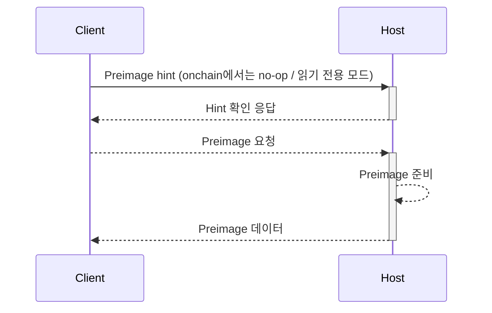

자체 [결함 증명 프로그램(Fault Proof Program)](https://specs.optimism.io/fault-proof/index.html#fault-proof-program) 개발을 시작하기 전에,
프로그램이 실행될 환경을 이해하는 것이 중요합니다.

FPP는 맞춤형 FPVM 타깃 위에서 실행됩니다. FPVM은 일반적으로 기존 RISC(축소 명령어 집합) 아키텍처의 수정된 하위 집합과 Linux syscall의 하위 집합을 갖춘 VM입니다. FPVM은
검증 가능한 프로그램을 실행하도록 설계되었으며, 검증 가능한 메모리 접근, `client`(프로그램)와 `host`(FPVM) 간의 통신, 기타 구현별 기능을 지원하기 위해
기반이 되는 명령어 세트와 메모리의 내부 표현을 수정하는 경우가 많습니다.

## Host와 Client 간 통신

프로그램이 FPVM 위에서 실행되는 동안 프로그램은 `client` 역할로 간주되고, VM은 `host` 역할로 간주됩니다. `client`와 `host`가
서로 통신하는 유일한 방법은 [Preimage ABI](https://specs.optimism.io/fault-proof/index.html#pre-image-oracle)([명세][preimage-specs])를 통한 동기식 통신입니다.

`client`가 `host`로부터 데이터를 읽을 수 있도록, FPVM 내에서 `read` 및 `write` syscall이 수정되어 `client`가 외부 데이터의 준비를 요청하고 이를 읽을 수 있습니다.

### 읽기

`client`가 `host`로부터 데이터를 읽으려면 먼저 hint 파일 디스크립터를 통해 `host`에 "hint"를 보내야 합니다. 이는 `host`에 읽기용 데이터를 준비하라는 요청을 알리는 신호입니다. 그러면 `host`는
데이터를 준비하고 `client`에 hint 확인 응답(acknowledgement)을 보냅니다. 그런 다음 `client`는 지정된 파일 디스크립터를 통해 host로부터 데이터를 읽을 수 있습니다.

준비 단계("hinting")는 `host`가 `client`의 의도와 실행에 필요한 데이터를 미리 알 수 있게 해 주는 최적화입니다. 이를 통해
데이터를 지연 로딩(lazy loading)할 수 있으며, `host`의 메모리 내에서 불필요한 할당이 필요하지 않게 됩니다. 이 단계는 onchain에서는 no-op이며,
`host`가 FPVM의 네이티브 구현인 경우에만 로컬에서 실행됩니다.

## 전체 예시

아래는 OP Stack 결함 증명 프로그램의 원래 Go 구현인 [`op-program`](https://github.com/ethereum-optimism/optimism/tree/op-program/v1.9.0/op-program)(`op-program/v1.9.0` 기준, 출처: [결함 증명 명세][fp-specs])의 전체 아키텍처 다이어그램입니다.
이 프로그램의 목적은 [OP Stack][op-stack] layer two의 상태에 관한 claim을 검증하는 것입니다. `op-program`은 지원 종료되었으며 현재 유지 관리되는 결함 증명 프로그램은 `kona-client`입니다([op-geth 및 op-program 지원 종료](/ko/notices/archive/op-geth-deprecation) 참고). 하지만 여기에 표시된 아키텍처는 둘 다에 적용됩니다.

이 프로그램에서는 L2 체인의 실행과 도출(derivation)이 프로그램 내부에서 수행되며, 최종적으로 L2 체인의 주장된 상태가 [prologue](/ko/op-stack/fault-proofs/kona/fpp-dev/prologue) 단계에서 검증됩니다.

프로그램은 두 가지 이유로 `host`와 통신합니다.

1. L1 및 L2 상태 데이터 preimage의 준비를 요청하기 위해
1. 위 요청 이후 준비된 L1 및 L2 상태 데이터 preimage를 읽기 위해

`host`는 다음을 담당합니다.

1. L1 및 L2 상태 데이터 preimage와 로컬 부트스트랩 k/v 쌍의 저장소를 준비하고 유지 관리합니다.
1. `client`가 읽을 수 있도록 L1 및 L2 상태 데이터 preimage를 제공합니다.

다른 프로그램(`client`)은 `host`와의 통신에 대해 요구 사항이 다를 수 있지만, 위 방식은 FPVM 위에 구축된 프로그램의 일반적인 패턴입니다. 일반적으로 다음과 같습니다.

1. `client` 프로그램은 입력으로부터 자신을 부트스트랩하고, 프로그램 로직을 실행하고, 결과를 검증하는 상태 머신입니다.
1. `host`는 `client`가 부트스트랩 시 받지 못한 데이터를 `client`에 제공하고, 프로그램 자체를 실행하는 역할을 합니다.

[op-stack]: https://github.com/ethereum-optimism/optimism
[cannon]: https://github.com/ethereum-optimism/optimism/tree/develop/cannon
[cannon-rs]: https://github.com/op-rs/cannon-rs
[asterisc]: https://github.com/ethereum-optimism/asterisc
[fp-specs]: https://specs.optimism.io/fault-proof/index.html
[fpp-specs]: https://specs.optimism.io/fault-proof/index.html#fault-proof-program
[preimage-specs]: https://specs.optimism.io/fault-proof/index.html#pre-image-oracle
[cannon-specs]: https://specs.optimism.io/fault-proof/cannon-fault-proof-vm.html
[l2-output-root]: https://specs.optimism.io/protocol/proposals.html#l2-output-commitment-construction
[op-succinct]: https://github.com/succinctlabs/op-succinct
[revm]: https://github.com/bluealloy/revm

[kona]: https://github.com/ethereum-optimism/optimism/tree/develop/rust/kona
[issues]: https://github.com/ethereum-optimism/optimism/issues
[new-issue]: https://github.com/ethereum-optimism/optimism/issues/new
[contributing]: https://github.com/ethereum-optimism/optimism/blob/develop/CONTRIBUTING.md

[op-labs]: https://github.com/ethereum-optimism
[bad-boi-labs]: https://github.com/BadBoiLabs
