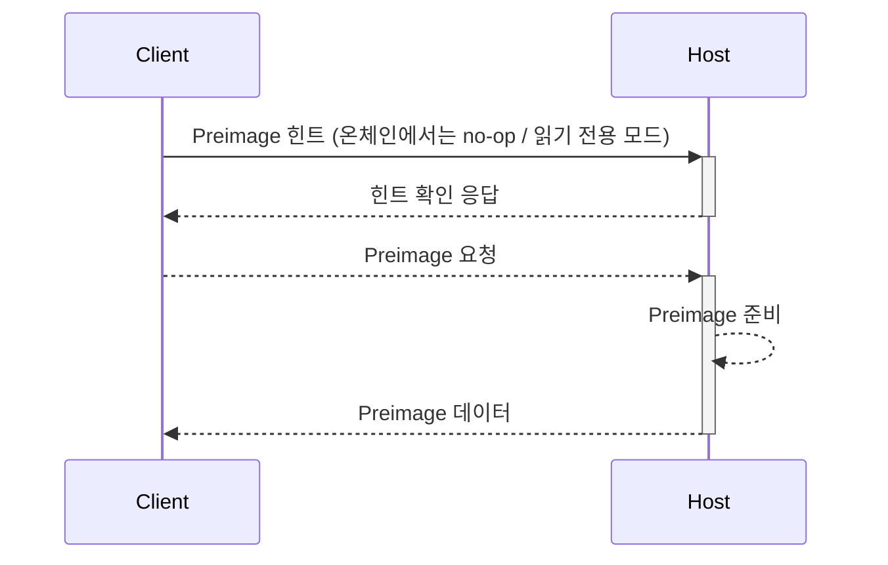

<Note>
이 섹션을 읽기 전에, [결함 증명 프로그램 환경](/ko/op-stack/fault-proofs/kona/fpp-dev/env) 섹션을 먼저 읽고
PreimageOracle IO 패턴에 익숙해지는 것을 권장합니다.
</Note>

Kona는 실질적으로 세 부분으로 나뉩니다.

- OP Stack 상태 전이 로직(`kona-derive`, `kona-executor`, `kona-mpt`)
- OP Stack 상태 전이 증명 SDK(`kona-preimage`, `kona-proof`)
- [Fault Proof VM](https://specs.optimism.io/fault-proof/index.html#fault-proof-vm) IO 및 유틸리티
  (`kona-std-fpvm`, `kona-std-fpvm-proc`)

이 섹션에서는 [FPVM 타깃](/ko/op-stack/fault-proofs/kona/fpp-dev/env) 위에서 실행되는 프로그램의 host와 client 간 통신을 지원하기 위해
`kona-std-fpvm`과 `kona-preimage`를 사용하는 방법에 초점을 맞춥니다.

## Host와 Client 통신 API

FPVM 시스템 API는 여러 계층으로 구성됩니다. 이 문서에서는 가장 낮은 수준부터 가장 높은 수준의 API까지
이 계층들을 차례로 다룹니다.

### `kona-std-fpvm`

`kona-std-fpvm`은 원시 syscall 디스패치, 기본 전역 메모리 allocator, 그리고 blocking async 런타임을 구현합니다.
`kona-std-fpvm`은 동작을 위해 최소한의 linux 백엔드에 의존하며, [PreimageOracle ABI][preimage-specs]를 구현하는 데
필요한 syscall(`read`, `write`, `exit_group`)만 지원합니다.

이러한 syscall은 `io` 모듈을 통해 사용자에게 직접 노출되며, 지원되는 각 플랫폼은
[`BasicKernelInterface`](https://docs.rs/kona-std-fpvm/latest/kona_std_fpvm/trait.BasicKernelInterface.html) trait을 구현합니다.

이러한 syscall을 직접 디스패치할 수 있도록 [`io`](https://docs.rs/kona-std-fpvm/latest/kona_std_fpvm/io/index.html) 모듈은
안전한 API를 제공합니다.

```rust
use kona_std_fpvm::{io, FileDescriptor};

// Print to `stdout`. Infallible, will panic if dispatch fails.
io::print("Hello, world!");

// Print to `stderr`. Infallible, will panic if dispatch fails.
io::print_err("Goodbye, world!");

// Read from or write to a specified file descriptor. Returns a result with the
// return value or syscall errno.
let _ = io::write(FileDescriptor::StdOut, "Hello, world!".as_bytes());
let mut buf = Vec::with_capacity(8);
let _ = io::read(FileDescriptor::StdIn, buf.as_mut_slice());

// Exit the program with a specified exit code.
io::exit(0);
```

이 라이브러리를 사용하면 host와 client 간의 커스텀 통신 프로토콜을 구현하거나, 기존
[PreimageOracle ABI][preimage-specs]를 확장할 수 있습니다. 하지만 대부분의 개발자에게는 `stdout`에 직접 출력하는 것과 같은
특별한 필요가 없는 한, [FPVM](/ko/op-stack/fault-proofs/kona/fpp-dev/env)을 대상으로 하는 프로그램을 개발할 때 `kona-preimage`를
사용할 것을 권장합니다.

### `kona-preimage`

`kona-preimage`는 [PreimageOracle ABI][preimage-specs]의 구현입니다. 이 crate는 FPP Dev 환경 섹션의
[Host - Client 통신](/ko/op-stack/fault-proofs/kona/fpp-dev/env#host-and-client-communication)에서 설명한 것처럼
host와 client 프로그램 간의 동기식 통신을 가능하게 합니다.

이 crate는 양방향 파이프의 한쪽 끝 역할을 하는 [`Channel`](https://docs.rs/kona-preimage/latest/kona_preimage/trait.Channel.html) trait을
중심으로 구성됩니다([`pipe` manpage](https://man7.org/linux/man-pages/man2/pipe.2.html) 참고).

이 핸들을 통해 상위 수준의 구성 요소는 아래 프로토콜에 따라 채널의 반대편 끝을 가진 상대방과
데이터를 읽고 쓸 수 있습니다.

<center>



</center>

위 프로토콜의 각 부분에 대한 인터페이스는 다음 trait으로 정의됩니다.

- [`PreimageOracleClient`](https://docs.rs/kona-preimage/latest/kona_preimage/trait.PreimageOracleClient.html)
  - 명세 준수 구현: [`OracleReader`](https://docs.rs/kona-preimage/latest/kona_preimage/struct.OracleReader.html)
- [`HintWriterClient`](https://docs.rs/kona-preimage/latest/kona_preimage/trait.HintWriterClient.html)
  - 명세 준수 구현: [`HintWriter`](https://docs.rs/kona-preimage/latest/kona_preimage/struct.HintWriter.html)
- [`PreimageOracleServer`](https://docs.rs/kona-preimage/latest/kona_preimage/trait.PreimageOracleServer.html)
  - 명세 준수 구현: [`OracleServer`](https://docs.rs/kona-preimage/latest/kona_preimage/struct.OracleServer.html)
- [`HintReaderServer`](https://docs.rs/kona-preimage/latest/kona_preimage/trait.HintReaderServer.html)
  - 명세 준수 구현: [`HintReader`](https://docs.rs/kona-preimage/latest/kona_preimage/struct.HintReader.html)

다만 사용자의 요구 사항이 [명세][preimage-specs] 준수 구현으로 충족되지 않는 경우, 이러한 trait 각각을 다시 구현하여
host와 client 간의 통신 프로토콜을 재정의할 수 있습니다.

### `kona-proof` - Oracle 기반 소스 (예시)

마지막으로, `kona-proof`에는 `PreimageKey`를 사용해 host로부터 타입이 지정되지 않은 데이터를 가져오는 `kona-derive` 및 `kona-executor` 데이터 소스 trait의
구현이 제공됩니다. 이러한 데이터 소스 trait은 [커스텀 백엔드](/ko/op-stack/fault-proofs/kona/proof/custom-backend) 섹션에서
더 자세히 다루지만, 여기서는 직관을 얻기 위해 간단히 살펴보겠습니다.

예를 들어 [`OracleL1ChainProvider`](https://github.com/ethereum-optimism/optimism/blob/develop/rust/kona/crates/proof/proof/src/l1/chain_provider.rs)를 살펴보겠습니다.
`kona-derive`의 [`ChainProvider`](https://docs.rs/kona-derive/latest/kona_derive/trait.ChainProvider.html) trait은
L1 체인에 대한 정보를 가져오기 위한 간단한 인터페이스를 정의합니다. `OracleL1ChainProvider`에서는 이 정보를
[PreimageOracle ABI][preimage-specs]를 통해 가져옵니다. 이 외에도 `L2ChainProvider`, `BlobProvider`, `TrieProvider`, `TrieHinter` 등
다양한 데이터 소스 trait이 있으며, 이를 통해 서로 다른 데이터 소스 백엔드를 만들 수 있습니다.

예시로, 앞서 설명한 `PreimageOracleClient + HintWriterClient` trait을 조합한 `CommsClient` trait 위에 구축된
`OracleL1ChainProvider::header_by_hash`를 살펴보겠습니다.

```rust
#[async_trait]
impl<T: CommsClient + Sync + Send> ChainProvider for OracleL1ChainProvider<T> {
    type Error = OracleProviderError;

    async fn header_by_hash(&mut self, hash: B256) -> Result<Header, Self::Error> {
        // Fetch the header RLP from the oracle.
        HintType::L1BlockHeader.with_data(&[hash.as_ref()]).send(self.oracle.as_ref()).await?;
        let header_rlp = self.oracle.get(PreimageKey::new_keccak256(*hash)).await?;

        // Decode the header RLP into a Header.
        Header::decode(&mut header_rlp.as_slice()).map_err(OracleProviderError::Rlp)
    }

    // - snip -
}
```

여기서 힌트 전송과 preimage 조회를 모두 확인할 수 있습니다. `HintType::L1BlockHeader.with_data(...).send(...)`는 `HintWriterClient`를 통해 힌트를 쓰고, `self.oracle.get(...)`은 `PreimageOracleClient`를 통해 준비된 preimage를 읽습니다.

`header_by_hash`에서는 내부의 `HintWriter`를 사용해 host에 블록 해시 preimage를 준비하라는 힌트를 보냅니다.
그런 다음 host로부터 preimage가 준비되었다는 확인 응답을 받으면, RLP(해시의 preimage)를 요청합니다.
RLP를 받은 후에는 이를 `Header` 타입으로 디코딩하여 사용자에게 반환합니다.

[op-stack]: https://github.com/ethereum-optimism/optimism
[op-program]: https://github.com/ethereum-optimism/optimism/tree/develop/op-program
[cannon]: https://github.com/ethereum-optimism/optimism/tree/develop/cannon
[cannon-rs]: https://github.com/op-rs/cannon-rs
[asterisc]: https://github.com/ethereum-optimism/asterisc
[fp-specs]: https://specs.optimism.io/fault-proof/index.html
[fpp-specs]: https://specs.optimism.io/fault-proof/index.html#fault-proof-program
[preimage-specs]: https://specs.optimism.io/fault-proof/index.html#pre-image-oracle
[cannon-specs]: https://specs.optimism.io/fault-proof/cannon-fault-proof-vm.html
[l2-output-root]: https://specs.optimism.io/protocol/proposals.html#l2-output-commitment-construction
[op-succinct]: https://github.com/succinctlabs/op-succinct
[revm]: https://github.com/bluealloy/revm

[kona]: https://github.com/ethereum-optimism/optimism/tree/develop/rust/kona
[issues]: https://github.com/ethereum-optimism/optimism/issues
[new-issue]: https://github.com/ethereum-optimism/optimism/issues/new
[contributing]: https://github.com/ethereum-optimism/optimism/blob/develop/CONTRIBUTING.md

[op-labs]: https://github.com/ethereum-optimism
[bad-boi-labs]: https://github.com/BadBoiLabs
