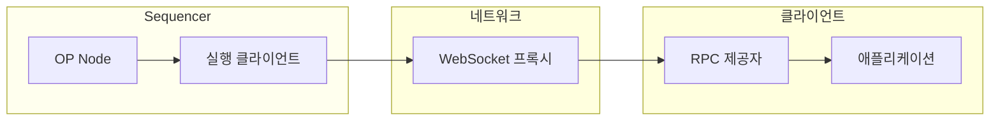

*Subblocks*(이전 명칭: Flashblocks)는 OP Stack sequencer가 전체 블록을 아직 구축하는 동안 스트리밍하는 부분 블록입니다.
Subblock은 200 ms마다 도착하므로, 애플리케이션은 트랜잭션을 포함한 블록이 봉인(seal)되기 훨씬 전에 트랜잭션 결과에 따라 동작할 수 있습니다. 블록 시간이 2초인 체인에서는 약 10배 더 빠릅니다.

이 페이지에서는 subblock이 무엇인지, 그 페이로드에 무엇이 포함되고 포함되지 않는지, 그리고 생성 구조가 어떻게 구성되는지 설명합니다.
애플리케이션에서 사전 확인된 상태를 읽으려면 [앱 통합 가이드](/ko/app-developers/guides/transactions/integrating-subblocks)를 따르십시오.
OP Sepolia와 OP Mainnet의 현재 간격 및 페이로드 변경 사항은 [Subblocks 공지](/ko/notices/subblocks)를 참조하십시오.

## 작동 방식

sequencer는 일반적으로 전체 블록을 실행한 다음, 블록 시간이 끝날 때 한 번 게시합니다.
Subblocks는 이 구간을 분할합니다. sequencer는 지금까지 실행한 내용을 200 ms마다 게시하며, 각 subblock은 이전 subblock을 확장합니다.

여기서 두 가지 속성이 도출되며, 두 가지 모두 스트림을 소비하는 모든 사람에게 중요합니다.

*   **Subblock 시퀀스는 추가 전용(append-only)입니다.** 봉인된 블록의 트랜잭션 목록은 시퀀스에 있는 모든 subblock을 순서대로 연결한 것입니다.
    subblock에서 이미 내보낸 트랜잭션은 이를 봉인하는 블록에서 순서가 바뀌거나 제외되지 않습니다.
    [Lagoon](/ko/op-stack/protocol/hardforks/lagoon)을 실행하는 체인에서는 봉인된 블록이 스트림이 별도로 전달하는 post-execution 트랜잭션으로 끝날 수도 있습니다. [post-execution 트랜잭션](#the-post-execution-transaction)을 참조하십시오.
*   **Subblock은 커밋먼트가 아니라 투영(projection)입니다.** 지금까지 실행된 트랜잭션을 보고할 뿐, 그 결과 상태를 증명하지는 않습니다.

시퀀스의 첫 번째 subblock은 블록의 입금(디파짓) 트랜잭션을 담고 있습니다. 입금 트랜잭션은 mempool의 트랜잭션이 고려되기 전에 실행되기 때문입니다.
이후의 각 subblock은 mempool 트랜잭션 묶음을 추가합니다.

200 ms 간격은 보장이 아니라 목표입니다.
한 간격에서 실행 부하가 크면 이후 간격에 남는 시간이 줄어들므로, 블록에 포함되는 subblock의 수는 달라집니다.

## Subblock 페이로드에 포함되는 내용

페이로드는 이전의 Flashblocks 형식과 와이어 호환되며, 타입 이름도 여전히 `ExecutionPayloadFlashblockDeltaV1`입니다.
제거된 필드는 없으며, 유일하게 추가된 것은 [아래](#the-post-execution-transaction)에서 설명하는 선택적 필드 `post_exec_tx`입니다.
네 개의 필드는 존재하지만 제로 값으로 설정됩니다.

| 필드 | 스트림상의 값 |
| --- | --- |
| `state_root` | `0x0000...0000` |
| `block_hash` | `0x0000...0000` |
| `withdrawals_root` | `0x0000...0000` |
| `withdrawals` | `[]` |

`transactions`, `gas_used`, `receipts_root`, `logs_bloom`을 포함한 다른 모든 필드는 실제 값을 담고 있습니다.

근본 원인은 상태 루트(state root)입니다.
상태 루트는 실행이 계속되는 동안 계산되며 블록이 봉인된 후에야 정확해지므로, subblock은 이를 담을 수 없습니다.
블록 해시는 상태 루트에 커밋하므로 블록 해시 역시 최종 값일 수 없습니다.

<Warning>
  페이로드가 와이어 호환성을 유지하므로, 0으로 설정된 필드를 읽으면 오류가 발생하는 대신 제로 값이 반환됩니다.
  스트림의 `state_root` 또는 `block_hash`를 신뢰할 수 있는 값으로 취급하는 통합은 아무런 경고 없이 실패합니다.
  두 필드 모두 없는 것으로 취급하고, subblock이 담고 있는 트랜잭션을 실행하여 상태를 도출하십시오.
</Warning>

스트림을 소비하는 node는 0으로 설정된 필드가 필요하지 않습니다.
node는 자체 체인 뷰를 기준으로 subblock의 트랜잭션을 실행하고 그 결과를 `pending` 블록 태그로 제공하므로, 와이어상에 루트가 없어도 `eth_call`과 `eth_getBalance`가 올바르게 응답합니다.

### Post-execution 트랜잭션

[Lagoon 네트워크 업그레이드](/ko/op-stack/protocol/hardforks/lagoon)부터는 블록이 `0x7D` 타입의 *post-execution 트랜잭션*으로 끝날 수 있습니다. 이 트랜잭션은 트랜잭션별 gas 환불과 같이 sequencer가 제공하는 합의 데이터를 담고 있습니다.
스트림은 이 트랜잭션을 인코딩된 바이트 형태로 `diff.post_exec_tx`에 담아 전달하며, 절대 `diff.transactions` 안에 넣지 않습니다.

이 트랜잭션이 `transactions` 밖에 있는 이유는 이미 스트리밍된 트랜잭션처럼 고정되어 있지 않기 때문입니다.
이 트랜잭션은 블록이 지금까지 실행한 모든 것을 바탕으로 계산되므로, sequencer는 subblock마다 이를 다시 계산하며 각 subblock의 값이 이전 값을 대체합니다.
여전히 변경되는 값을 추가 전용 목록에 넣으면, 이후 subblock이 모순되는 트랜잭션을 게시하게 됩니다.

따라서 스트림을 직접 읽는 경우, `diff.post_exec_tx`를 스트리밍된 또 하나의 트랜잭션이 아니라 변경 가능한 값으로 취급하십시오.

블록의 subblock 전체에 걸쳐 `diff.transactions`를 연결하면, 마지막 `0x7D` 트랜잭션(존재하는 경우)을 제외한 봉인된 블록의 트랜잭션 목록을 얻을 수 있습니다.

<Info>
  [Lagoon post-exec 사양](https://specs.optimism.io/protocol/lagoon/post-exec.html#subblocks)은 이 필드에 대한 규범적 문서이며, 구현 시 기준으로 삼아야 할 참고 자료입니다.
  이 사양은 필드가 `diff`에 위치하는 이유, 필드가 없는 경우, 어느 subblock의 값이 정규 값인지, `transactions`가 비어 있을 수 있다는 점, 그리고 이 트랜잭션에 대한 영수증이 스트리밍되지 않는 이유를 명시하며, 각 규칙마다 그 근거와 소비자가 가정할 수 있는 사항을 함께 제시합니다.
  [Subblocks 사양](https://specs.optimism.io/protocol/subblocks.html#post-execution-transactions)은 스트림 측면에서 동일한 필드를 다룹니다.
</Info>

## 아키텍처

Subblocks는 sequencer의 실행 클라이언트가 블록을 구축하는 동안 생성되며, WebSocket 스트림을 통해 게시됩니다.
합의 계층과 실행 계층 사이에는 아무것도 존재하지 않습니다.

*   **`op-node`**는 subblock이 없는 체인에서와 똑같이 engine API를 통해 블록 구축을 주도합니다.
*   **실행 클라이언트**는 블록을 실행하며, 실행하는 동안 200 ms마다 subblock을 게시합니다.
*   **`flashblocks-websocket-proxy`**는 활성 sequencer의 스트림을 RPC 제공자에게 중계합니다.
*   **`op-conductor`** *(선택 사항)*는 다중 sequencer 구성을 관리하여 정상 상태인 리더의 스트림만 프록시에 도달하도록 합니다.

Subblocks 생성은 OP Enterprise 고객에게 제공됩니다.
Subblocks 소비는 제한되지 않습니다. 모든 node가 스트림을 팔로우할 수 있으며, 모든 애플리케이션이 스트림을 팔로우하는 제공자로부터 사전 확인된 상태를 읽을 수 있습니다.

### Flashblocks 스택

Subblocks 이전에는 Flashblocks 스택이 사전 확인을 생성했습니다. 이 스택에서는 `rollup-boost`가 합의 계층과 두 개의 실행 클라이언트 사이를 조율했으며, `op-rbuilder`가 블록을 구축하고 `op-reth`가 대체(fallback) 빌더로 대기했습니다.

<Warning>
  Flashblocks 스택은 여전히 실행될 수 있지만, OP Labs는 이에 대해 **어떠한 지원도 제공하지 않습니다**.
  향후 포크에서 작동이 중단될 수 있습니다.
  `rollup-boost`와 `op-rbuilder`를 실행하는 체인은 마이그레이션을 계획해야 합니다.
  단계적 종료 일정은 [사전 확인 아키텍처 전환 공지](/ko/notices/preconfirmation-architecture-transition)를 참조하십시오.
</Warning>

제공 여부에 대한 정보는 [Subblocks 활성화](/ko/chain-operators/guides/features/subblocks-guide)를 참조하십시오.

## Subblocks FAQ

### 블록 구축 및 가용성

<AccordionGroup>
  <Accordion title="Subblock은 얼마나 자주 생성됩니까?">
    200ms마다 생성되지만, 더 낮은 값으로 구성할 수 있습니다.
    OP Sepolia와 OP Mainnet 모두 200 ms로 전환됩니다. 적용 일정은 [Subblocks 공지](/ko/notices/subblocks)를 참조하십시오.
  </Accordion>

  <Accordion title="블록에는 항상 최대 개수의 subblock이 포함됩니까?">
    아닙니다. 한 간격에서 실행 부하가 크면 이후 간격에 사용할 수 있는 시간이 줄어들므로, 블록마다 개수가 달라집니다.
  </Accordion>

  <Accordion title="큰 트랜잭션은 지연됩니까?">
    큰 트랜잭션은 남은 gas 용량이 충분한 어느 subblock에든 포함될 수 있으므로, 실제로는 블록의 뒷부분에 포함됩니다.
    구체적인 예는 [Subblocks와 gas 사용량](/ko/app-developers/guides/transactions/subblocks-and-gas-usage)을 참조하십시오.
  </Accordion>
</AccordionGroup>

### 안전성 및 연속성

<AccordionGroup>
  <Accordion title="블록 도중에 sequencer가 실패하면 어떻게 됩니까?">
    중단된 블록에 대해 이미 게시된 subblock은 봉인되지 않습니다.
    다중 sequencer 구성에서는 `op-conductor`가 정상 상태인 sequencer로 리더십을 이전하며, 스트림은 동일한 엔드포인트를 통해 새 리더로부터 계속됩니다.
    자세한 내용은 [op-conductor 문서](/ko/chain-operators/tools/op-conductor)를 참조하십시오.
  </Accordion>

  <Accordion title="Subblocks가 체인의 안전성 모델을 변경합니까?">
    아닙니다. subblock의 모든 트랜잭션은 블록에서와 동일한 엔진에 의해 동일한 규칙으로 실행됩니다. Subblocks는 sequencer가 결과를 알려주는 시점을 바꿀 뿐, 결과 자체를 바꾸지는 않습니다.
  </Accordion>

  <Accordion title="사전 확인이 취소될 수 있습니까?">
    예. sequencer가 unsafe 블록을 reorg할 수 있는 것과 동일한 조건에서 취소될 수 있습니다. 사전 확인은 프로토콜이 아닌 sequencer에 대한 신뢰 가정을 수반합니다. 각 단계가 보장하는 내용은 [트랜잭션 최종성](/ko/op-stack/transactions/transaction-finality)을 참조하십시오.
  </Accordion>

  <Accordion title="사전 확인 응답에는 무엇이 포함됩니까?">
    블록에서 지금까지 실행된 트랜잭션, 해당 영수증, 그리고 누적된 `gas_used`, `receipts_root`, `logs_bloom`이 포함됩니다.
    사용 가능한 `state_root`나 `block_hash`는 포함되지 않습니다. [subblock 페이로드에 포함되는 내용](#what-a-subblock-payload-carries)에서 설명한 것처럼 두 필드 모두 0으로 설정됩니다.
    또한 블록의 [post-execution 트랜잭션](#the-post-execution-transaction)이나 그에 대한 영수증도 포함되지 않습니다. 해당 트랜잭션은 `diff.post_exec_tx`로 별도로 스트리밍됩니다.
  </Accordion>
</AccordionGroup>

## 다음 단계

*   [Subblocks 통합 가이드](/ko/app-developers/guides/transactions/integrating-subblocks)를 참조하여 앱에서 사전 확인된 상태를 읽으십시오.
*   적용 일정과 점검해야 할 페이로드 필드는 [Subblocks 공지](/ko/notices/subblocks)를 확인하십시오.
*   Subblocks가 [블록 내 gas 가용성](/ko/app-developers/guides/transactions/subblocks-and-gas-usage)을 어떻게 변경하는지 알아보십시오.
