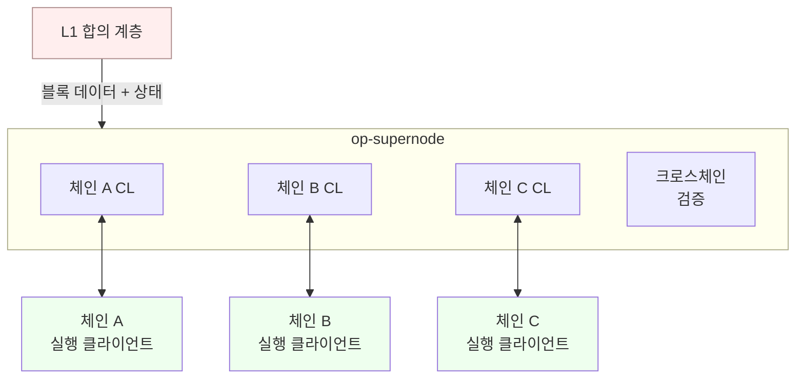
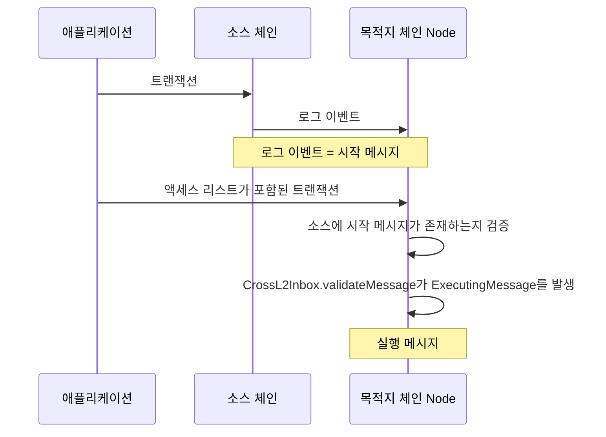
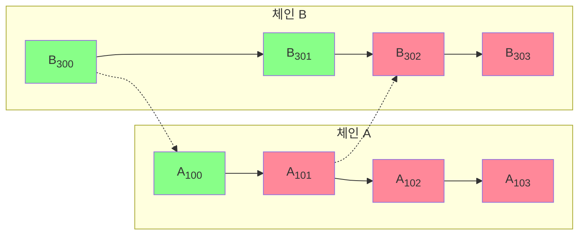
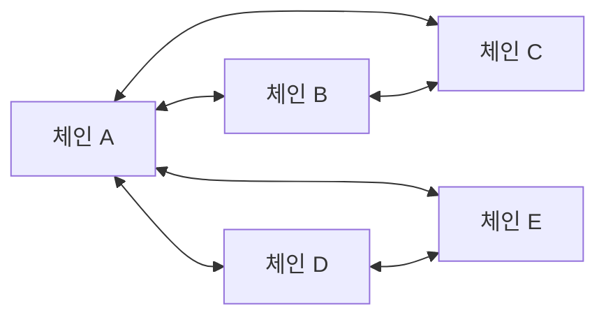
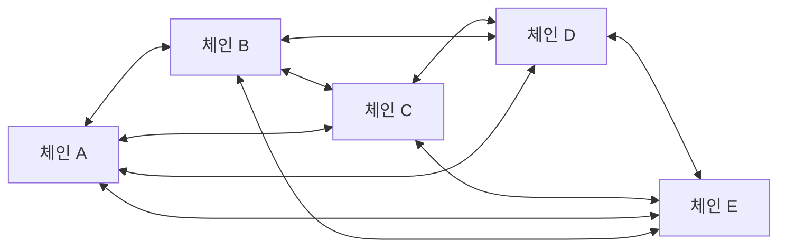

<Info>OP Stack interop은 Lagoon 하드포크와 함께 활성화됩니다. 일부 기능은 실험적일 수 있습니다.</Info>

<Info>
  **OP Stack 배우기 — 14단계 중 13단계.**
  단일 체인이 어떻게 안전하게 유지되는지 이해하셨습니다. 이 페이지에서는
  스택이 나아가는 방향, 즉 여러 체인으로 이루어진 네트워크를 하나의 블록체인처럼
  느끼게 하는 상호운용성을 다룹니다. 다 읽은 후에는 마지막 단계인
  [Docker로 node 실행하기](/ko/node-operators/tutorials/node-from-docker)로 이동하십시오.
</Info>

# OP Stack 상호운용성

블록체인이 스스로 생성한 정보에 대해 확신하기는 쉽습니다.
다른 출처에서 오는 정보를 안전하고 탈중앙화되며 검열 불가능한 방식으로 제공하기는 더 어렵습니다(이를 [오라클 문제(The Oracle Problem)](https://chain.link/education-hub/oracle-problem)라고 합니다).
OP Stack의 다음 주요 확장성 개선은 여러 체인으로 이루어진 네트워크를 하나의 블록체인처럼 느끼게 하는 것입니다.
이 목표를 달성하려면 지연 시간이 짧고 원활한 메시지 전달과 자산 브리징이 필요합니다.

*OP Stack 상호운용성(interoperability)*은 OP Stack 블록체인들이 서로의 상태를 읽을 수 있게 해 주는 프로토콜 집합입니다.
OP Stack 상호운용성은 다음과 같은 이점을 제공합니다.

*   ETH와 ERC-20 토큰이 네이티브 발행(mint) 및 소각(burn)을 통해 체인 간에 안전하게 이동합니다. 자산 상호운용성은 자산 래핑이나 유동성 풀로 인해 발생하는 유동성 파편화와 열악한 사용자 경험 문제를 해결합니다.
*   앱이 다른 체인에 존재하는 데이터와 조합(compose)될 수 있습니다.
*   이를 필요로 하는 애플리케이션을 위한 수평적 확장성을 제공합니다.

## 상호운용성 아키텍처

interop 이전의 OP Stack node는 두 가지 소프트웨어로 구성됩니다. 파생(derivation)을 주도하는 합의 클라이언트(예: op-node)와, 사용자 트랜잭션을 처리하고 블록을 구성하는 실행 클라이언트(예: op-geth)입니다.

OP Stack interop은 이 파이프라인 위에 크로스체인 메시지 검증을 추가합니다. 어떤 체인이든 실행 메시지(executing message)를 포함한 블록을 넘어 진행하기 전에, 해당하는 시작 메시지(initiating message)를 소스 체인에서 재현해야 합니다. 종속성 집합(dependency set)에 있는 모든 체인을 추적하는 일은 크리티컬 패스에 놓여 있습니다. 종속성을 증명할 수 없는 로컬 블록은 unsafe 상태로 남습니다.

이 검증 작업은 [op-supernode](/ko/op-stack/interop/supernode)가 수행합니다. op-supernode는 종속성 집합에 있는 모든 체인의 합의 계층을 함께 호스팅하고, 체인별 계층 위에서 크로스체인 검사를 실행하는 구성 요소입니다. 각 체인의 CL은 자기 체인의 안전성에 대한 단일 진실 공급원(single source of truth)으로 유지되며, supernode는 CL이 따르는 좁은 권한 인터페이스를 통해 "진행(advance)" 또는 "무효화(invalidate)" 신호를 보냅니다.



interop 참여자는 종속성 집합에 있는 모든 체인의 로그 이벤트를 인덱싱합니다. 그러한 이벤트는 모두 시작 메시지가 될 수 있기 때문입니다. 또한 L2 블록의 안전성을 판단하기 위해 L1의 합의 계층에서 데이터를 읽습니다.

종속성 집합의 모든 체인을 팔로우하는 데는 많은 비용이 듭니다. 각 체인마다 파생, 실행 엔진, 그리고 interop이 도입하는 크로스체인 기록 관리가 필요합니다. op-supernode는 모든 체인을 단일 프로세스에서 함께 실행하고 공유 L1 클라이언트와 beacon 클라이언트가 모든 체인에 서비스를 제공하도록 하여 이 비용을 줄입니다. [Superchain interop 클러스터](#superchain-interop-cluster)와 같이 완전히 연결된 클러스터의 경우, 이것이 크로스체인 검증이 실행되도록 설계된 토폴로지입니다. 아키텍처에 대해서는 [op-supernode 설명](/ko/op-stack/interop/supernode)을 참조하십시오.

## 메시지가 한 체인에서 다른 체인으로 전달되는 방식

크로스체인 메시지에는 두 개의 트랜잭션이 필요합니다. 하나는 소스 체인에서, 다른 하나는 목적지 체인에서 실행됩니다.



첫 번째 트랜잭션은 소스 체인에서 *시작 메시지(initiating message)*를 생성합니다. 시작 메시지는 단순한 로그 이벤트입니다. 목적지 체인의 종속성 집합에 속한 어떤 체인의 어떤 로그 이벤트든 크로스 도메인 메시지를 시작할 수 있습니다.

두 번째 트랜잭션은 목적지 체인에서 *실행 메시지(executing message)*를 생성합니다. 이 트랜잭션은 [`CrossL2Inbox`](https://specs.optimism.io/interop/predeploys.html?utm_source=op-docs&utm_medium=docs#crossl2inbox) predeploy를 호출하여 특정 로그 이벤트가 특정 소스 체인에서 발생했다고 주장합니다. `CrossL2Inbox` 호출은 외부 소유 계정(EOA)에서 올 수도 있지만, 더 일반적으로는 [`L2ToL2CrossDomainMessenger`](https://specs.optimism.io/interop/predeploys.html?utm_source=op-docs&utm_medium=docs#l2tol2crossdomainmessenger)와 같은 스마트 컨트랙트에서 옵니다.

각 실행 메시지는 소스 체인 ID, 소스 컨트랙트 주소(`origin`), 소스 블록 번호, 블록 내 로그 인덱스, 소스 블록 타임스탬프로 [시작 메시지를 고유하게 식별](https://github.com/ethereum-optimism/optimism/blob/develop/packages/contracts-bedrock/src/L2/CrossL2Inbox.sol#L13-L19)합니다. 모든 검사를 통과하면 `CrossL2Inbox`는 크로스체인 참조를 기록하는 `ExecutingMessage` 이벤트를 발생시킵니다.

### 액세스 리스트를 사용한 메시지 검증

`CrossL2Inbox` 자체는 다른 체인의 상태를 절대 읽지 않습니다. 실행 트랜잭션이 사용하려는 모든 크로스체인 메시지를 *사전에 선언*했는지만 검증합니다. 이를 통해 목적지 체인의 node는 트랜잭션이 블록에 포함되기 *전에* 소스 체인 로그 인덱스와 그 선언을 대조하여 확인할 수 있습니다.

선언은 `CrossL2Inbox` predeploy 주소를 대상으로 하는 트랜잭션의 [EIP-2930 액세스 리스트](https://eips.ethereum.org/EIPS/eip-2930)에 들어 있습니다. 각 실행 메시지에 대해 [interop 액세스 리스트 사양](https://specs.optimism.io/interop/predeploys.html#access-list)은 최대 세 개의 타입이 지정된 스토리지 키 항목을 정의합니다.

1.  소스 체인 ID, 블록 번호, 로그 타임스탬프, 로그 인덱스를 묶은 **lookup-identity** 항목. node가 인덱스에서 참조된 로그를 찾는 데 사용하는 힌트입니다.
2.  선택적인 **chain-ID extension** 항목. 소스 체인 ID가 64비트에 맞지 않는 경우에만 존재합니다.
3.  **checksum** 항목. 메시지의 전체 `Identifier`와 메시지 해시에 커밋하는 버전 지정 해시입니다. EVM 자체가 접근하는 유일한 항목입니다.

블록에 포함하기 전에 node는 `CrossL2Inbox`를 대상으로 하는 각 액세스 리스트 항목을 순회하면서, 항목이 가리키는 메시지를 재구성하고 해당 식별자와 해시를 가진 시작 로그가 필요한 안전성 수준에서 소스 체인에 실제로 존재하는지 확인합니다. 인식되지 않는 항목이나 node가 증명할 수 없는 메시지를 가리키는 항목이 있으면 검사에 실패하며 트랜잭션은 폐기됩니다.

EVM 내부에서 [`CrossL2Inbox.validateMessage`](https://github.com/ethereum-optimism/optimism/blob/develop/packages/contracts-bedrock/src/L2/CrossL2Inbox.sol#L76-L82)는 호출 시 전달받은 `Identifier`와 `msgHash`로부터 checksum을 다시 계산하고, gas 비용 측정을 사용하여 해당 스토리지 슬롯이 "warm" 상태인지, 즉 checksum 항목이 실제로 액세스 리스트에 있었는지 확인합니다. 항목이 없거나 잘못된 경우 `NotInAccessList`로 revert되므로, node의 사전 검사를 우회했거나 이와 모순되는 트랜잭션은 런타임에 절대 성공할 수 없습니다. 입금(디파짓) 트랜잭션은 액세스 리스트를 가질 수 없으므로, 입금 내부에서 `CrossL2Inbox.validateMessage`를 호출하면 항상 revert됩니다.

액세스 리스트 메커니즘은 sequencer, 빌더, 검증자에게 참조된 메시지가 존재하지 않는 트랜잭션을 블록에 포함되기 전에 폐기할 수 있는, EVM을 사용하지 않는 균일한 방법을 제공합니다. 이는 reorg와 equivocation 상황에서도 마찬가지입니다.

## 블록 안전성 수준

OP Stack interop은 앱 개발자와 노드 운영자가 이미 익숙한 세 가지 안전성 수준을 그대로 유지합니다.



*   **Unsafe**. 블록이 생성되어 gossip 프로토콜을 통해 공유되었지만, 그 소스 데이터가 아직 L1에 기록되지 않은 상태입니다. 블록을 생성한 sequencer가 여전히 equivocation을 할 수 있습니다.
*   **Safe**. 블록이 L1의 데이터로부터 파생되었으며, *동시에* 블록이 참조하는 모든 시작 메시지도 최소한 동일한 안전성 수준에 도달한 상태입니다. 블록이 safe 상태가 되면 sequencer를 포함한 어떤 참여자도 L1 reorg 없이는 이를 되돌릴 수 없습니다.
*   **Finalized**. 블록이 파생된 L1 데이터가 L1에서 최종 확정되어 더 이상 L1 reorg의 영향을 받지 않는 상태입니다.

interop의 핵심 속성은 두 번째 항목입니다. 블록은 그것이 의존하는 모든 것이 safe 상태가 된 후에만 safe로 취급됩니다. 위 다이어그램에서 체인 B의 블록 B<sub>302</sub>와 B<sub>303</sub>은 모두 체인 A의 시작 메시지를 참조합니다. 이 블록들은 A<sub>101</sub>(및 그에 이르는 모든 블록)도 L1에 기록될 때까지 safe 상태가 될 수 없습니다.

이 종속성 검사가 사용자를 [체인 간 이중 지불(double-spend)](/ko/op-stack/interop/reorg)로부터 보호합니다. sequencer가 unsafe 시작 메시지를 참조하는 실행 메시지를 수락하기로 선택하면 가능한 가장 낮은 크로스체인 지연 시간을 얻을 수 있지만, 자신의 [전이적 종속성 집합(transitive dependency set)](#what-is-the-transitive-dependency-set)에 있는 모든 sequencer가 gossip한 데이터를 결국 게시할 것이라는 신뢰 가정을 떠안게 됩니다. 그중 하나라도 equivocation을 하면, 실행 메시지를 포함한 블록은 reorg로 제거되고 입금 전용 블록으로 대체됩니다. 지연 시간과 보안 간의 트레이드오프, 그리고 체인 운영자가 인바운드 메시지에 대해 수락할 최소 안전성 수준을 구성하는 방법에 대한 자세한 논의는 [크로스체인 보안 조치](/ko/op-stack/security/interop-security)를 참조하십시오.

<Accordion title="전이적 종속성 집합이란 무엇입니까?">

  체인의 종속성 집합은 해당 체인이 시작 메시지를 직접 수락하는 체인들의 집합입니다. *전이적(transitive)* 종속성 집합에는 그 체인들의 종속성도 포함되며, 이는 계속 이어집니다.

  ```mermaid

  flowchart LR
      A[체인 A] <--> B[체인 B]
      B <--> C[체인 C]
      B <--> D[체인 D]
      D <--> E[체인 E]
      F[체인 F] <--> G[체인 G]
  ```

  위 그림에서 체인 A의 직접 종속성 집합은 `{B}`이지만, 전이적 종속성 집합은 `{B, C, D, E}`입니다. 체인 E의 unsafe 시작 메시지에 의존하는 체인 D의 블록은 해당 체인 E 블록이 L1에 기록될 때까지 unsafe 상태로 남으며, 그 체인 D 블록에 의존하는 모든 체인 B 및 체인 A 블록도 마찬가지입니다.

  전이적으로 검증하기 때문에 체인은 전혀 알지 못하는 체인으로부터 무제한의 신뢰를 물려받지 않고도 지연 시간이 짧은 메시지를 수락할 수 있습니다. 체인 A는 자신의 전이적 종속성 집합에 속한 체인들의 신뢰 가정만 수락하면 됩니다.
</Accordion>

## Interop 클러스터

각 체인은 *종속성 집합*, 즉 시작 메시지를 수락할 의향이 있는 체인들의 집합을 구성합니다. 종속성 집합이 서로에게 닿는 체인들의 그룹이 함께 interop 클러스터를 형성합니다.



종속성 집합이 대칭이거나 완전히 연결될 필요는 없습니다. 위 예에서 체인 B의 종속성 집합은 `{A, C}`이므로, 체인 E에서 체인 B로 보내는 메시지는 체인 A를 통해 중계되어야 합니다. 즉, E에서 A로 보낸 다음 A에서 B로 보냅니다.

### Superchain interop 클러스터

OP Stack은 기반 interop 프로토콜 위에 단일한 완전 연결 메시(mesh)를 구축합니다. Superchain interop 클러스터의 모든 체인은 다른 모든 체인을 자신의 종속성 집합에 포함하므로, 어떤 체인이든 다른 어떤 체인에게나 메시지를 직접 보낼 수 있습니다.



Superchain interop 클러스터의 모든 체인은 크로스체인 메시징의 가장 약한 고리(weakest-link) 위험을 완화하기 위해 동일한 보안 모델을 공유합니다. [Standard Rollup Charter](/ko/op-stack/protocol/blockspace-charter)에 명시된 대로, 이 체인들은 동일한 L1 `ProxyAdmin` Owner를 공유하며, 클러스터에 대한 모든 변경은 OP Stack 수정을 위한 확립된 거버넌스 프로세스인 표준 Protocol Upgrade 투표를 거칩니다.

운영 측면에서 완전히 연결된 클러스터는 [op-supernode](/ko/op-stack/interop/supernode)가 실행하도록 설계된 워크로드입니다. 하나의 supernode(또는 소규모 고가용성 풀)가 클러스터의 모든 체인을 파생하고 크로스체인 메시지를 검증하며, 운영자의 나머지 node들은 더 가벼운 모드로 이를 따라갑니다.

Superchain interop 클러스터는 단계적으로 출시되고 있습니다. 어떤 체인이 참여할 자격이 있는지 확인하려면 [Superchain Index](https://www.superchain.eco/superchain-index)를 방문하여 `Standard` charter를 가진 체인을 찾아보십시오.

## 다음 단계

*   [메시지가 한 체인에서 다른 체인으로 전달되는 방식](/ko/app-developers/guides/interoperability/message-passing)을 알아보십시오.
*   [interop이 reorg를 처리하고 이중 지불을 방지하는 방식](/ko/op-stack/interop/reorg)을 알아보십시오.
*   종속성 집합의 모든 체인을 함께 파생하고 크로스체인 안전성을 적용하는 구성 요소인 [op-supernode](/ko/op-stack/interop/supernode)에 대해 읽어 보십시오.
*   안전한 상호운용성을 위한 [크로스체인 보안 조치](/ko/op-stack/security/interop-security)를 읽어 보십시오.
