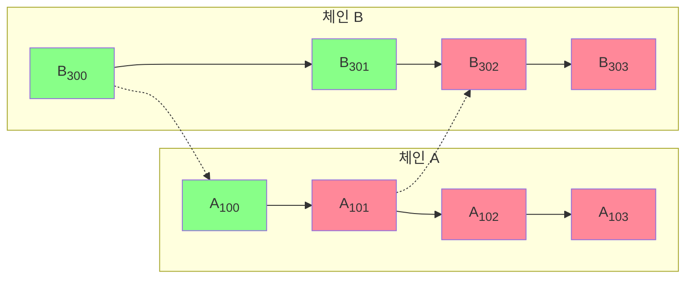
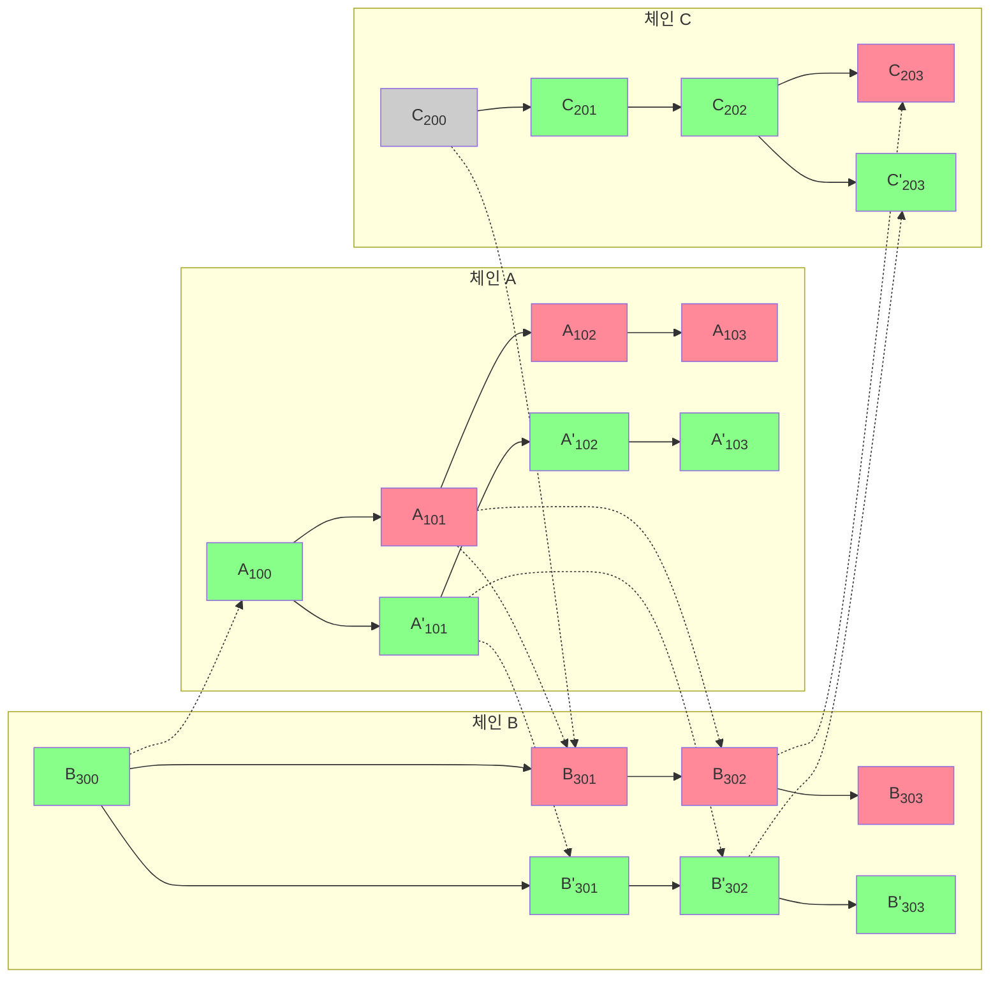

<Info>OP Stack interop은 Lagoon 하드포크와 함께 활성화됩니다. 일부 기능은 실험적일 수 있습니다.</Info>

[체인 재구성(chain reorganization), 즉 "reorg"](https://www.alchemy.com/overviews/what-is-a-reorg#what-happens-to-reorgs-after-the-merge)는 검증자들이 블록체인의 가장 정확한 버전에 대해 의견이 일치하지 않을 때 발생합니다.
올바르게 처리하지 않으면 크로스체인 환경에서의 reorg는 [이중 지불(double-spend) 문제](https://en.wikipedia.org/wiki/Double-spending)로 이어질 수 있습니다.
이중 지불 문제를 완화하는 가장 일반적인 해결책은 Ethereum 최종성(finality)을 기다리는 것이지만, 이 방법은 크로스체인 통신의 지연 시간을 늘리고 사용자 경험을 저하시킵니다.

<Accordion title="이중 지불이란 무엇입니까?">

  ```mermaid

  flowchart LR
      classDef ok fill:#8F8

      subgraph src["소스 체인"]
          direction TB
          debit["토큰 차감"]
          emit["시작 메시지 발생"]
          debit --> emit
      end

      subgraph dst["목적지 체인"]
          direction TB
          receive["시작 메시지 검증"]
          credit["토큰 입금"]
          receive --> credit
      end

      emit ==>|크로스체인 메시지|receive

      class debit,emit,receive,credit ok
  ```

  일반적인 자산 전송에서는 먼저 소스 체인에서 토큰이 차감된 다음, 목적지 체인으로 메시지가 전송됩니다.
  해당 메시지가 수신되면 목적지 체인에서 토큰이 입금되고, 사용자는 이제 그 토큰을 사용할 수 있습니다.

  ```mermaid

  flowchart LR
      classDef bad fill:#F89

      subgraph src["소스 체인(reorg 이후)"]
          direction TB
          gone["시작 트랜잭션이 reorg로 제거됨<br/>토큰이 차감되지 않음"]
      end

      subgraph dst["목적지 체인"]
          direction TB
          receive["오래된 시작 메시지가 수락됨"]
          credit["토큰 입금"]
          receive --> credit
      end

      gone -.->|메시지가 더 이상 정규 메시지가 아님|receive

      class gone,receive,credit bad
  ```

  이중 지불 문제는 목적지 체인이 유효한 시작 메시지를 수신했지만, reorg와 같은 소스 체인의 문제로 인해 해당 시작 트랜잭션이 더 이상 유효하지 않게 될 때 발생합니다.
  이 경우 토큰은 여전히 소스 체인에 있으면서 동시에 목적지 체인에도 존재하게 됩니다.

  메커니즘은 자산에 따라 다릅니다.
  ETH는 온체인 유동성 컨트랙트에 잠기고 잠금 해제되며, SuperchainERC20 토큰은 소각되고 발행됩니다.
  어느 쪽이든 이중 지불 위험은 동일합니다.
</Accordion>

이중 지불 문제를 완화하는 대부분의 해결책은 [L1 최종성](https://ethereum.org/en/developers/docs/consensus-mechanisms/pos/#finality)에 의존합니다. 그러나 이 방법은 지연 시간이 길고 사용자 경험이 좋지 않습니다.

이중 지불 문제를 완화하면서도 지연 시간이 짧은 크로스체인 경험을 제공하기 위해, OP Stack interop은 [블록 안전성 수준](/ko/op-stack/interop/explainer#block-safety-levels)을 사용합니다.
즉, 사용자는 1블록 지연 시간으로 OP Stack 체인 간에 자산을 전송할 수 있으며, reorg가 발생하더라도 소스 트랜잭션과 목적지 트랜잭션이 모두 유지되거나 모두 되돌려집니다.
어떤 경우에도 이중 지불의 기회가 생기는 구간은 없습니다.

## 블록 안전성 수준



위 다이어그램에서 실선 화살표는 체인의 이전 블록으로부터 블록이 파생되는 것을 나타냅니다. 점선 화살표는 시작 메시지가 있는 블록(소스)에서 해당 실행 메시지가 있는 블록(목적지)으로 이어집니다. 이 페이지 전체에서 블록은 안전성 수준에 따라 finalized(회색), safe(녹색), unsafe(빨간색)로 색이 지정됩니다.

블록체인 A는 블록 A<sub>100</sub>만 L1에 게시했습니다. 블록 A<sub>101</sub>은 여전히 unsafe 상태이며, 이에 직접적으로(A<sub>102</sub> 및 B<sub>302</sub>) 또는 간접적으로(A<sub>103</sub> 및 B<sub>303</sub>) 의존하는 모든 블록도 마찬가지입니다. 블록 B<sub>302</sub>와 B<sub>303</sub>이 그 자체로 L1에 기록되었더라도, A<sub>101</sub>이 safe가 될 때까지는 safe가 될 수 없습니다. 블록은 그것이 참조하는 모든 시작 메시지도 최소한 safe 상태가 된 후에만 safe로 취급되기 때문입니다. A<sub>101</sub>이 마침내 L1에 기록되면, 의존하는 블록들이 차례로 승격될 수 있습니다.

A<sub>101</sub>과 B<sub>302</sub> 사이의 메시지는 bridge를 통해 이동하는 자산일 수 있습니다.
이 경우 시작 메시지(A<sub>101</sub>)는 소스 체인(A)에서 `n`개의 토큰을 소각하고, 실행 메시지(B<sub>302</sub>)는 목적지 체인(B)에서 `n`개의 토큰을 발행합니다.

### 종속성 검사가 적용되는 방식

위의 종속성 규칙, 즉 블록은 그것이 참조하는 모든 시작 메시지도 safe가 된 후에만 safe가 된다는 규칙은 종속성 집합에 있는 모든 체인의 합의 계층을 함께 호스팅하는 구성 요소인 [op-supernode](/ko/op-stack/interop/supernode)가 적용합니다. 각 L2 타임스탬프에 대해 op-supernode의 interop 활동은 *대기(wait)*, *진행(advance)*, *무효화(invalidate)*, *되감기(rewind)* 중 하나를 결정합니다. 이 결정은 적용되기 전에 write-ahead log에 저장되므로, supernode는 재시작 후에도 이전과 동일한 상태에서 작업을 이어갑니다.

각 체인의 CL은 자기 체인의 안전성에 대한 단일 진실 공급원으로 유지됩니다. supernode는 CL이나 실행 계층에 직접 개입하지 않고, 체인 자체가 제어하는 인터페이스를 통해서만 진행에 영향을 줍니다. 이 페이지의 나머지 부분에서는 각 결정을 이끄는 상황을 설명합니다.

### L1 reorg

L1 reorg는 일반적으로 unsafe head에서 발생합니다. 즉, safe로 간주될 만큼 충분한 확인을 받기 전인 가장 최근의 L1 블록에서만 발생합니다. 각 체인의 CL은 이미 L1 safe 및 finalized 레이블을 통해 L1 파생을 필터링하므로, 거의 모든 L1 reorg는 L2 파생 파이프라인에 전혀 도달하지 않습니다.

L1 reorg가 실제로 L2에 영향을 미치는 경우, 다음 두 가지 중 하나가 발생합니다.

* **대체 L1 블록이 원래 블록과 동일한 배치 데이터를 담고 있는 경우.** 파생은 결정론적이므로 생성되는 L2 체인은 동일하며, L2 관점에서 reorg는 아무런 영향이 없습니다.
* **대체 L1 블록이 해당 배치 데이터를 담고 있지 않은 경우.** sequencer가 이를 감지하고 이후의 L1 블록에 영향을 받은 배치를 다시 게시합니다. [sequencer window](https://specs.optimism.io/glossary.html#sequencing-window)(OP Mainnet, Unichain 같은 표준 체인에서 3600 L1 블록 ≈ 12시간)가 지나기 전에 배치가 다시 기록되는 한, 파생은 동일한 L2 체인을 재현합니다. 배치가 다시 나타나지 않은 채 window가 지나면, 영향을 받은 L2 블록은 입금(디파짓) 전용 블록으로 대체됩니다(아래 [유효하지 않은 블록](#invalid-block) 참조).

유출된 L1 reorg로 인해 op-supernode가 체인별로 일관되지 않은 L1 뷰를 갖게 되면, interop 활동은 *되감기(rewind)*를 실행합니다. 검증된 상태가 롤백되고 L1이 안정되면 다시 파생됩니다.

L1 reorg 자체가 interop 보장을 깨뜨리지는 않습니다. 데이터가 돌아와 L2가 동일하게 유지되거나, 체인이 해당 구간에 대해 입금 전용 블록으로 대체됩니다. 후자는 sequencer가 단순히 오프라인 상태가 되었을 때와 동일한 동작입니다.

### Equivocation

sequencer는 두 가지 방법으로 나머지 OP Stack 체인에 새 블록을 알립니다.

*   gossip 프로토콜. 일반적으로 블록이 생성되는 즉시 사용됩니다.
    문제는 gossip 프로토콜이 커밋먼트를 생성하지 않는다는 점입니다.
*   L1에 게시. 일반적으로 블록이 생성되고 몇 분 후에 이루어집니다.
    그 이유는 비용 때문입니다. 압축과 L1 게시를 개별 블록마다 수행하는 것보다 큰 배치로 수행하는 것이 훨씬 저렴합니다.

Equivocation은 sequencer가 gossip 프로토콜을 통해 게시한 블록이 결국 L1에 기록되는 블록과 다를 때 발생합니다. L1 버전이 우선하며, [op-supernode](#how-the-dependency-check-is-enforced)는 gossip된 버전을 기반으로 구축된 모든 unsafe 종속 블록(로컬 또는 크로스체인)에 대해 *무효화(invalidate)*를 실행합니다.



다른 체인의 블록이 여기 있는 특정 블록에 의존하려면, 실행 메시지에서 해당 블록의 로그 중 하나를 참조해야 합니다. 그리고 블록은 의존하는 모든 시작 메시지도 최소한 safe에 도달한 후에만 safe 레이블을 얻습니다. 따라서 A<sub>101</sub>과 A'<sub>101</sub> 사이의 equivocation은 *unsafe* 블록만 무효화합니다. 즉, 체인 A의 A<sub>102</sub>와 A<sub>103</sub>(잘못된 이력을 확장한 블록), 체인 B의 B<sub>301</sub>과 B<sub>302</sub>(A<sub>101</sub>을 직접 참조한 블록) 및 그 뒤를 잇는 B<sub>303</sub>, 그리고 체인 C의 C<sub>203</sub>(B<sub>302</sub>를 참조한 블록)입니다. 이러한 unsafe 블록은 모두 reorg로 제거되고, A'<sub>101</sub>에서 파생된 `'` 표시가 붙은 해당 블록으로 대체됩니다. 이전에 safe 또는 finalized 레이블이 지정된 블록은 영향을 받지 않습니다.

### 유효하지 않은 블록

블록이 정규 체인에서 완전히 무효화될 수도 있습니다. 검증자가 L2 블록을 L1에서 재현할 수 없다고 판단하면(예: 배치가 소스 체인에 존재하지 않는 시작 메시지를 주장하는 경우), 정규 체인은 해당 블록을 *입금 전용 블록(deposit-only block)*으로 대체합니다. 입금 전용 블록은 L1을 통해 강제된 입금 트랜잭션만 포함하고 모든 sequencer 트랜잭션은 제거된 블록입니다. 위 예와 같은 interop 관련 실패의 경우, 이를 판단하는 검증자는 [op-supernode](#how-the-dependency-check-is-enforced)입니다.

<Accordion title="블록이 유효하지 않게 되는 이유는 무엇입니까?">

  다음과 같은 여러 가지 잠재적 이유가 있습니다.

  *   L1에 게시된 블록에 잘못된 정보가 포함된 경우. 예를 들어 배치가 소스 체인이 실제로 발생시킨 적 없는 시작 메시지를 주장하면, 이를 참조하는 실행 메시지는 재현될 수 없습니다.
  *   블록이 아예 게시되지 않은 경우. L1 에포크를 다루는 배치 없이 [sequencer window](https://specs.optimism.io/glossary.html#sequencing-window)(표준 체인에서 3600 L1 블록 ≈ 12시간)가 지나면, 검증자는 해당 에포크에 대해 입금 전용 블록으로 대체합니다.
</Accordion>

기능적으로 이는 equivocation과 동일하며, 위의 종속성 규칙도 같은 방식으로 처리합니다. unsafe 블록(및 이에 전이적으로 의존하는 모든 블록 체인)만 재구성되며, 이미 safe 레이블에 도달한 블록은 영향을 받지 않습니다.

{/*
### L2 reorg

An L2 reorg could happen after the sequencer is decentralized.
In that case, there is a deterministic FCU (fork choice update), just as there is on L1.
At worst, some unsafe blocks need to be recalculated (if one fork is chosen over another).
*/}

## 다음 단계

*   아키텍처의 나머지 부분은 [interop 설명](/ko/op-stack/interop/explainer)을 읽어 보십시오.
*   종속성 집합의 모든 체인을 함께 파생하고 위에서 설명한 안전성 수준을 적용하는 구성 요소인 [op-supernode](/ko/op-stack/interop/supernode)에 대해 읽어 보십시오.
*   안전한 상호운용성을 위한 [크로스체인 보안 조치](/ko/op-stack/security/interop-security)를 읽어 보십시오.
*   더 많은 [interop 가이드 및 튜토리얼](/ko/app-developers/guides/interoperability/get-started)을 확인하십시오.
