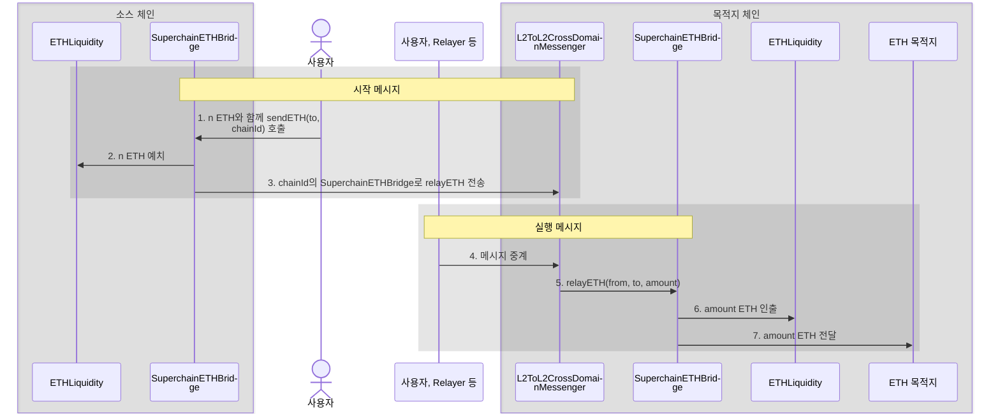

<Info>OP Stack interop은 Lagoon 하드포크와 함께 활성화됩니다.</Info>
<Info>
  이 문서는 interop ETH의 작동 방식에 대한 설명입니다.
  단계별 튜토리얼은 [여기](/ko/app-developers/tutorials/bridging/bridge-crosschain-eth)에서 확인할 수 있습니다.
</Info>

InteroperableETH는 Superchain 블록체인 간의 원활한 ETH 전송을 가능하게 합니다. 이는 세 가지 핵심 컨트랙트를 사용하여 구현됩니다.

*   [`SuperchainETHBridge`](https://github.com/ethereum-optimism/optimism/blob/develop/packages/contracts-bedrock/src/L2/SuperchainETHBridge.sol): Superchain 블록체인 간의 ETH 전송을 지원하는 bridge 컨트랙트입니다.
*   [`ETHLiquidity`](https://github.com/ethereum-optimism/optimism/blob/develop/packages/contracts-bedrock/src/L2/ETHLiquidity.sol): ETH 전송을 위한 유동성 공급자입니다.
`SuperchainETHBridge`는 목적지 체인에서 ETH 가용성을 보장하기 위해 이 컨트랙트를 유동성 저장소로 사용합니다.
*   [`L2ToL2CrossDomainMessenger`](https://github.com/ethereum-optimism/optimism/blob/develop/packages/contracts-bedrock/src/L2/L2ToL2CrossDomainMessenger.sol): [크로스체인 통신을 지원하는](/ko/app-developers/guides/interoperability/message-passing) 메시징 컨트랙트입니다.

Superchain ETH Bridge는 소스 체인의 `ETHLiquidity` 컨트랙트에 ETH를 예치하고, 목적지 체인에서 동일한 양을 인출합니다.
이 메커니즘은 자본 효율성을 개선하고, 자산 래핑이나 유동성 풀 의존으로 인해 발생하는 유동성 파편화와 열악한 사용자 경험을 없애 줍니다.

## 기능 및 이점

*   OP Stack 체인 간의 원활한 ETH 전송을 가능하게 합니다
*   OP Stack 체인 전반에서 ETH의 대체 가능성(fungibility)을 유지합니다
*   크로스체인 트랜잭션을 위한 유동성을 제공합니다
*   복잡한 브리징 프로세스를 추상화하여 사용자 경험을 개선합니다

## 작동 방식

#### 시작 메시지

1.  사용자(또는 사용자를 대신하여 동작하는 컨트랙트)가 목적지 주소와 chainId를 지정하여 `SuperchainETHBridge.sendETH`를 호출합니다.
    이 호출에는 전송할 금액만큼의 ETH가 첨부되어야 합니다.

2.  `SuperchainETHBridge`는 지정된 양의 ETH를 `ETHLiquidity`로 전송하여 소스 체인의 유통량에서 제거합니다.

3.  소스 체인의 `SuperchainETHBridge`는 [`L2ToL2CrossDomainMessenger`](/ko/app-developers/guides/interoperability/message-passing)를 사용하여 목적지 체인의 `SuperchainETHBridge`에 [`relayETH`](https://github.com/ethereum-optimism/optimism/blob/develop/packages/contracts-bedrock/src/L2/SuperchainETHBridge.sol) 메시지를 보냅니다.

#### 실행 메시지

4.  오프체인 주체가 메시지를 실행하기 위한 트랜잭션을 제출합니다.
    어떤 주소든 이 트랜잭션을 제출할 수 있지만, 목적지 체인에 ETH를 보유하고 있어야 합니다.
    일반적으로는 해당 체인의 autorelayer가 이를 수행합니다.

5.  목적지 체인의 `L2ToL2CrossDomainMessenger`가 다음 정보와 함께 `SuperchainETHBridge`를 호출합니다.

    *   ETH의 출처
    *   목적지 주소
    *   ETH 금액

    `SuperchainETHBridge`는 다음과 같은 여러 가지 기본 검사를 수행합니다.

    *   `relayETH` 호출은 `L2ToL2CrossDomainMessenger`에서 시작되어야 합니다.
    *   interop 메시지는 `SuperchainETHBridge`가 보낸 것이어야 합니다

6.  `SuperchainETHBridge`는 `ETHLiquidity`에서 지정된 양의 ETH를 인출합니다.
    `SuperchainETHBridge`만 `ETHLiquidity`에서 인출할 수 있으므로, ETH가 목적지 체인의 유통량에 올바르게 다시 도입되도록 보장됩니다.

7.  `SuperchainETHBridge`는 [`SafeSend`](https://github.com/ethereum-optimism/optimism/blob/develop/packages/contracts-bedrock/src/universal/SafeSend.sol)를 사용하여 ETH를 보냅니다.
    이를 통해 목적지가 스마트 컨트랙트인 경우에도 해당 컨트랙트의 커스텀 로직이 실행되지 않도록 보장합니다.
이 동작은 스마트 컨트랙트가 ETH를 수신할 때 커스텀 로직을 트리거할 수 있는 [표준 ETH 전송](https://docs.base.org/learn/address-and-payable/address-and-payable#receiving-ether-with-payable-addresses)과 다릅니다.

#### 환불

목적지에서 메시지를 끝내 중계하지 않으면 메시지는 [만료](/ko/app-developers/guides/interoperability/message-expiration)됩니다. 소스 체인의 `L2ToL2CrossDomainMessenger`가 `expiredMessages`에 해당 메시지를 보고하면, 발신자는 전송 시의 목적지 체인 ID, 메시지 nonce, 수신자, 금액을 지정하여 `SuperchainETHBridge.refundETH`를 호출할 수 있으며, ETH는 다시 `SafeSend`를 통해 한 번만 발신자에게 반환됩니다.

`sendETH`를 호출한 주소만 환불을 청구할 수 있습니다. 사용자를 대신하여 전송하는 컨트랙트는 직접 `refundETH`를 호출한 다음 ETH를 사용자에게 전달해야 합니다. 중계된 interop 메시지는 `sendETH`를 호출할 수 없으며, 이 경우 중계가 revert됩니다. L1에서 온 메시지는 호출할 수 있지만, 이때 전송의 발신자는 환불을 사용할 수 없는 `L2CrossDomainMessenger`가 되므로 전송이 만료되면 해당 ETH는 손실됩니다. L1에서 환불 가능한 방식으로 ETH를 보내려면, portal을 통해 자신의 주소로 입금(디파짓)한 다음 그 주소에서 `sendETH`를 호출하십시오.

## L1 Treasury

OP Stack 체인에서 유통되는 모든 ETH(`ETHLiquidity`가 보유한 ETH 제외)는 L1의 ETH로 뒷받침되어야 합니다.

이는 L1의 lockbox 컨트랙트에 의해 보장됩니다. 이 컨트랙트는 [OP Stack interop 클러스터 체인](/ko/op-stack/interop/explainer#superchain-interop-cluster)으로 브리징되었지만 아직 출금되지 않은 모든 ETH를 보관합니다.
새로운 ETH는 L1에 잠긴 경우에만 L2에서 발행될 수 있으며, lockbox에서 해제되기 전에 L2에서 소각됩니다.

다음은 작동 방식의 예입니다.

| 단계 | L1의 사용자 | Lockbox | 체인 A의 사용자 | 체인 A의 ETHLiquidity | 체인 B의 사용자 | 체인 B의 ETHLiquidity |
| ---: | ---------: | ------: | --------------: | ----------------------: | --------------: | ----------------------: |
|    1 |          7 |     200 |               0 |                  100000 |               0 |                  100000 |
|    2 |          4 |     203 |               3 |                  100000 |               0 |                  100000 |
|    3 |          4 |     203 |               2 |                  100001 |               0 |                  100000 |
|    4 |          4 |     203 |               2 |                  100001 |               1 |                   99999 |
|    5 |          4 |     203 |               2 |                  100001 |               0 |                   99999 |
|    6 |          5 |     202 |               2 |                  100001 |               0 |                   99999 |

1.  초기 상태입니다. 사용자는 L1에 7 ETH를 보유하고 있으며, 체인 A와 B에는 아무것도 없습니다.

2.  사용자가 3 ETH를 체인 A로 브리징합니다.
    사용자는 L1에서 bridge로 3 ETH를 보내고, 이는 lockbox에 잠깁니다.
    그런 다음 체인 A의 bridge가 사용자를 위해 3 ETH를 발행합니다.

3.  사용자가 체인 B로 브리징할 1 ETH와 함께 체인 A의 `SuperchainETHBridge`로 시작 메시지를 보냈습니다.
    이 1 ETH는 체인 A의 `ETHLiquidity`로 전송됩니다.

4.  누군가(사용자, 사용자를 대신하는 relayer 등)가 체인 B로 해당 실행 메시지를 보냈습니다.
    `SuperchainETHBridge`는 체인 B의 `ETHLiquidity`에서 사용자에게 1 ETH를 전송합니다.

5.  사용자가 체인 B에서 L1로 1 ETH를 출금하기로 결정합니다.
    일반적으로 사용자는 더 빠르고 대개 더 저렴한 서드파티 bridge를 통해 이를 수행하지만, 설명을 위해 이 사용자는 표준 OP bridge를 사용합니다.
    사용자는 체인 B에서 시작 메시지로 시작하며, 이 메시지는 1 ETH를 소각하고 L1로 메시지를 보냅니다.

6.  일주일 동안의 [챌린지 기간](/ko/op-stack/reference/glossary#challenge-period)이 지나면, 사용자는 L1에서 출금을 최종 확정합니다.
    lockbox가 1 ETH를 해제하고, 이 ETH는 사용자에게 전송됩니다.

## 다음 단계

*   [OP Stack interop을 사용하여 체인 간에 ETH를 전송하는 방법](/ko/app-developers/tutorials/bridging/bridge-crosschain-eth)을 실습해 보십시오.
