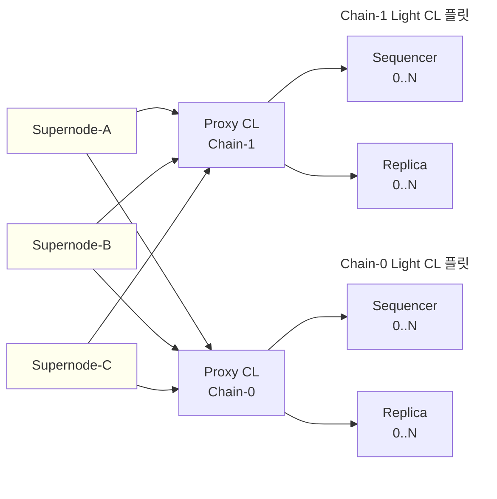

<Info>
  OP Stack interop은 Lagoon 하드포크와 함께 활성화됩니다.
  op-supernode는 interop 체인 운영자가 실행하게 될 런타임이며, 여기에서 설명하는 아키텍처와 인터페이스는 출시가 진행됨에 따라 계속 발전할 수 있습니다.
</Info>

# OP Supernode

*op-supernode*는 interop 종속성 집합(dependency set)의 모든 체인을 하나의 바이너리 안에서 가상 node로 함께 실행하는 구성 요소입니다.
interop 이전의 배포에서는 체인당 하나의 op-node를 실행하지만, op-supernode는 모든 체인을 나란히 호스팅하고, L1 및 beacon 체인 연결 구성을 체인 간에 공유하며, interop에 필요한 크로스체인 메시지 검증 작업을 추가합니다.

## op-supernode가 존재하는 이유

OP Stack interop은 단일 node가 해야 하는 일을 바꿉니다.
interop 이전에는 node가 자기 체인만 파생하면 되었습니다.
interop에서는 node가 *종속성 집합의 모든 체인*을 파생해야 합니다. 그 체인들 중 어느 것이든 로컬 체인이 의존하는 시작 메시지를 발생시킬 수 있기 때문입니다.
로컬 체인은 종속성을 증명할 수 없는 블록을 넘어 진행할 수 없으므로, 집합 내 다른 모든 체인의 파생이 크리티컬 패스에 놓이게 됩니다.

통합하지 않으면 모든 운영자는 종속성 집합의 모든 체인에 대해 전체 op-node와 실행 클라이언트를 실행해야 합니다.
이로 인해 L1 클라이언트, beacon 체인 클라이언트, 파생 파이프라인, 스토리지 레이아웃, 그리고 각각을 둘러싼 운영 연결 작업이 중복됩니다.
[Superchain interop 클러스터](/ko/op-stack/interop/explainer#superchain-interop-cluster)가 목표로 하는 구성인 완전히 연결된 종속성 집합의 경우, 이 중복은 클러스터 크기에 비례하여 늘어납니다.

op-supernode는 이러한 중복을 없앱니다.
각 체인을 하나의 프로세스 안에서 메모리 내 *가상 node(virtual node)*로 실행하고, 단일 L1 클라이언트와 단일 beacon 클라이언트가 모든 체인에 서비스를 제공하며, 체인별 계층 위에 크로스체인 메시지 검증 작업을 추가합니다.

## op-supernode의 작동 방식

supernode는 *체인 컨테이너(chain container)*와 *활동(activity)*으로 구성됩니다.
각 체인 컨테이너는 하나의 체인에 대한 하나의 가상 node를 호스팅합니다.
활동은 체인 계층 위에서 동작하며 모든 체인에 접근할 수 있는 모듈식 구성 요소입니다.

### 체인 컨테이너

*체인 컨테이너*는 하나의 체인을 감싸는 supernode의 래퍼입니다.
체인 컨테이너 안에는 *가상 node*가 있습니다. 가상 node는 별도의 운영 체제 프로세스가 아니라 프로세스 내부에서 호스팅되는 합의 계층(CL) 구현입니다.
현재 유일한 가상 node 구현은 라이브러리로 호스팅되는 op-node 자체입니다. 체인 컨테이너는 그 수명 주기(시작, 중지, 일시 중지, 재개)를 관리하고 나머지 supernode에 안정적인 인터페이스를 제공합니다.

체인 컨테이너는 엔진 컨트롤러를 통해 해당 체인의 실행 엔진도 구동합니다.
체인 컨테이너는 특정 체인의 내부에 직접 접근하지 않고도, supernode가 크로스체인 메시지를 검증하는 데 필요한 작업을 제공합니다. 여기에는 특정 타임스탬프의 local-safe 블록 파생, 영수증 조회, output-root 쿼리 응답이 포함됩니다.

### 공유 리소스

모든 체인을 하나의 프로세스 안에서 실행하면 리소스를 공유할 수 있습니다.

*   단일 **L1 RPC 클라이언트**와 단일 **L1 beacon 클라이언트**가 모든 체인에 서비스를 제공합니다. L1 블록과 blob 조회에 대한 캐시 적중이 체인 간에 공유됩니다.
*   **JSON-RPC 인터페이스**는 체인별로 네임스페이스가 지정됩니다. `10/`은 OP Mainnet의 RPC에, `130/`은 Unichain의 RPC에 연결됩니다. op-node 형태의 엔드포인트를 기대하는 도구는 해당 접두사를 통해 체인에 접근합니다.
*   **메트릭**도 동일한 방식으로 체인별 네임스페이스가 지정됩니다.
*   **데이터 디렉터리**는 네임스페이스가 지정되므로, 한 체인의 SafeDB와 P2P 상태가 다른 체인과 충돌하지 않습니다.

일부 플래그는 의도적으로 체인별이 아닌 supernode 수준에서 관리됩니다.
`--l1`과 `--l1.beacon`은 공유 L1 연결을 구성하며, 이에 대한 체인별 재정의는 경고 없이 최상위 값으로 대체됩니다.

### 활동

*활동(activity)*은 특정 체인 내부가 아니라 체인 계층 위에서 동작하는 모듈식 구성 요소입니다.
각 활동은 supernode 루트에 RPC 네임스페이스를 등록하고, Prometheus 메트릭을 노출하며, supernode가 실행되는 동안 goroutine을 실행할 수 있습니다.

supernode에는 다음과 같은 소수의 활동이 기본 제공됩니다.

*   **Heartbeat** — 활성 상태(liveness) 신호를 발생시키고 JSON-RPC를 통해 `heartbeat_check`를 노출합니다.
*   **SuperRoot** — *super root*를 생성합니다. super root는 특정 타임스탬프에서 종속성 집합 전반의 검증된 L2 블록에 대한 커밋먼트입니다. `superroot_atTimestamp`로 노출됩니다. 결함 증명(fault proof) 시스템은 interop을 인식하는 증명을 생성하기 위해 이 커밋먼트가 필요합니다.
*   **Supernode** — 종속성 집합 전반의 체인별 동기화 상태를 집계한 `supernode_syncStatus`를 노출합니다.
*   **Interop** — 실제 크로스체인 메시지 검증을 수행합니다(다음 섹션 참조).

## 크로스체인 메시지 안전성

interop 활동은 체인의 블록이 크로스체인 종속성을 충족하여 unsafe 이상으로 승격될 수 있는 시점을 결정하는 op-supernode의 구성 요소입니다.
이 활동은 체인 컨테이너 위에서 실행되며, 좁은 인터페이스를 통해 체인 컨테이너에 접근합니다.

모든 체인에서 생성되는 모든 블록에 대해 interop 활동은 한 가지 질문에 답합니다. 이 블록이 실행하는 모든 시작 메시지가 L1에서 재현되었으며, 목적지 블록이 도달하려는 것과 동일한 안전성 수준에 있는가?
이 활동은 라운드마다 *대기(wait)*, *진행(advance)*, *무효화(invalidate)*, *되감기(rewind)* 중 하나를 결정합니다.
결정은 write-ahead log에 기록되므로, supernode는 재시작 후에도 이전과 동일한 상태에서 작업을 이어갈 수 있습니다.

답이 *진행*이면 supernode는 체인의 CL에 블록을 승격하라는 신호를 보냅니다.
이 신호는 체인 컨테이너가 보유하고 가상 node가 따르는 *권한(authority)* 인터페이스를 통해 전달됩니다. supernode는 오직 해당 체인의 CL을 통해서만 체인의 안전성을 진행시킵니다.
CL은 자기 체인의 안전성에 대한 단일 진실 공급원으로 유지되며, 실행 계층(EL)은 interop에 대해 알 필요가 전혀 없습니다.

답이 *무효화* 또는 *되감기*이면 supernode는 체인에 영향을 받은 블록을 되돌리도록 지시합니다.
체인 A의 로그를 참조한 체인 B의 블록은 해당 체인 A 로그가 L1에 기록되지 않았거나, L1 기록이 P2P를 통해 gossip된 내용과 모순되는 경우 무효화될 수 있습니다.
이것이 체인 수준에서 어떻게 진행되는지는 [Interop reorg 인식](/ko/op-stack/interop/reorg)을 참조하십시오.

사용자에게 보이는 안전성 수준은 변경되지 않습니다.
블록 안전성 수준(*unsafe*, *safe*, *finalized*)은 interop이 없을 때와 동일하게 정의되며, 이러한 레이블에 대한 EL의 뷰도 일치합니다.
supernode의 역할은 크로스체인 종속성이 고려 대상이 된 이후에도 레이블이 의미하는 바를 정확히 유지하도록 보장하는 것입니다.

## op-supernode와 Light CL

op-supernode는 op-node 및 kona-node의 *Light CL* 모드와 함께 사용됩니다.
Light CL은 로컬 파생을 끄고 `optimism_syncStatus` RPC를 통해 신뢰할 수 있는 외부 소스로부터 safe 및 finalized 상태를 미러링합니다.
Light CL은 여전히 P2P를 통해 unsafe 체인을 진행시키며, safe 및 finalized 뷰만 위임합니다.

supernode와 Light CL은 함께 다음과 같은 토폴로지를 형성합니다.

*   신뢰할 수 있는 하나의 op-supernode(또는 소규모 고가용성 풀)가 종속성 집합의 모든 체인에 대한 파생과, 블록을 safe로 승격하는 interop 활동을 실행합니다.
*   운영자의 나머지 node들은 Light CL 모드로 op-node 또는 kona-node를 실행하고, supernode의 `optimism_syncStatus`를 가리키며, supernode의 safe 및 finalized 뷰를 물려받습니다.
*   노드 운영자도 동일한 구성을 실행하되, sequencer Light CL은 제외합니다(블록은 체인 운영자만 생성합니다).

이러한 분리 덕분에 이미 체인당 수십 또는 수백 개의 node를 운영하는 운영자에게도 interop이 감당 가능한 수준이 됩니다.
비용이 많이 드는 다중 체인 파생 작업은 supernode에서 한 번만 수행되며, 나머지 node들은 저렴하게 유지됩니다.

## 다음 단계

*   OP Mainnet 및 Unichain 활성화에 대한 노드 운영자 조치 체크리스트는 [interop 준비 공지](/ko/notices/interop-prep)를 읽어 보십시오.
*   권장 설정과 시작용 구성은 [supernode 구성 가이드](/ko/node-operators/guides/configuration/supernode)를, 전체 플래그 목록은 [op-supernode 구성 레퍼런스](/ko/node-operators/reference/op-supernode-config)를 읽어 보십시오.
*   supernode와 Light CL 토폴로지의 플릿 측면, 즉 `--l2.follow.source`로 경량 op-node를 실행하는 운영자용 패턴은 [특화된 op-node 토폴로지 공지](/ko/notices/specialized-node-topology)를 읽어 보십시오.
*   안전성 모델이 equivocation과 L1 reorg를 처리하는 방식은 [interop reorg 인식](/ko/op-stack/interop/reorg)을 읽어 보십시오.
*   운영자가 인바운드 메시지에 요구하는 안전성 수준을 구성하는 방법은 [크로스체인 보안 조치](/ko/op-stack/security/interop-security)를 읽어 보십시오.
*   프로토콜 수준에서 크로스체인 메시징이 작동하는 방식은 [interop 설명](/ko/op-stack/interop/explainer)을 읽어 보십시오.
*   구현 세부 사항은 monorepo의 [op-supernode 소스](https://github.com/ethereum-optimism/optimism/tree/develop/op-supernode)를 참조하십시오.
