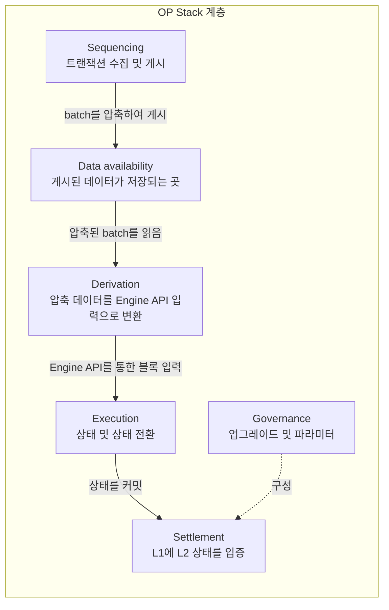

<Info>
  **OP Stack 배우기 — 14개 단계 중 5단계.**
  지금까지 OP Stack 체인이 Ethereum과 어떤 관계인지 알아보았습니다. 이 페이지에서는
  스택의 개념적 계층과 이를 채우는 소프트웨어 모듈, 즉 다음 단계에서 배포할
  구성 요소를 소개합니다. 다 읽은 후에는
  [자체 L2 rollup testnet 만들기](/ko/chain-operators/tutorials/create-l2-rollup)로 이어서 진행하십시오.
</Info>

**OP Stack은 L2 블록체인 생태계를 구축하기 위한 공통 개발 스택으로, Optimism을 구동하기 위해 Optimism Collective가 구축했습니다.**

이 페이지는 표준 계층 분류 체계입니다. 여기서 소개하는 여섯 개의 계층은
문서 전반에서 사용하는 계층입니다. 런타임에 구성 요소들이 어떻게 상호작용하는지는
[OP Stack 아키텍처](/ko/op-stack/architecture)를 참조하고, 개별 구성 요소의
허브 페이지는 [Stack 구성 요소](/ko/op-stack/components/index)를 참조하십시오.

OP Stack은 Optimism Collective가 유지 관리하는 소프트웨어 구성 요소의 모음으로 이해하는 것이 가장 좋습니다. 이 구성 요소들은 스택의 새로운 계층을 정의하거나 스택 내의 모듈로 들어맞습니다.

OP Stack은 아직 개발 중이므로 다양한 계층과 모듈이 계속 발전하고 있습니다.
이 페이지에서는 현재 존재하는 스택의 다양한 개념적 계층을 개략적으로 설명하고, 해당 계층에 들어맞는 일부 모듈을 소개합니다.
향후 존재할 수 있는 모든 모듈이나 계층을 포함하지는 않지만, 주요 OP Stack 구성 요소에 대한 좋은 개요를 제공합니다.
계층은 일반적으로 스택의 아래쪽(예: Data Availability Layer)으로 갈수록 엄격하게 정의되고, 스택의 위쪽(예: Governance Layer)으로 갈수록 느슨하게 정의됩니다.

<Info>
  이 페이지에서 설명하는 모든 모듈이 이미 프로덕션 상태로 존재하는 것은 아닙니다. 그러한 모듈은 "**개발 중**" 또는 "**제안됨**"으로 명시적으로 표시되어 있습니다.
</Info>

이 다이어그램은 계층을 쌓아 올리는 대신 데이터의 흐름을 따르므로, 위 섹션에서
설명한 아래에서 위로의 순서와 일치하지 않습니다. Sequencing은 L2 블록을
batch로 압축하여 데이터 가용성 계층에 게시하고, derivation은 압축된 batch를
다시 읽어 L2 체인을 재구축하는 입력으로 변환합니다. 각 계층은 교체 지점입니다.
체인은 계층마다 하나의 모듈을 선택합니다.

## 계층

### 데이터 가용성

Data Availability Layer는 OP Stack 기반 체인의 원시 입력이 게시되는 위치를 정의합니다. OP Stack 체인은 하나의 Data Availability 모듈을 사용하여 입력 데이터를 가져올 수 있습니다. OP Stack 체인은 Data Availability Layer로부터 도출되므로, 사용하는 Data Availability 모듈은 시스템의 보안 모델에 큰 영향을 미칩니다. 예를 들어, 특정 데이터를 Data Availability Layer에서 더 이상 가져올 수 없게 되면 체인을 동기화하지 못할 수 있습니다.

#### Ethereum DA

Ethereum DA는 현재 OP Stack에서 가장 널리 사용되는 Data Availability 모듈입니다. Ethereum DA 모듈을 사용하면 Ethereum 블록체인에서 접근 가능한 모든 정보로부터 소스 데이터를 도출할 수 있습니다. 여기에는 Ethereum calldata, 이벤트, 4844 데이터 blob이 포함됩니다.

*   [명세](https://specs.optimism.io/protocol/derivation.html?utm_source=op-docs&utm_medium=docs#batch-submission-wire-format)
*   [소스 코드](https://github.com/ethereum-optimism/optimism/tree/develop/op-batcher)

### 시퀀싱

Sequencing Layer는 OP Stack 체인의 사용자 트랜잭션이 수집되어 사용 중인 Data Availability Layer 모듈에 게시되는 방식을 결정합니다. OP Stack의 기본 Rollup 구성에서는 일반적으로 하나의 전용 Sequencer가 시퀀싱을 처리합니다. Derivation Layer에 정의된 규칙은 일반적으로 Sequencer가 특정 기간 이상 트랜잭션을 보류하지 못하도록 제한합니다. 향후 시퀀싱은 모듈화되어, 체인이 현재 Sequencer를 제어하는 메커니즘을 쉽게 선택하고 변경할 수 있게 될 것입니다.

#### 단일 sequencer

OP Stack의 기본 Sequencer 모듈은 Single Sequencer 모듈로, 전용 행위자에게 Sequencer 역할을 수행할 권한이 부여됩니다. Single Sequencer 모듈에서는 거버넌스 메커니즘이 특정 시점에 누가 Sequencer 역할을 수행할 수 있는지 결정할 수 있습니다.

#### 다중 sequencer

Single Sequencer 모듈을 간단히 수정한 것이 Multiple Sequencer 모듈로, 특정 시점의 Sequencer가 사전에 정의된 행위자 집합에서 선택됩니다. 개별 OP Stack 기반 체인은 가능한 Sequencer 집합을 정의하는 정확한 메커니즘과 그 집합에서 Sequencer를 선택하는 메커니즘을 결정할 수 있습니다.

### Derivation

Derivation Layer는 Data Availability Layer의 원시 데이터가 처리되어, 표준 [Ethereum Engine API](https://github.com/ethereum/execution-apis/blob/94164851c1630ff0a9c31d8d7d3d4fb886e196c0/src/engine/README.md)를 통해 Execution Layer로 전송되는 처리된 입력을 형성하는 방식을 정의합니다. Derivation Layer는 원시 입력 데이터를 파싱할 때 Execution Layer가 정의하는 현재 시스템 상태를 참고할 수도 있습니다. Derivation Layer는 다양한 데이터 소스로부터 Engine API 입력을 도출하도록 수정할 수 있습니다. Derivation Layer는 모든 원시 입력 데이터를 파싱하는 방법을 알아야 하므로 일반적으로 Data Availability Layer와 밀접하게 연결되어 있습니다.

#### Rollup

Rollup 모듈은 Ethereum 블록 데이터, Sequencer 트랜잭션 batch, Deposited 트랜잭션 이벤트 등으로부터 Engine API 입력을 도출합니다.

*   [명세](https://specs.optimism.io/protocol/derivation.html?utm_source=op-docs&utm_medium=docs#l2-chain-derivation-pipeline)
*   [소스 코드](https://github.com/ethereum-optimism/optimism/tree/develop/op-node)

#### Indexer

Indexer 모듈은 Derivation Layer 모듈로, Ethereum DA와 같은 Data Availability Layer 모듈상의 특정 스마트 컨트랙트에 트랜잭션이 전송되거나, 해당 컨트랙트가 이벤트를 발생시키거나, 해당 컨트랙트의 스토리지가 수정될 때 Engine API 입력을 도출합니다.

### Execution

Execution Layer는 OP Stack 시스템 내 상태의 구조를 정의하고, 이 상태를 변경하는 상태 전환 함수를 정의합니다. 상태 전환은 Engine API를 통해 Derivation Layer로부터 입력을 받을 때 트리거됩니다. Execution Layer 추상화는 EVM 수정이나 완전히 다른 기반 VM의 사용 가능성을 열어 줍니다.

#### EVM

EVM은 Ethereum Virtual Machine과 동일한 상태 표현 및 상태 전환 함수를 사용하는 Execution Layer 모듈입니다. OP Stack의 Ethereum Rollup 구성에서 사용하는 EVM 모듈은 EVM을 약간 수정한 버전으로, Ethereum에서 시작된 L2 트랜잭션에 대한 지원을 추가하고, Ethereum에 트랜잭션을 게시하는 비용을 반영하기 위해 각 트랜잭션에 L1 Data Fee를 추가로 부과합니다.

*   [소스 코드](https://github.com/ethereum-optimism/optimism/tree/develop/rust/op-reth)

### Settlement layer

Settlement Layer는 외부 블록체인상의 메커니즘으로, 해당 외부 제3자 체인(다른 OP Stack 체인 포함)에서 OP Stack 체인(대상)의 상태에 대한 **뷰(view)**를 수립합니다. 각 대상 체인에 대해 하나 이상의 외부 체인에 하나 이상의 Settlement 메커니즘이 존재할 수 있습니다. Settlement Layer 메커니즘은 **읽기 전용**이며, 제3자 체인이 대상 OP Stack 체인의 상태를 기반으로 자신의 상태에 영향을 줄 수 있는 결정을 내릴 수 있게 합니다.

"Settlement Layer"라는 용어는 Settlement Layer 메커니즘이 블록체인에서 ETH와 토큰의 출금을 처리하는 데 자주 사용된다는 사실에서 유래했습니다. 이러한 종류의 출금 시스템은 먼저 대상 블록체인의 상태를 제3자 체인에 증명한 다음, 그 상태를 기반으로 출금을 처리합니다. 본질적으로 Settlement Layer는 제3자 체인이 대상 체인의 상태를 신뢰할 수 있게 해 줄 뿐입니다.

트랜잭션이 해당 Data Availability 계층에 게시되고 최종 확정되면, 그 트랜잭션은 OP Stack 체인에서도 최종 확정됩니다. 기반 Data Availability 계층이 무너지지 않는 한, 해당 트랜잭션은 더 이상 수정되거나 제거될 수 없습니다. Settlement Layer는 트랜잭션의 *결과*를 검증할 수 있어야 하므로 아직 Settlement Layer에서 받아들여지지 않았을 수 있지만, 트랜잭션 자체는 이미 변경 불가능합니다.

#### 증명(attestation) 기반 결함 증명

<Note>
  **대체됨.** OP Mainnet은 2024년 6월 10일 결함 증명(fault proof)이 활성화되기 전까지
  이 방식으로 정산했습니다. Settlement Layer는 교체 지점이며, 이 모듈은 OP Stack이
  교체한 모듈이므로 여기에 설명합니다.
</Note>

증명(attestation) 기반 결함 증명 메커니즘은 낙관적(optimistic) 프로토콜을 사용하여 OP Stack 체인의 뷰를 수립합니다. 일반적으로 낙관적 정산 메커니즘에서는 **Proposer** 주체가 OP Stack 체인의 현재 유효한 상태라고 판단하는 것을 제안할 수 있습니다. 이러한 제안이 일정 기간("챌린지 기간") 내에 무효화되지 않으면 메커니즘은 해당 제안이 올바르다고 간주합니다. 특히 Attestation Proof 메커니즘에서는 사전에 정의된 당사자 중 일정 임계값 이상이 제안의 상태와 다른 유효한 상태에 대한 증명(attestation)을 제공하면 제안이 무효화될 수 있습니다. 이는 사전에 정의된 참여자 중 적어도 임계값 수 이상이 정직하다는 신뢰 가정을 전제로 합니다.

#### 결함 증명 기반 낙관적 정산

**이것이 현재 OP Mainnet이 사용하는 Settlement Layer 모듈**이며, 2024년 6월 10일에 활성화되었습니다. 이 모듈은 증명(attestation) 메커니즘의 MultiSig challenger를 무허가 결함 증명 프로세스로 대체합니다. 누구나 체인의 상태를 제안할 수 있으며, 누구나 잘못되었다고 판단하는 제안에 이의를 제기할 수 있습니다. 올바르게 구성된 결함 증명은 챌린지 기간 내에 잘못된 제안을 무효화하며, 이를 통해 신뢰 가정이 지정된 참여자 집합의 정직성에서 결함 증명 구성의 정확성으로 옮겨 갑니다. 해당 구성이 실패할 경우에는 [Guardian](/ko/op-stack/protocol/privileged-roles#guardian) 역할을 수행하는 Optimism Security Council이 최후의 안전장치가 됩니다.

*   [명세](https://specs.optimism.io/fault-proof/index.html?utm_source=op-docs&utm_medium=docs)
*   [결함 증명 설명](/ko/op-stack/fault-proofs/explainer)
*   [소스 코드](https://github.com/ethereum-optimism/optimism/tree/develop/packages/contracts-bedrock/src/dispute)

#### 유효성 증명 기반 정산

유효성 증명(Validity Proof) 기반 정산 메커니즘은 수학적 증명을 사용하여 제안된 뷰의 정확성을 입증합니다. 제안된 상태에 유효한 증명이 함께 제공되면 즉시 무조건적으로 수락되며, 그렇지 않으면 거부됩니다. 이 메커니즘은 특정 참여자나 프로세스에 대한 신뢰가 아니라 암호학적 가정에 의존합니다. 챌린지 기간이 필요 없지만, 증명을 생성하기 위해 상당한 사전 연산이 필요합니다.

### Governance

Governance Layer는 시스템 구성, 업그레이드, 설계 결정을 관리하는 데 사용되는 도구와 프로세스의 일반적인 집합을 의미합니다. 이는 비교적 추상적인 계층으로, 대상 OP Stack 체인과 제3자 체인상에서 OP Stack의 다른 여러 계층에 영향을 미치는 광범위한 메커니즘을 포함할 수 있습니다.

#### MultiSig 컨트랙트

MultiSig 컨트랙트는 사전에 정의된 참여자 집합으로부터 임계값 이상의 서명을 받으면 작업을 수행하는 스마트 컨트랙트입니다. 이는 OP Stack 기반 시스템의 구성 요소 업그레이드를 관리하는 데 자주 사용됩니다. 현재 OP Mainnet에서는 이 메커니즘을 사용하여 bridge 컨트랙트의 업그레이드를 관리합니다. MultiSig 컨트랙트 시스템의 보안은 참여자 수, 임계값, 각 참여자의 보안 절차 등 다양한 요인에 따라 달라집니다.

#### 거버넌스 토큰

거버넌스 토큰은 의사 결정을 탈중앙화하는 데 널리 사용됩니다. 거버넌스 토큰의 정확한 기능은 경우에 따라 다르지만, 가장 일반적인 메커니즘은 토큰 보유자가 프로젝트가 내려야 하는 결정 중 일부에 대해 투표할 수 있도록 하는 것입니다. 투표는 직접 수행하거나 위임을 통해 수행할 수 있습니다.
