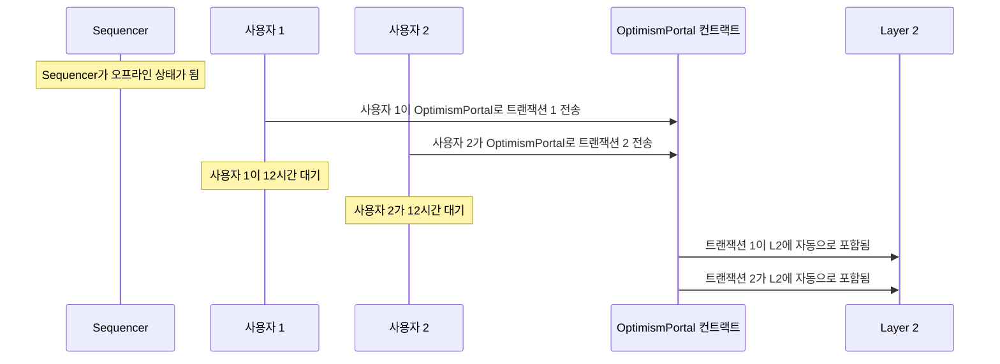
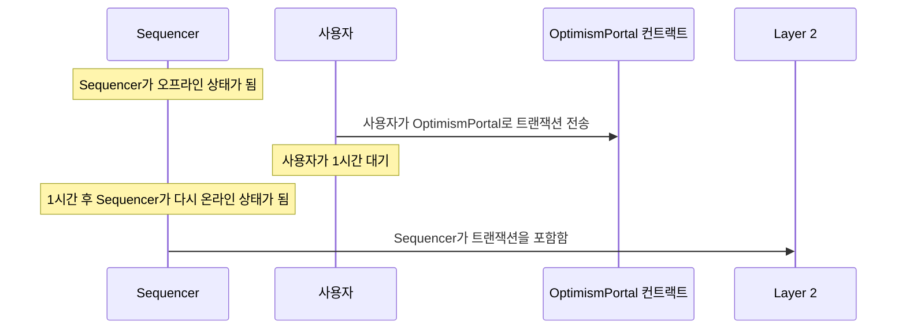
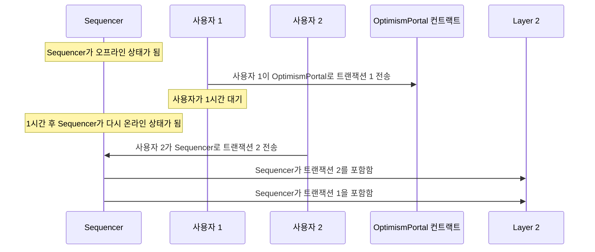

import { NormativeSpec } from "/ko/snippets/normative-spec.mdx"

<NormativeSpec
  what="입금 트랜잭션을 통한 sequencer 우회"
  title="입금(deposits) 명세"
  href="https://specs.optimism.io/protocol/deposits.html#user-deposited-transactions"
  note="이 페이지는 장애 유형과 완화 방안을 설명하며, 명세의 내용을 다시 서술하지 않습니다."
/>

모든 OP Stack 체인에는 L2 트랜잭션을 수신하고, 순서를 정하고, L1에 게시할 수 있는 Sequencer가 있습니다.
여느 소프트웨어 시스템과 마찬가지로, Sequencer도 여러 가지 이유로 사용할 수 없게 될 가능성이 있습니다.
Sequencer 장애가 미치는 영향과 이에 대비하는 방법을 알아 두는 것이 중요합니다.

Sequencer 장애는 크게 두 가지 유형으로 분류할 수 있습니다.

1.  **Sequencer 다운타임 장애**는 Sequencer가 사용자의 L2 트랜잭션을 전혀 수신하거나 처리할 수 없을 때 발생합니다. 이 유형의 장애는 사용자에게 Sequencer에 트랜잭션을 전혀 제출할 수 없는 상태로 나타납니다.
1.  **트랜잭션 제출 장애**는 Sequencer가 여전히 사용자의 L2 트랜잭션을 수신하고 처리할 수 있지만 이 트랜잭션을 L1에 게시할 수 없을 때 발생합니다. 이 유형의 장애는 장기간 해결되지 않는 경우가 아니라면 일반적으로 사용자에게 영향을 미치지 않습니다.

두 가지 장애 유형 모두 L1의 [`OptimismPortal`](https://github.com/ethereum-optimism/optimism/blob/develop/packages/contracts-bedrock/src/L1/OptimismPortal2.sol#L684) 컨트랙트에 트랜잭션을 직접 제출하여 우회할 수 있지만, 몇 가지 중요한 주의 사항이 있습니다.
이러한 잠재적 장애와 대처 방법에 대한 자세한 내용은 계속 읽어 보십시오.

## Sequencer 다운타임 장애

### 설명

Sequencer 다운타임 장애는 Sequencer가 사용자의 L2 트랜잭션을 수신하거나 처리할 수 없을 때 발생합니다.
이 유형의 장애는 클라이언트 소프트웨어의 버그, 클라우드 장애 또는 기타 유사한 오류 등 다양한 문제로 인해 발생할 수 있습니다.
Sequencer 다운타임 장애의 정확한 원인은 각 OP Stack 체인에서 Sequencer를 실행하는 데 사용하는 특정 인프라에 따라 달라질 수 있습니다.

### 영향

Sequencer 다운타임 장애는 사용자 경험에 상당한 영향을 미칠 수 있습니다.
이 유형의 장애가 발생하는 동안 사용자는 Sequencer에 트랜잭션을 직접 제출할 수 없습니다.
사용자는 네트워크가 특정 블록 높이에서 "멈춘" 것처럼 보이는 현상을 관찰할 수 있습니다.

### 완화 방안

사용자는 L1의 [`OptimismPortal`](https://github.com/ethereum-optimism/optimism/blob/develop/packages/contracts-bedrock/src/L1/OptimismPortal2.sol#L684) 컨트랙트에 L2 트랜잭션을 직접 보내 언제든지 Sequencer를 우회할 수 있습니다.
이 기능에 대한 자세한 내용은 아래의 [Sequencer 우회](#bypassing-the-sequencer) 섹션을 참조하십시오.

## 트랜잭션 제출 장애

### 설명

트랜잭션 제출 장애는 Sequencer가 여전히 사용자의 L2 트랜잭션을 수신하고 처리할 수 있지만 이 트랜잭션을 L1에 게시할 수 없을 때 발생합니다.
이 유형의 장애는 예상치 못한 L1 네트워크 상황, 트랜잭션 제출 소프트웨어의 버그 또는 기타 유사한 오류 등 다양한 문제로 인해 발생할 수 있습니다.

### 영향

트랜잭션 제출 장애는 장기간 해결되지 않는 경우가 아니라면 일반적으로 사용자 경험에 큰 영향을 미치지 않습니다.
이 유형의 장애가 발생하는 동안 사용자는 Sequencer에 트랜잭션을 직접 제출할 수 있지만, 이러한 트랜잭션이 포함된 블록은 L1에 게시되지 않습니다.
사용자는 L2 체인의 "unsafe" 블록 높이는 계속 증가하는 반면 "safe" 및 "finalized" 블록 높이는 멈춰 있는 것처럼 보이는 현상을 관찰할 수 있습니다.

트랜잭션 제출 장애가 해결되지 않고 지속되면 더 큰 영향을 미칠 수 있습니다.
중요한 점은 Sequencer에 직접 보낸 L2 트랜잭션은 Sequencer가 L2 블록에 포함한 후 일정 시간 내에 게시되어야 한다는 것입니다.
이 시간 제한을 초과하면 L2 체인을 재구성(reorg)하여 해당 트랜잭션을 이후 블록에 포함해야 합니다.
이는 사용자에게 L2 체인의 예상 상태가 크게 변경된 것처럼 보일 수 있습니다.

### 완화 방안

사용자는 L1의 [`OptimismPortal`](https://github.com/ethereum-optimism/optimism/blob/develop/packages/contracts-bedrock/src/L1/OptimismPortal2.sol#L684) 컨트랙트에 L2 트랜잭션을 직접 보내 언제든지 Sequencer를 우회할 수 있습니다.
이 기능에 대한 자세한 내용은 [Sequencer 우회](#bypassing-the-sequencer) 섹션을 참조하십시오.

## Sequencer 우회

OP Stack 체인의 핵심 보안 목표 중 하나는 Sequencer가 사용자의 L2 체인 트랜잭션 제출을 막을 수 없어야 한다는 것입니다.
OP Stack 체인의 사용자는 L1의 [`OptimismPortal`](https://github.com/ethereum-optimism/optimism/blob/develop/packages/contracts-bedrock/src/L1/OptimismPortal2.sol#L684) 컨트랙트에 L2 트랜잭션을 직접 보내 언제든지 sequencer를 우회하고 L2 체인에 트랜잭션을 포함시킬 수 있습니다.

### OptimismPortal 소개

`OptimismPortal` 컨트랙트는 스마트 컨트랙트와 EOA 모두가 Sequencer의 직접적인 개입 없이 L2 트랜잭션을 생성하는 데 사용할 수 있는 L1 스마트 컨트랙트입니다.
많은 사용자가 모든 OP Stack 체인에서 사용할 수 있는 Standard Bridge 시스템을 통해 L1과 L2 간에 ETH나 기타 토큰을 bridge할 때 이미 이 컨트랙트와 간접적으로 상호작용하고 있습니다.

현재 `OptimismPortal` 컨트랙트는 OP Stack 체인마다 고유한 컨트랙트입니다.
`OptimismPortal` 컨트랙트의 주소는 해당 OP Stack 체인의 컨트랙트 주소 페이지를 참조하십시오.
`OptimismPortal` 컨트랙트의 `depositTransaction` 함수를 호출하여 L1에서 L2 트랜잭션을 트리거할 수 있습니다.

### 기능

사용자는 컨트랙트 생성 및 ETH 값을 전달하는 트랜잭션을 포함하여 모든 유형의 L2 트랜잭션을 `OptimismPortal` 컨트랙트로 보낼 수 있습니다.
보안 조치로서, L2 스마트 컨트랙트의 관점에서 `OptimismPortal`을 통해 보낸 트랜잭션은 Sequencer를 통해 보낸 트랜잭션과 구별할 수 없습니다.

### 주소 별칭(Address aliasing)

`OptimismPortal` 컨트랙트를 통해 트리거된 트랜잭션은 스마트 컨트랙트가 보낸 경우가 **아니라면** 트랜잭션을 트리거한 L1 주소에서 보낸 것으로 표시됩니다.
스마트 컨트랙트가 `OptimismPortal` 컨트랙트를 통해 보낸 L2 트랜잭션은 해당 스마트 컨트랙트 주소의 "별칭" 버전에서 보낸 것으로 표시됩니다.
주소 별칭에 대한 자세한 내용은 [주소 별칭](/ko/op-stack/protocol/differences#address-aliasing) 설명을 참조하십시오.

### 포함 규칙

`OptimismPortal` 컨트랙트로 보낸 트랜잭션은 Sequencer 장애의 영향을 제한하도록 설계된 일련의 규칙에 따라 처리됩니다.
장애의 영향을 적절히 완화하려면 이러한 규칙을 자세히 이해하는 것이 중요합니다.

`OptimismPortal`로 보낸 모든 트랜잭션에는 다음이 적용됩니다.

1.  특정 L1 블록 내에서 보낸 트랜잭션은 함께 처리됩니다.
2.  트랜잭션에는 미래 방향으로 최대 [`max_sequencer_drift`](https://specs.optimism.io/protocol/derivation.html?utm_source=op-docs&utm_medium=docs#overview)를 넘지 않는 타임스탬프가 부여됩니다.
3.  트랜잭션은 수신된 순서대로 처리됩니다.
4.  트랜잭션은 [`sequencer_window`](https://specs.optimism.io/glossary.html?utm_source=op-docs&utm_medium=docs#sequencing-window) 내에 처리됩니다.

실제로 이는 `OptimismPortal` 컨트랙트로 보낸 트랜잭션이 항상 수신된 순서대로, 그리고 최대 `sequencer_window`(기본값은 12시간이지만 체인마다 다를 수 있음)의 지연 내에 처리된다는 것을 의미합니다.
Sequencer를 사용할 수 없거나 이 `sequencer_window` 내에 트랜잭션이 L1에 게시되지 않으면, OP Stack 체인은 자동으로 재구성되어 이러한 트랜잭션이 L2 체인에 포함되도록 보장합니다.

`OptimismPortal` 컨트랙트로 보낸 트랜잭션이 처리되는 방식에 대한 훨씬 자세한 설명은 [L2 체인 derivation 명세](https://specs.optimism.io/protocol/derivation.html?utm_source=op-docs&utm_medium=docs)를 참조하십시오.

### 포함 시나리오

다양한 시나리오에서 `OptimismPortal` 컨트랙트로 보낸 트랜잭션이 어떻게 처리되는지 이해하면 도움이 됩니다.
다음 시나리오들은 Sequencer와 L2 체인의 상태에 대해 서로 다른 가정을 하여 `OptimismPortal` 컨트랙트로 보낸 트랜잭션이 어떻게 처리되는지 보여 줍니다.

#### Sequencer 전체 장애

이 시나리오에서는 Sequencer를 완전히 사용할 수 없어 어떤 트랜잭션도 처리할 수 없다고 가정합니다.
사용자는 트랜잭션을 L2 체인에 포함시키기 위해 `OptimismPortal` 컨트랙트에 직접 보내야 합니다.
또한 `sequencer_window`가 12시간으로 설정되어 있다고 가정합니다.
여기서는 두 명의 사용자가 `OptimismPortal` 컨트랙트로 트랜잭션을 보냅니다.

`sequencer_window`가 경과한 후 두 사용자가 보낸 트랜잭션이 자동으로 L2 체인에 포함되는 방식을 살펴보십시오.
트랜잭션은 `OptimismPortal` 컨트랙트가 수신한 순서대로 L2 체인에 포함됩니다.

#### Sequencer 부분 장애

이 시나리오에서는 Sequencer가 일정 기간 중단되었다가 `sequencer_window`가 경과하기 전에 다시 온라인 상태가 된다고 가정합니다.
사용자가 다운타임 중에 `OptimismPortal`로 트랜잭션을 보내지만, Sequencer가 다시 온라인 상태가 되어 전체 `sequencer_window`가 끝나기 전에 해당 트랜잭션을 L2 블록에 포함합니다.

#### 부분 장애 시 순서

여기서도 Sequencer가 일정 기간 중단되었다가 `sequencer_window`가 경과하기 전에 다시 온라인 상태가 된다고 가정합니다.
이 시나리오에서는 Sequencer가 `OptimismPortal` 컨트랙트로 보낸 트랜잭션 사이에 추가 트랜잭션을 L2 체인에 포함할 수 있는 능력을 살펴봅니다.

여기서는 첫 번째 사용자가 두 번째 사용자보다 먼저 `OptimismPortal` 컨트랙트로 트랜잭션을 보냈고 두 번째 사용자는 이후 Sequencer로 트랜잭션을 보냈음에도, Sequencer는 첫 번째 사용자의 트랜잭션보다 두 번째 사용자의 트랜잭션을 먼저 포함할 수 있습니다.
**Sequencer는 일반적으로 다른 트랜잭션보다 `OptimismPortal` 컨트랙트로 보낸 트랜잭션을 먼저 포함하지만, 이는 보장되지 않습니다.**

