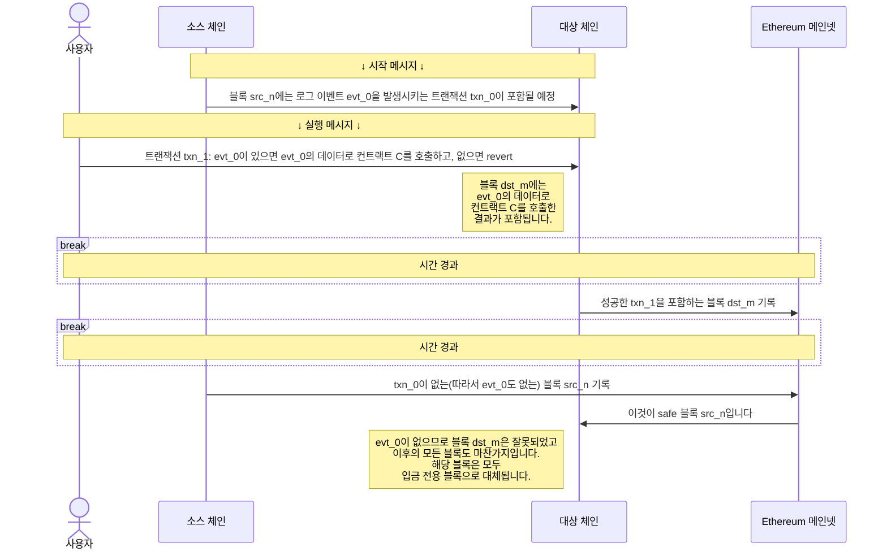
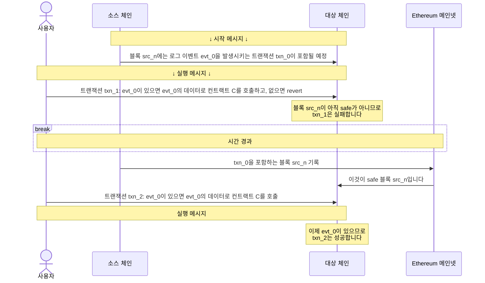

<Info>OP Stack 상호운용성(interop)은 Lagoon 하드포크와 함께 활성화됩니다.</Info>
## 신뢰 모델

이 상호운용성 취약점은 시작 메시지(initiating message)가 존재하는 것처럼 보여 실행 메시지(executing message)가 처리되었지만, 실제로는 시작 메시지가 정규(canonical) 체인에 나타나지 않는 경우에 발생합니다.
L1 reorg를 제외하면, 이는 두 가지 방식으로 발생할 수 있습니다.

*   *이중 발행(Equivocation)*. sequencer가 가십(gossip) 프로토콜을 통해 게시한 블록이 최종적으로 L1에 기록되는 블록과 다른 경우입니다.
    문제는 가십 프로토콜로 전달된 블록에는 시작 메시지로 사용되는 로그 항목이 포함되어 있지만, 실제 블록(L1에 기록된 블록)에는 포함되어 있지 않을 때 발생합니다.
    이를 처리하는 방식은, unsafe 블록에 의존하는 블록은 그 자체도 unsafe로 간주하는 것입니다.
    해당 블록은 자신이 (직접 또는 간접적으로) 의존하는 모든 블록이 L1에 기록될 때까지 safe로 취급되지 않습니다.

*   *잘못된 정보*. sequencer 운영자는 의존성 집합(dependency set)에 속한 모든 체인에 대해 검증자(verifier) node를 실행할 수 있으며, 이 경우 모든 체인의 safe 트랜잭션으로부터 시작 메시지를 추론할 수 있습니다.
    리소스를 절약하기 위해 sequencer는 소스 블록체인의 기존 node에 질의하는 방식을 선택할 수도 있습니다.
    이 경우 sequencer에 제공된 정보가 잘못되었다면, 당연히 sequencer가 게시하는 블록도 잘못된 블록이 됩니다.

    이 경우 잘못된 블록은 다른 검증자에 의해 입금 전용 블록(deposit only block)으로 대체됩니다.

    <Accordion title="입금 전용 블록이란 무엇입니까?">

      일반적으로 정규 블록체인에 포함되는 블록은 sequencer가 L1에 게시한 블록입니다.
      그러나 해당 블록이 누락되었거나 유효하지 않은 경우(예: 누락된 시작 메시지에 의존하는 경우), 이 블록은 *입금 전용 블록*으로 대체됩니다. 입금 전용 블록은 sequencer에 의존하지 않고 L1로부터 내용을 계산할 수 있는 블록입니다.

      이는 OP Stack 블록에 두 가지 유형의 사용자 트랜잭션이 있기 때문에 가능합니다.

      *   sequencer 트랜잭션: sequencer를 거치는 트랜잭션입니다.
          이 트랜잭션은 매우 저렴하지만, 이론적으로 sequencer가 검열할 수 있습니다.
      *   입금(디파짓) 트랜잭션: 사용자가 L1을 통해 제출하는 트랜잭션입니다.
          이 트랜잭션은 L1 트랜잭션 비용이 들어 훨씬 비싸지만, sequencer가 검열할 수 없습니다.

      입금 전용 블록에는 sequencer 트랜잭션은 포함되지 않고, 입금 트랜잭션과 일부 내부 트랜잭션만 포함됩니다.

      이 과정에 대한 자세한 내용은 [기술 사양을 참조하십시오](https://specs.optimism.io/protocol/derivation.html?utm_source=op-docs&utm_medium=docs#deriving-the-transaction-list).
    </Accordion>

## 지연 시간과 보안 간의 트레이드오프

시작 메시지는 다른 블록체인의 블록에서 비롯됩니다.
가십 프로토콜을 통해 블록을 받는 즉시 시작 메시지를 수락하면 지연 시간은 최소화되지만, 보안 측면의 비용이 따릅니다(소스 sequencer가 가십을 통해 잘못된 정보를 보낼 수 있기 때문입니다).
반대로 소스 sequencer가 블록을 L1에 게시할 때까지 기다릴 수도 있습니다.
이 경우 블록이 올바르다는 것을 더 확신할 수 있지만, 지연 시간이 길어집니다.

지연 시간과 보안 수준에 따라 세 가지 선택지가 있습니다.

### Unsafe 시작 메시지

L2 블록은 unsafe 상태로 시작합니다. 즉, 해당 블록에 대한 L1 증거가 없으며, 해당 블록체인의 sequencer가 잘못된 정보를 보낼 수 있습니다.
예를 들어 특정 트랜잭션이 블록에 포함되지 않았는데 포함되었다고 알리는 것처럼 잘못된 정보를 보내는 것을 *이중 발행*(equivocation)이라고 합니다.
상호운용성을 사용하여 블록을 생성하는 sequencer는 지연 시간을 최소화하기 위해 (가십 프로토콜을 통해 받은) unsafe 블록의 메시지를 수락하도록 선택할 수 있습니다.

이중 발행 위험을 최소화하기 위해, L1에 기록된 블록(*local safe*)은 해당 블록과 그 블록체인의 모든 이전 블록이 L1에 기록된 후에만 완전히 safe(*cross safe*)한 것으로 간주됩니다.
소스 블록이 먼저 L1에 기록되면 대상 sequencer가 이를 감지할 수 있습니다.
이중 발행으로 인해 sequencer가 의존한 시작 메시지가 소스 블록에 없는 경우, sequencer는 오류를 식별하고 상태를 다시 계산할 수 있습니다. 이 시나리오에서는 큰 피해가 발생하지 않습니다.

그러나 시작 메시지에 의존하는 실행 메시지를 포함한 대상 블록이 먼저 L1에 기록되면(예: 해당 체인의 트래픽이 더 많은 경우) 다른 위험이 발생합니다.
최종적으로 L1에 기록된 소스 블록에 시작 메시지가 없으면, 검증자는 대상 블록과 그 블록에 의존하는 모든 블록의 도출(derivation)이 잘못되었음을 감지합니다.
이 경우 대상 블록과, 어느 체인에서든 해당 블록에 의존하는 모든 후속 블록은 입금 전용 블록으로 분류됩니다.

### Safe 시작 메시지

또는 시작 메시지가 cross safe 블록에 포함된 후에만 실행 메시지를 수락하도록 sequencer를 구성할 수 있습니다.
cross safe 블록이란 L1에 기록되었고, 그 의존성(동일 체인의 이전 블록의 의존성을 포함하여 직접 또는 간접적인 모든 의존성)이 모두 L1에 기록된 블록을 말합니다.

블록이 cross safe 상태가 되면 소스 sequencer는 이중 발행을 할 수 없으며, [L1 reorg](https://www.alchemy.com/overviews/what-is-a-reorg#what-happens-to-reorgs-after-the-merge)가 발생한 경우에만 상태를 다시 계산하면 됩니다.
이렇게 보안이 강화되는 대신, 한 블록체인에서 다른 블록체인으로 메시지가 전달되는 데 더 오랜 시간이 걸립니다.
Base나 OP Mainnet처럼 처리량이 높은 OP Stack 체인은 약 5분마다 배치를 제출하므로, 시작 메시지가 safe 상태가 되기까지 평균 약 2.5분이 걸립니다.

[이 Dune 대시보드](https://dune.com/oplabspbc/op-stack-chains-l1-activity#submission-frequency)에서 OP Stack 체인이 얼마나 자주 배치를 제출하는지 확인할 수 있습니다.

### 최종 확정된 시작 메시지

시작 메시지가 *최종 확정*(finalized)될 때까지, 즉 L1에 되돌릴 수 없게 기록되어 reorg의 영향을 받지 않게 될 때까지 모든 실행 메시지를 거부하도록 sequencer를 구성할 수도 있습니다.
현재 이 방식은 메시지 지연 시간을 [약 15분](https://ethereum.org/en/roadmap/single-slot-finality/) 늘립니다.

 

<Image src="/public/img/op-stack/protocol/safe-unsafe.png" alt="Safe 및 Unsafe 보안 다이어그램" width={700} height={500} />

<Info>
  sequencer가 unsafe 시작 메시지를 수락하더라도, 이에 의존하여 생성한 블록은 해당 시작 메시지를 포함한 블록이 L1에 기록되어 safe 상태가 될 때까지 unsafe로 간주됩니다.
</Info>

{/*
## What is stopping a sequencer from censoring a cross-chain message?
There is nothing stopping a sequencer from censoring a transaction when it is sent directly to the sequencer. This does not mean the network has no censorship resistance, users can always send a deposit transaction for censorship resistance as strong as L1 guarantees. The tradeoff here is the latency, instead of being confirmed in ~2 seconds, the transaction can be confirmed at the rate of L1 block production. It may be possible to adopt something like [EIP-7547](https://eips.ethereum.org/EIPS/eip-7547) in the future to enable low latency censorship resistance.

## What is stopping a shared sequencer from including just the executing message and not the initiating message?
The protocol enforces the fact that all executing messages are valid. It does this by reorganizing out executing messages that have invalid initiating messages. Running software that does not enforce this would be non-standard behavior and would leave yourself at risk of accepting an invalid executing message and therefore running on a forked chain.

*/}

*   OP Stack 상호운용성이 내부적으로 어떻게 작동하는지에 대한 자세한 내용은 [사양을 확인하십시오](https://specs.optimism.io/interop/overview.html?utm_source=op-docs&utm_medium=docs)
*   더 많은 [상호운용성 튜토리얼](/ko/app-developers/tutorials/interoperability/message-passing)을 확인하십시오
