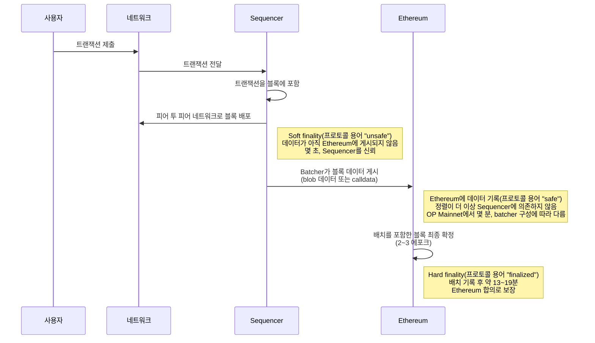

이 가이드에서는 OP Stack 체인의 트랜잭션이 언제 최종적인 것으로 간주되는지 설명하고, OP Stack의 트랜잭션 최종성(finality)에 관한 일반적인 오해를 다룹니다. 대부분의 사용자에게 중요한 두 단계인 **soft finality**와 **hard finality**로 최종성을 설명하고, 두 단계를 node 운영자와 원격 프로시저 호출(RPC) 사용자가 다루는 프로토콜 자체 용어(unsafe, safe, finalized)에 대응시킵니다.

## 최종성의 기본

트랜잭션 최종성이란 특정 가정하에서 트랜잭션을 되돌릴 수 없게 되는 시점을 말합니다. 예를 들어 Ethereum 트랜잭션은 Ethereum 합의 메커니즘의 특정 조건이 충족되면 최종 확정된 것으로 간주됩니다. Ethereum 위에 구축된 많은 애플리케이션은 사용자가 자금을 입금한 후 사용자 계정에 잔액을 반영하는 것과 같은 결정을 내릴 때 이 속성에 의존합니다.

## OP Stack 최종성

표준 구성의 OP Stack 체인은 별도의 합의 프로토콜을 실행하지 않고 Ethereum의 합의 메커니즘을 사용하여 트랜잭션을 정렬하고 최종 확정하는 Layer 2(L2) rollup입니다. 따라서 OP Stack 체인은 Ethereum의 정렬 및 최종성 속성을 그대로 이어받습니다.

## Soft finality와 hard finality

사용자나 애플리케이션의 관점에서는 두 시점이 중요합니다.

*   **Soft finality:** Sequencer가 트랜잭션을 처리하여 블록에 포함한 시점입니다. 이 시점부터 트랜잭션의 결과가 확정되고 그에 따른 체인 상태를 계산할 수 있으며, 실제로 Sequencer가 이를 재정렬하는 일은 없습니다. Sequencer 자체 블록의 reorg는 극히 드뭅니다. Sequencer를 신뢰하는 애플리케이션은 즉시 트랜잭션을 기반으로 조치를 취할 수 있으며, OP Mainnet에서는 일반적으로 제출 후 약 2초 이내입니다. [Subblocks](/ko/op-stack/features/subblocks)를 스트리밍하는 체인에서는 애플리케이션이 제출 후 200밀리초 만에 사전 확인(preconfirmation)을 기반으로 더 일찍 조치를 취할 수 있습니다.
*   **Hard finality:** 트랜잭션 데이터가 Ethereum에 게시되고, 해당 데이터를 포함한 Ethereum 블록이 Ethereum 합의 메커니즘에 의해 최종 확정된 시점입니다. 이 시점부터 트랜잭션은 일반 Ethereum 트랜잭션만큼 최종적입니다. 이를 되돌리려면 Ethereum 자체의 최종성 보장을 깨뜨려야 합니다. OP Mainnet에서는 일반적으로 제출 후 약 15~30분 이내에 이루어집니다.

Soft finality에는 반드시 이해해야 할 신뢰 가정이 따릅니다. Soft finality는 체인 운영자가 운영하는 단일 Sequencer에 의존합니다. 트랜잭션 데이터가 Ethereum에 기록되기 전까지는, 실제로 그런 일이 거의 일어나지 않더라도 기술적으로 Sequencer가 reorg를 통해 트랜잭션을 제거할 수 있습니다. Sequencer를 신뢰하지 않는다면 트랜잭션 데이터가 Ethereum에 기록될 때까지 기다리십시오. 그 시점부터는 정렬이 Ethereum에 의해 고정되며 더 이상 Sequencer에 의존하지 않습니다.
체인의 batcher 키에도 동일하게 적용됩니다. batcher 키를 제어하는 주체가 어떤 트랜잭션 데이터를 Ethereum에 게시할지 결정하며, node는 해당 데이터가 기록된 후 몇 분 이내에 그 데이터에 맞추어 자신의 unsafe 블록을 reorg합니다.
거래소, bridge, 그리고 트랜잭션을 기반으로 오프체인 작업을 수행하는 모든 서비스는 최소한 safe 단계까지 기다려야 합니다. 자세한 내용은 [거래소 및 bridge를 위한 보안 가이드](/ko/op-stack/security/exchanges-and-bridges)를 참조하십시오.

그 중간 시점도 그 자체로 알아 둘 가치가 있습니다. 트랜잭션 데이터가 Ethereum 블록에 포함되면 정렬에 대해 더 이상 Sequencer를 신뢰할 필요가 없지만, Ethereum 블록 자체는 Ethereum이 최종 확정하기 전까지 원칙적으로 여전히 reorg될 수 있습니다. Hard finality는 이 마지막 단서까지 제거합니다.

## 프로토콜 용어와의 대응

내부적으로 OP Stack node는 **unsafe**, **safe**, **finalized**의 세 가지 상태를 추적합니다. "unsafe"라는 단어 때문에 망설일 수 있지만, 이는 위에서 설명한 soft finality 단계를 가리키는 프로토콜의 기술 용어입니다. 트랜잭션이 포함된 블록의 데이터가 아직 Ethereum에 게시되지 않았다는 의미입니다. OP Stack node는 이러한 레이블을 JSON-RPC로 노출합니다. unsafe head는 `latest` 블록으로 제공되며, safe head와 finalized head는 각각 `safe` 및 `finalized` 블록 태그에 대응합니다.

다음 표는 각 단계를 프로토콜 용어, 일반적인 소요 시간, 신뢰 가정에 대응시킨 것입니다.

| 확인되는 상태                                                                                    | 프로토콜 용어(RPC 블록 태그) | OP Mainnet의 일반적인 소요 시간   | 신뢰 대상                                                 |
| ----------------------------------------------------------------------------------------------- | ----------------------------- | ---------------------------- | --------------------------------------------------------------------- |
| Subblock 사전 확인([Subblocks](/ko/op-stack/features/subblocks)를 스트리밍하는 체인의 경우)       | pending state                 | 약 200밀리초       | Sequencer                                                          |
| Soft finality(트랜잭션이 L2 블록에 포함됨)                                               | unsafe (`latest`)             | 약 2초            | Sequencer                                                          |
| 트랜잭션 데이터가 Ethereum 블록에 포함됨                                                  | safe (`safe`)                 | 몇 분                | Ethereum 정렬. 블록은 최종 확정되기 전까지 여전히 reorg될 수 있음   |
| Hard finality(Ethereum이 데이터를 포함한 블록을 최종 확정함)                                | finalized (`finalized`)       | 약 15~30분       | Ethereum의 합의 및 최종성 보장                           |

## Soft finality에서 hard finality까지의 과정

1.  사용자가 네트워크에 트랜잭션을 제출하면, 네트워크는 이를 Sequencer로 전달합니다.
2.  Sequencer는 트랜잭션을 L2 블록에 포함하고, 공개 피어 투 피어 네트워크를 통해 해당 블록을 배포합니다. 이것이 **soft finality**이며, 블록의 데이터가 아직 Ethereum에 게시되지 않았으므로 프로토콜은 이 블록을 "**unsafe**"로 표시합니다. 이는 일반적으로 트랜잭션 제출 후 몇 초가 걸립니다(OP Mainnet은 2초마다 새 블록을 생성합니다). [Subblocks](/ko/op-stack/features/subblocks)를 스트리밍하는 체인에서는 애플리케이션이 전체 블록이 게시되기 전, 제출 후 200밀리초 만에 사전 확인을 기반으로 추가로 조치를 취할 수 있습니다.
3.  체인의 batcher가 블록 데이터를 [blob 데이터](https://www.eip4844.com/) 또는 표준 Ethereum 트랜잭션에 첨부된 calldata 형태로 Ethereum에 게시합니다. 해당 데이터가 Ethereum 블록에 포함되면 프로토콜은 블록을 "**safe**"로 표시하며, 트랜잭션의 정렬은 더 이상 Sequencer에 의존하지 않습니다. 이 과정에 걸리는 시간은 체인의 batcher 구성과 처리량에 따라 달라집니다. OP Mainnet처럼 처리량이 높은 체인은 배치를 빠르게 채워 몇 분마다 Ethereum에 게시하지만, 데이터 비용을 낮추도록 조정된 체인은 구성된 최대 채널 기간까지 데이터를 보류할 수 있으며, 이는 몇 시간이 될 수도 있습니다. 프로토콜의 시퀀싱 윈도우(표준 구성에서 12시간)가 이 단계에 걸리는 시간의 상한을 정하지만, 트랜잭션이 safe 상태가 되는 것을 보장하지는 않습니다. batcher가 윈도우 내에 데이터를 게시하지 않으면, node는 해당 기간의 체인을 그 데이터 없이 도출하며, 트랜잭션은 확정되지 않고 제거됩니다.
4.  배치 데이터를 포함한 Ethereum 블록이 [Ethereum 합의 메커니즘](https://ethereum.org/en/developers/docs/consensus-mechanisms/pos/#finality)에 의해 최종 확정됩니다. 이것이 **hard finality**이며, 프로토콜의 "**finalized**" 상태입니다. Ethereum은 6.4분 단위의 에포크로 블록을 최종 확정하며, 정상적인 조건에서 Ethereum 블록은 제안된 후 약 2~3 에포크(약 13~19분) 후에 최종 확정됩니다. Ethereum 네트워크 상황이 좋지 않을 때는 최종 확정에 더 오래 걸릴 수 있습니다. 배치 제출 단계까지 더하면, OP Mainnet의 트랜잭션은 일반적으로 제출 후 약 15~30분 이내에 finalized 상태에 도달합니다. 배치를 덜 자주 게시하는 체인에서는 대기 시간의 대부분을 배치 제출 간격이 차지합니다.

다음 다이어그램은 같은 과정을 사용자, 네트워크, Sequencer, Ethereum 간의 메시지 시퀀스로 보여 줍니다.

## 일반적인 오해

### 트랜잭션이 최종 확정되는 데 7일이 걸린다

흔한 오해 중 하나는 OP Stack 체인의 트랜잭션이 최종 확정되는 데 7일이 걸린다는 것입니다. **이는 사실이 아닙니다.** OP Stack 체인의 트랜잭션은 그 데이터가 최종 확정된 Ethereum 블록에 포함되면 최종 확정되며, OP Mainnet에서는 일반적으로 제출 후 약 15~30분이 걸립니다. 최종 확정된 OP Stack 체인 트랜잭션을 reorg하려면 해당 Ethereum 블록의 reorg가 필요합니다.

이 오해는 흔히 OP Stack의 Standard Bridge 때문에 생깁니다. Standard Bridge는 ether(ETH)와 Ethereum Request for Comments 20(ERC-20) 토큰의 출금에 7일의 지연을 둡니다. Standard Bridge를 사용하여 OP Stack 체인에서 Ethereum으로 토큰을 출금하려면 최소 7일을 기다려야 합니다. 이 지연은 Standard Bridge를 통한 출금에만 영향을 미치며, OP Stack 체인의 트랜잭션 최종성에는 영향을 주지 않습니다.

### Standard Bridge의 챌린지가 체인 reorg를 일으킬 수 있다

[최종 확정에 7일이 걸린다](#transactions-take-7-days-to-finalize)는 믿음과 관련된 또 다른 오해는, Standard Bridge의 출금에 대응하여 생성된 **결함 증명(fault proof) 챌린지**가 OP Stack 체인을 재구성할 수 있다는 것입니다. **이는 사실이 아닙니다.** OP Stack 트랜잭션은 결함 증명 챌린지에 대응하여 재구성되지 않습니다.

[Standard Bridge](/ko/app-developers/guides/bridging/standard-bridge)는 모든 OP Stack 체인에 기본으로 포함된 bridge 애플리케이션으로, 체인을 "부모" 블록체인(보통 Ethereum)에 연결합니다. 이 bridge를 통해 이동하는 ETH 및 ERC-20 토큰에 높은 수준의 보안을 제공합니다.

Standard Bridge를 사용할 때 ETH 또는 ERC-20 토큰을 Ethereum으로 보내는 사용자는 먼저 OP Stack 체인에서 해당 토큰을 소각한 다음 Ethereum에서 **출금 청구**(withdrawal claim)를 생성해야 합니다.

Standard Bridge는 출금 청구를 즉시 검증할 수 없으므로, OP Stack 결함 증명 시스템이 유효하지 않은 청구를 걸러낼 수 있도록 청구를 7일간 지연시킵니다. 챌린지는 잘못된 청구만 제거하며, Standard Bridge나 OP Stack 체인에는 영향을 주지 않습니다.

### Sequencer는 언제든지 체인을 reorg할 수 있다

흔한 오해 중 하나는 Sequencer가 언제든지 OP Stack 체인의 재구성을 일으킬 수 있다는 것입니다. Sequencer는 (아직 Ethereum에 게시되지 않은) "**unsafe**" 블록을 재구성할 수 있지만, 블록이 "**safe**" 상태가 되면 재구성이 더 어려워지고, 블록이 "**finalized**" 상태가 되면 사실상 불가능해집니다. 이는 soft finality의 신뢰 가정의 이면입니다. Sequencer에 대한 신뢰가 중요한 기간은 데이터가 Ethereum에 기록되는 즉시 끝납니다.

*   **Unsafe 블록:** Sequencer는 데이터가 Ethereum에 기록될 때까지 이 블록을 재구성할 수 있습니다. 이 기간은 OP Mainnet에서 일반적으로 몇 분이며, 배치를 덜 자주 게시하는 체인에서는 배치 제출 간격만큼 길어질 수 있습니다.
*   **Safe 블록:** Sequencer가 Ethereum 자체에서 reorg를 일으켜야 하며, 이는 복잡하고 일어날 가능성이 낮습니다.
*   **Finalized 블록:** 블록이 최종 확정된 Ethereum 블록에 포함되면, Sequencer는 Ethereum의 최종성 보장을 훼손하지 않고서는 이를 재구성할 수 없습니다.

### Ethereum reorg가 OP Stack 체인 reorg를 일으킨다

Ethereum에서 reorg가 발생하면 OP Stack 체인은 원활한 복구를 시도합니다. OP Stack node는 필요한 경우 "**safe**" 트랜잭션을 "**unsafe**"로 강등하고, Sequencer는 체인 연속성을 유지하기 위해 트랜잭션 데이터를 다시 게시합니다. 극단적인 Ethereum 네트워크 상황이 OP Stack 체인에 영향을 미칠 가능성은 있지만, "**finalized**" OP Stack 트랜잭션은 reorg로부터 보호됩니다.

## 결론

OP Stack의 트랜잭션 최종성은 보기보다 간단합니다. Sequencer를 신뢰하는 애플리케이션은 몇 초 이내에 soft finality를 얻으며, Ethereum이 트랜잭션 데이터를 최종 확정하면 hard finality가 이어집니다. OP Stack 체인은 Ethereum의 최종성 보장을 이어받으므로, 트랜잭션이 "**finalized**" 상태가 되면 되돌릴 수 없습니다.

## 다음 단계

*   OP Mainnet의 일반적인 소요 시간은 [OP Mainnet의 트랜잭션 최종성](/ko/op-mainnet/network-information/transaction-finality)을 참조하십시오.
*   오프체인 조치를 취하기 전에 어느 단계까지 기다려야 하는지에 대한 자세한 내용은 [거래소 및 bridge를 위한 보안 가이드](/ko/op-stack/security/exchanges-and-bridges)를 참조하십시오.
*   출금과 7일 지연에 대한 자세한 내용은 [Standard Bridge 사용하기](/ko/app-developers/guides/bridging/standard-bridge)를 참조하십시오.
