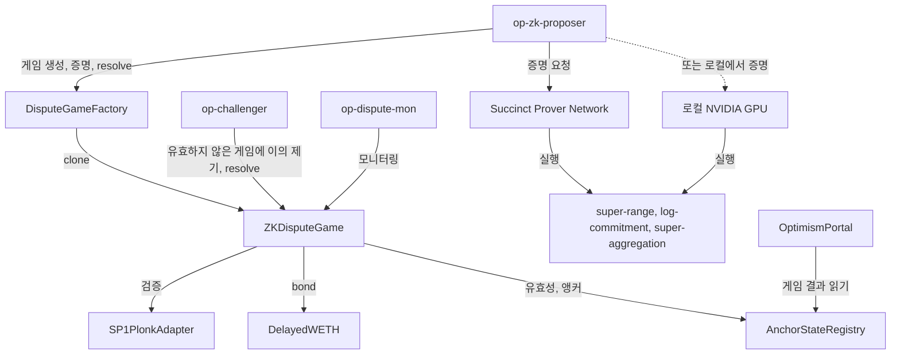

import { NormativeSpec } from "/ko/snippets/normative-spec.mdx"
import ZkProofsStatus from "/snippets/zk-proofs-status.mdx"

<NormativeSpec
  what="ZK 분쟁 게임의 컨트랙트와 참여자"
  title="ZK 분쟁 게임 명세"
  href="https://specs.optimism.io/fault-proof/stage-one/zk/zk-dispute-game.html#contracts-involved"
  note="이 페이지는 해당 컨트랙트를 OP Stack의 서비스와 연결하여 설명하며, 명세 내용을 다시 서술하지 않습니다."
/>

<ZkProofsStatus />

ZK 증명 시스템은 세 부분으로 구성됩니다. 제안을 보관하고 분쟁을 해결하는 L1 컨트랙트, 증명을 생성하는 프로그램, 그리고 제안·이의 제기·증명·모니터링을 수행하는 오프체인 서비스입니다.

## L1 컨트랙트 {#l1-contracts}

| 컨트랙트 | 역할 |
| --- | --- |
| `DisputeGameFactory` | 각 제안에 대해 게임을 생성합니다. 게임은 등록된 구현의 clone에 체인의 구성을 덧붙인 형태입니다. 각 게임 유형에 필요한 init bond를 저장합니다. |
| `ZKDisputeGame` | 제안당 하나의 게임입니다. 이의 제기, 증명, resolve 생명주기를 실행하고 bond를 추적합니다. [ZK 분쟁 게임](/ko/op-stack/zk-proofs/zk-dispute-game)을 참고하십시오. |
| `SP1PlonkAdapter` | 게임이 호출하는 verifier입니다. Succinct의 SP1 PLONK verifier 위에 범용 `IZKVerifier` 인터페이스를 구현합니다. |
| `AnchorStateRegistry` | 새 게임이 기반으로 삼는 앵커 상태, respected game type, Guardian의 블랙리스트와 retirement 타임스탬프를 기록합니다. 게임 결과가 언제 최종 확정되는지 결정합니다. |
| `DelayedWETH` | 모든 bond를 보관하며, 잘못된 게임의 자금을 보류할 수 있도록 지급을 지연합니다. Guardian은 출금을 일시 중지할 수 있고, `ProxyAdmin` 소유자는 자금을 보류하거나 회수할 수 있습니다. |
| `OptimismPortal` | `AnchorStateRegistry`가 유효하다고 판단한 게임을 기준으로 출금을 증명하고 최종 확정합니다. 게임의 super root에서 해당 체인의 output root를 읽습니다. |
| `OPContractsManager` | 릴리스의 게임 구현을 각 체인의 `DisputeGameFactory`에 등록하고, prestate와 verifier를 포함한 각 체인의 게임 구성을 설정합니다. |

## 증명 프로그램 {#proof-programs}

[SP1](https://github.com/succinctlabs/sp1) 프로그램인 `super-range`, `log-commitment`, `super-aggregation`이 증명을 생성합니다. 이 프로그램들은 OP Stack 상태 전이의 Kona 구현을 기반으로 빌드되며, `kona-sp1-program` 릴리스로 함께 배포됩니다. [ZK 증명 시스템](/ko/op-stack/zk-proofs/proof-system)을 참고하십시오.

## 오프체인 서비스 {#off-chain-services}

| 서비스 | 역할 | 운영 주체 |
| --- | --- | --- |
| [`op-zk-proposer`](/ko/op-stack/components/op-zk-proposer) | 고정된 간격으로 체인의 super root를 제안하고, 이의가 제기된 게임에 대한 증명을 생성하여 제출하며, 게임을 resolve하고 bond를 청구합니다. 선택적으로 [빠른 최종성(fast finality)](/ko/op-stack/zk-proofs/explainer#fast-finality)을 위해 자신이 생성한 모든 게임을 증명할 수 있습니다. | 체인 운영자 |
| [`op-challenger`](/ko/op-stack/components/op-challenger) | 모든 ZK 게임의 제안을 자체 super root 소스와 대조하여 검사하고, 유효하지 않은 제안과 실패한 부모의 자식 게임에 이의를 제기하며, 게임을 resolve합니다. | 체인 운영자 및 체인 보안에 기여하려는 누구나 |
| `op-dispute-mon` | 모든 게임을 모니터링하고, 각 제안을 신뢰할 수 있는 node와 비교하며, 조치가 필요한 게임을 보고합니다. [체인 모니터링](/ko/chain-operators/tools/chain-monitoring#dispute-mon)을 참고하십시오. | 체인 운영자 |
| Succinct Prover Network | 독립적인 prover 간의 경매를 통해 요청에 따라 SP1 증명을 생성하며, PROVE로 비용을 지불합니다. | Succinct 및 독립 prover |

proposer와 challenger는 모두 super root 소스에 의존합니다. interop set의 경우 [`op-supernode`](/ko/node-operators/guides/configuration/supernode)를, 단독 체인의 경우 safe head 데이터베이스가 활성화된 체인의 `op-node`를 사용합니다. proposer는 증명이 읽는 데이터를 수집하기 위해 L1 execution node와 beacon node, 그리고 각 체인의 L2 execution node도 필요합니다.

## 다음 단계 {#next-steps}

*   [`op-zk-proposer`](/ko/chain-operators/guides/configuration/zk-proposer)를 설정하십시오.
*   [ZK 분쟁 게임용 `op-challenger`](/ko/chain-operators/guides/configuration/zk-challenger)를 설정하십시오.
*   [ZK 증명 보안](/ko/op-stack/zk-proofs/security)을 읽어 보십시오.
