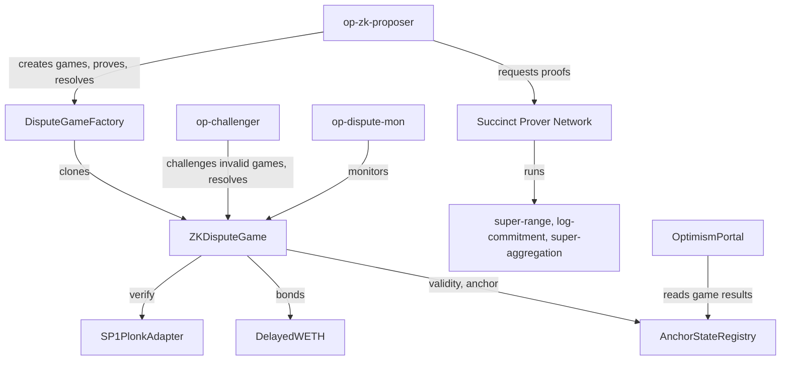

import { NormativeSpec } from "/snippets/normative-spec.mdx"
import ZkProofsStatus from "/snippets/zk-proofs-status.mdx"

<NormativeSpec
  what="The ZK dispute game's contracts and actors"
  title="ZK dispute game specification"
  href="https://specs.optimism.io/fault-proof/stage-one/zk/zk-dispute-game.html#contracts-involved"
  note="This page maps those contracts to the OP Stack's services; it does not restate the spec."
/>

<ZkProofsStatus />

The ZK proof system has three parts: contracts on L1 that hold proposals and settle disputes, programs that produce proofs, and off-chain services that propose, challenge, prove, and monitor.

## L1 contracts

| Contract | Role |
| --- | --- |
| `DisputeGameFactory` | Creates a game for each proposal, as a clone of the registered implementation with the chain's configuration appended. Holds the init bond for each game type. |
| `ZKDisputeGame` | One game per proposal. Runs the challenge, prove, and resolve lifecycle and tracks bonds. See [ZK dispute game](/op-stack/zk-proofs/zk-dispute-game). |
| `SP1PlonkAdapter` | The verifier that games call. Implements the generic `IZKVerifier` interface on top of Succinct's SP1 PLONK verifier. |
| `AnchorStateRegistry` | Records the anchor state that new games build on, the respected game type, and the Guardian's blacklist and retirement timestamp. Decides when a game's result is final. |
| `DelayedWETH` | Holds every bond, and delays payouts so the Guardian can recover funds from an incorrect game. |
| `OptimismPortal` | Proves and finalizes withdrawals against games that the `AnchorStateRegistry` considers valid. Reads the chain's own output root from the game's super root. |
| `OPContractsManager` | Deploys the game implementation and sets each chain's game configuration, including its prestate and verifier. |

## Proof programs

The [SP1](https://github.com/succinctlabs/sp1) programs `super-range`, `log-commitment`, and `super-aggregation` produce the proofs. They are built from the Kona implementation of the OP Stack state transition and released together as `kona-sp1-program` releases. See [ZK proof system](/op-stack/zk-proofs/proof-system).

## Off-chain services

| Service | Role | Who runs it |
| --- | --- | --- |
| [`op-zk-proposer`](/op-stack/components/op-zk-proposer) | Proposes the chain's super root on a fixed interval, generates and submits proofs for challenged games, resolves games, and claims bonds. Optionally proves every game it creates, for [fast finality](/op-stack/zk-proofs/explainer#fast-finality). | The chain operator |
| [`op-challenger`](/op-stack/components/op-challenger) | Checks every ZK game's proposal against its own super root source, challenges invalid proposals and children of failed parents, and resolves games. | The chain operator, and anyone else who wants to help secure the chain |
| `op-dispute-mon` | Monitors every game, compares each proposal with trusted nodes, and reports games that need action. See [Chain monitoring](/chain-operators/tools/chain-monitoring#dispute-mon). | The chain operator |
| Succinct Prover Network | Generates SP1 proofs on request, through an auction between independent provers, paid in PROVE. | Succinct and independent provers |

The proposer and challenger both depend on a source of super roots: an [`op-supernode`](/node-operators/guides/configuration/supernode) for an interop set, or the chain's `op-node` with its safe head database enabled for a chain on its own. The proposer also needs L1 execution and beacon nodes and an L2 execution node for each chain, to collect the data a proof reads.

## Next steps

*   Set up [`op-zk-proposer`](/chain-operators/guides/configuration/zk-proposer).
*   Set up [`op-challenger` for ZK dispute games](/chain-operators/guides/configuration/zk-challenger).
*   Read [ZK proofs security](/op-stack/zk-proofs/security).
